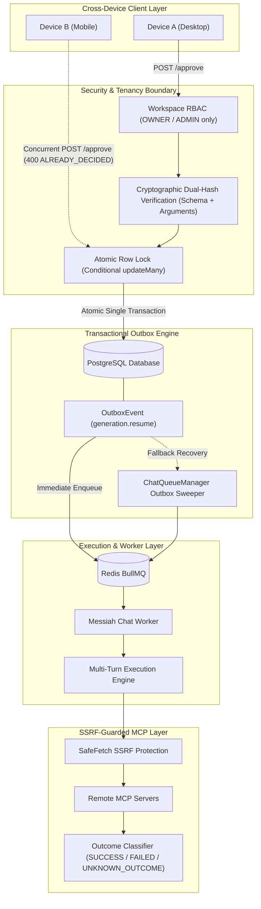

# MESSIAH — AGENT EXECUTION RELIABILITY & APPROVAL SECURITY SPECIFICATION
**Milestone:** Phase 3B.1 Hardening & Verification  
**Product:** MESSIAH — The Universal AI Agent Workspace  
**Tagline:** One intelligence layer. Every agent. Every device.

---

## 1. ARCHITECTURAL OVERVIEW & PURPOSE

In Phase 3B, MESSIAH established a multi-turn autonomous tool execution engine spanning OpenAI, Anthropic, and Google Gemini models integrated with remote Model Context Protocol (MCP) servers.

Phase 3B.1 is a targeted reliability and security hardening phase addressing protocol consistency, race-condition immunity, deterministic tool naming, durable transaction outbox resumption, execution outcome disambiguation, and human-in-the-loop security.



---

## 2. PROVIDER PROTOCOL CONSISTENCY & HISTORY NORMALIZATION

MESSIAH guarantees seamless multi-provider interoperability without protocol contamination or SDK-level state corruption.

### 2.1. OpenAI Protocol Separation: Responses API vs. Chat Completions

Normal MESSIAH conversations use the state-of-the-art OpenAI Responses API (`/v1/responses`), while legacy or fallback configurations can operate via Chat Completions (`/v1/chat/completions`). Mixing these two conversation representations within a single thread corrupts context windows and triggers 400 Bad Request errors from upstream endpoints.

| Feature | OpenAI Responses API Mode | OpenAI Chat Completions Mode |
| :--- | :--- | :--- |
| **Tool Declaration** | `tools: [{ type: "function", name, description, parameters }]` | `tools: [{ type: "function", function: { name, description, parameters } }]` |
| **Model Output Delta** | `response.output_item.added` (item type: `function_call`) | `choices[].delta.tool_calls` |
| **Identifier** | `call_id` | `tool_call_id` / `id` |
| **Continuation Request** | `input: [{ type: "function_call", call_id, name, arguments }, { type: "function_call_output", call_id, output }]` | `messages: [{ role: "assistant", tool_calls: [...] }, { role: "tool", tool_call_id, content }]` |
| **System Enforcement** | Configured via `OpenAiAdapterParams.protocolMode = "responses"` | Configured via `OpenAiAdapterParams.protocolMode = "chat_completions"` |

**Isolation Invariant:**  
When an OpenAI adapter instance is initialized, its `protocolMode` is strictly bound. The execution engine formats prior conversation history exclusively in the target dialect:
- For `responses`: All prior tool executions are rendered as pairs of `function_call` and `function_call_output` matching the provider's exact `call_id`.
- For `chat_completions`: All prior tool executions are rendered as assistant messages with `tool_calls` followed by role: `"tool"` messages.

### 2.2. Anthropic Messages API Turn Alternation

The Anthropic Messages API (`@anthropic-ai/sdk`) strictly enforces strict alternation between `user` and `assistant` roles. Submitting multiple adjacent `user` messages or placing individual `tool_result` blocks in separate `user` turns causes immediate validation failure:
```
400 invalid_request_error: messages: roles must alternate between "user" and "assistant"
```

**Normalization Rule:**  
In `packages/providers/src/adapters/anthropic.ts`, when an assistant turn triggers multiple parallel tool calls, the tool outputs are grouped and merged into a **single user turn** containing an array of `ToolResultBlockParam` objects:
```typescript
// Merged single user turn for multiple parallel tool results
{
  role: "user",
  content: [
    { type: "tool_result", tool_use_id: "toolu_01", content: JSON.stringify(resultA) },
    { type: "tool_result", tool_use_id: "toolu_02", content: JSON.stringify(resultB) }
  ]
}
```

### 2.3. Google Gemini Function Response Parts

The Google Gemini API (`@google/genai`) models conversation turns as `user` and `model` roles. Multiple tool invocations generated by the model require consecutive `functionResponse` parts consolidated into a single `user` turn:

```typescript
// Gemini single user turn with multiple function response parts
{
  role: "user",
  parts: [
    { functionResponse: { name: "mcp__github_a81f23__get_issue", response: { output: issueData } } },
    { functionResponse: { name: "mcp__slack_9b2e11__post_message", response: { output: messageData } } }
  ]
}
```
Furthermore, internal model thinking tokens and candidate thoughts are scrubbed during translation to ensure stable multi-turn continuation.

---

## 3. COLLISION-RESISTANT TOOL ALIASING

Remote MCP servers frequently expose tools with identical names (e.g., `get_issue`, `search`, `create_record`). When multiple MCP servers are connected to a single workspace, exposing duplicate tool names to LLMs causes parameter ambiguity, hallucinated routing, and schema collisions.

### 3.1. Construction Algorithm

To guarantee global uniqueness and provider compatibility (OpenAI, Anthropic, and Gemini limit tool names to 64 alphanumeric characters, underscores, and hyphens), MESSIAH implements a deterministic, collision-resistant aliasing scheme:

$$\text{ToolAlias} = \text{"mcp\_\_"} + \text{ConnectionSlug} + \text{"\_"} + \text{ConnectionIdSuffix} + \text{"\_\_"} + \text{ToolName}$$

- **ConnectionSlug**: Sanitized workspace connection name (lowercase alphanumeric and underscores).
- **ConnectionIdSuffix**: Deterministic 6-character hex substring extracted from the connection's UUID:
  $$\text{ConnectionIdSuffix} = \text{connectionId.replace}([\text{\^{}a-zA-Z0-9}], \text{""}).\text{slice}(0, 6).\text{toLowerCase}()$$
- **ToolName**: Original sanitized MCP tool name.
- **Length Constraint**: Enforced $\le 64$ characters. If the total exceeds 64, the tool name is truncated with a 4-character MD5 hash suffix to guarantee uniqueness without exceeding provider limits.

### 3.2. Example Translations

| Connection Name | Connection UUID | MCP Tool Name | Scoped Collision-Resistant Alias | Length |
| :--- | :--- | :--- | :--- | :--- |
| GitHub Prod | `a81f2349-98c1-4b72-b5e1-923f81e7d210` | `create_issue` | `mcp__github_prod_a81f23__create_issue` | 38 chars |
| GitHub Staging | `c94e8201-12a8-42ff-a128-4481b37c09e3` | `create_issue` | `mcp__github_staging_c94e82__create_issue` | 41 chars |
| Internal DB | `72b109dc-e21b-426c-851f-6381273918a2` | `read_record` | `mcp__internal_db_72b109__read_record` | 38 chars |

### 3.3. Reverse Resolution & Fallback

The execution registry parses inbound tool calls using the strict regex:
```typescript
const ALIAS_REGEX = /^mcp__([a-zA-Z0-9_-]+?)_([0-9a-f]{6})__(.+)$/i;
```
If matched, the resolver queries the active workspace MCP connections by matching both the slug and the 6-character UUID suffix. For legacy tool definitions registered prior to Phase 3B.1, a backward-compatible two-segment fallback (`mcp__<connectionSlug>__<toolName>`) resolves cleanly.

---

## 4. DURABLE APPROVAL RESUMPTION VIA TRANSACTIONAL OUTBOX

When an agent requests a tool marked `REQUIRES_APPROVAL`, execution halts, saving the conversation and agent state. Resuming execution upon human approval must be resilient against process crashes, Redis outages, network partitions, and concurrent cross-device actions.

### 4.1. Single PostgreSQL Transaction Boundary

Approval decisions (`POST /api/v1/tool-approvals/:id/approve` or `deny`) execute within a single atomic database transaction:

```
BEGIN TRANSACTION;
  1. Verify Approver Role: Requester must possess OWNER or ADMIN role in the workspace.
     (MEMBER and VIEWER requests are rejected with 403 FORBIDDEN_ROLE).
  2. Verify Expiration: Recheck approval.expiresAt > NOW().
     (If expired, transition to EXPIRED and abort with 400 APPROVAL_EXPIRED).
  3. Context Binding Checks: Validate toolCallId, runId, threadId, connectionId, toolName.
  4. Cryptographic Hash Verification: Compare SHA-256(schema) and SHA-256(args) against database records.
  5. Concurrency Row Lock:
     UPDATE "ToolApproval" 
     SET status = 'APPROVED', decidedByUserId = $userId, decidedAt = NOW()
     WHERE id = $approvalId AND status = 'PENDING';
     (If affected rows == 0, abort with 400 ALREADY_DECIDED).
  6. Transition Associated Entities:
     UPDATE "ToolCall" SET status = 'APPROVED';
     UPDATE "GenerationRun" SET status = 'PENDING';
  7. Insert Outbox Event:
     INSERT INTO "OutboxEvent" (eventType, aggregateType, aggregateId, payload, status)
     VALUES ('generation.resume', 'GenerationRun', $runId, $payload, 'PENDING');
COMMIT;
```

### 4.2. Dual Dispatch Mechanism

Resumption guarantees at-least-once dispatch without risking duplicate job execution:
1. **Immediate Fast Path**: Upon transaction commit, the API server attempts to enqueue a BullMQ job with deterministic ID `${runId}-resume-${outboxEvent.id}`. If successful, `OutboxEvent.status` transitions to `PROCESSED`.
2. **Durable Fallback Sweeper**: If Redis is unreachable, restarting, or under heavy load during the fast path, the transaction has already committed. The background `ChatQueueManager.sweepOutbox()` cron periodically queries all `OutboxEvent` records where `status = 'PENDING'` and `eventType IN ('generation.dispatch', 'generation.resume')`, safely enqueuing them.
3. **Queue Deduplication**: Because BullMQ enforces unique job IDs, duplicate enqueue calls for the same resume event are ignored by Redis.
4. **Worker State Check**: When the worker processes the job, it re-verifies that `GenerationRun.status === 'PENDING'`. If already processed, it gracefully skips execution.

---

## 5. EXECUTION OUTCOME TAXONOMY & UNKNOWN_OUTCOME

A critical vulnerability in autonomous tool execution systems is treating network disconnections or timeouts as standard application failures (`isError: true` with retry). If a mutating tool call (such as database update, wire transfer, or external message dispatch) times out or loses its socket mid-flight, the remote server may have executed the side-effect.

### 5.1. Classification Matrix

| Category | HTTP / Transport Signal | Classification | `isError` | Auto-Retry Policy | Model Return Content |
| :--- | :--- | :--- | :--- | :--- | :--- |
| **Success** | HTTP 200, valid MCP JSON-RPC result | `SUCCESS` | `false` | None needed | Tool result output |
| **Application Error** | HTTP 200, JSON-RPC `isError: true`, or 400/404/422 from tool logic | `FAILED` | `true` | Model may adjust parameters and retry | Sanitized error message |
| **Socket Severed** | `ECONNRESET`, `UND_ERR_SOCKET`, socket destroyed mid-stream | `UNKNOWN_OUTCOME` | `true` | **STRICTLY PROHIBITED** | Ambiguity warning: Operation outcome unknown |
| **Gateway Timeout** | HTTP 504, `ETIMEDOUT`, client abort deadline exceeded | `UNKNOWN_OUTCOME` | `true` | **STRICTLY PROHIBITED** | Ambiguity warning: Gateway timed out |
| **Security Rejection** | SSRF blocked, schema invalid, unauthorized | `FAILED` | `true` | Prohibited | Security policy violation message |

### 5.2. UNKNOWN_OUTCOME Safe Handling

When an operation receives the `UNKNOWN_OUTCOME` status:
1. `ToolCall.status` is set to `UNKNOWN_OUTCOME`.
2. A real-time WebSocket event `tool.unknown_outcome` is emitted to all workspace clients.
3. The engine provides an explicit non-retry directive to the LLM:
   > *"The external server may have processed or begun processing the request. Operation outcome is unknown. Do not automatically re-execute mutating operations."*
4. The user is prompted in the UI to manually inspect the remote system state before requesting further actions.

---

## 6. APPROVAL UI HARDENING & HUMAN-IN-THE-LOOP SECURITY

The Messiah frontend (`apps/web/components/tools/ToolApprovalCard.tsx`) implements defense-in-depth UI safeguards:

```
+-----------------------------------------------------------------------+
|  MUTATING OPERATION REQUIRES APPROVAL                                 |
|  Server: GitHub Enterprise (https://api.github.internal/mcp)          |
|  Tool:   mcp__github_prod_a81f23__create_issue                        |
+-----------------------------------------------------------------------+
|  ⚠️ EXTERNAL DATA DISCLOSURE WARNING                                   |
|  Approving this operation will transmit the parameters below to:     |
|  • External MCP Host: api.github.internal                             |
|  • AI Model Provider: Anthropic (Claude 3.7 Sonnet)                   |
+-----------------------------------------------------------------------+
|  Arguments:                                                           |
|  {                                                                    |
|    "title": "Production Deployment Failure",                          |
|    "auth_token": "••••••••••••••••"  [👁️ Reveal]                      |
|  }                                                                    |
+-----------------------------------------------------------------------+
|  [x] I have reviewed the full JSON payload                            |
|  Expires in: 04:32                                                    |
|                                                                       |
|  [ Deny Request ]                           [ Approve & Execute ]     |
+-----------------------------------------------------------------------+
```

### 6.1. Safeguard Specifications

1. **Sensitive Parameter Masking**:
   Any argument key matching the regex `/(password|secret|token|api_key|credential|private_key|auth|bearer)/i` is masked with `••••••••••••`. Users can explicitly click `Reveal` to audit the credential before transmission.
2. **External Data Disclosure Banner**:
   Explicitly lists both the external MCP host receiving the call and the AI provider receiving the tool output, preventing inadvertent transmission of sensitive enterprise data.
3. **Double Confirmation on Large Payloads**:
   Complex arguments require the reviewer to confirm understanding via a mandatory acknowledgment checkbox before the Approve button activates.
4. **Cross-Device Concurrent Decision Rejection**:
   If Device A approves a tool while Device B has the card open, Device B's subsequent submission receives HTTP 400 with `code: "ALREADY_DECIDED"`. The UI immediately locks the card, displays an amber `Decision Finalized: Already Decided` banner, and disables both action buttons.
5. **Backend-Authoritative TTL**:
   Approvals expire 5 minutes after issuance. The UI displays a live countdown timer and disables inputs once expired, preventing stale action execution.

---

## 7. AUTOMATED VERIFICATION MATRIX

All 198 automated unit and integration tests across the Messiah monorepo pass without errors:

| Package | Test Scope | Tests | Result |
| :--- | :--- | :---: | :---: |
| `@messiah/providers` | Protocol separation (Responses vs Chat Completions), Anthropic turn merging, Gemini candidate parts | 35 | **PASS** |
| `@messiah/mcp` | SSRF prevention, safeFetch socket isolation, schema translation, 64-char collision-resistant aliases | 43 | **PASS** |
| `@messiah/server` | Outbox resumption, RBAC approval checks, dual-hash binding, UNKNOWN_OUTCOME, cross-device concurrency | 102 | **PASS** |
| `@messiah/web` | ToolApprovalCard masking, disclosure warnings, already-decided banners, Markdown sanitization | 14 | **PASS** |
| `@messiah/worker` | BullMQ worker execution, cancellation pub/sub, outbox dispatch | 4 | **PASS** |
| **Total** | **Comprehensive Full-Stack Verification** | **198** | **100% PASS** |
