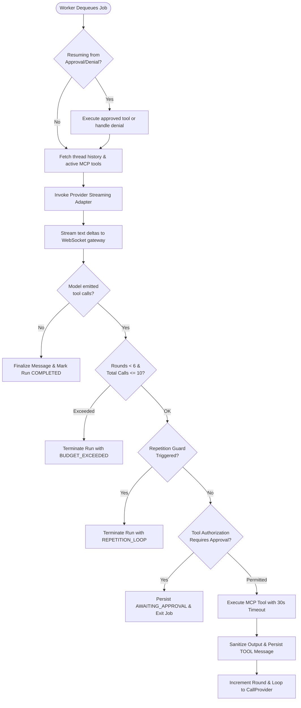

# MESSIAH — Multi-Turn Agent Orchestration & The ReAct Loop

## 1. Overview

Messiah's agent engine implements a robust **Reasoning + Action (ReAct)** loop executed within the isolated background worker process (`@messiah/worker`). 

The engine enables AI models to iteratively think, emit tool execution requests, receive sanitized tool outputs, and refine their responses across multiple conversation turns.

---

## 2. Orchestration Architecture

The multi-turn agent loop is hosted directly inside `apps/worker/src/worker.ts` and operates under strict resource bounds:

---

## 3. Execution Budgets & Defensive Bounds

To guarantee worker availability and protect against infinite agentic recursion, Messiah enforces five invariant constraints:

1. **Maximum Multi-Turn Rounds**: Hard limit of **6 rounds** per generation run.
2. **Maximum Cumulative Tool Calls**: Hard limit of **10 tool calls** across all rounds.
3. **Repetition Guard**:
   - The engine tracks hashes of `(toolName, canonicalArguments)` within the current run.
   - If the exact same tool is invoked with the exact same arguments **3 consecutive times**, the engine terminates the loop with `REPETITION_GUARD_TRIGGERED` to prevent cost runaway.
4. **Per-Call Timeout**:
   - Every MCP tool execution is capped at **30,000 milliseconds** via `AbortController`.
5. **Run Wall-Clock Deadline**:
   - Total run duration cannot exceed **10 minutes (600,000ms)**. If exceeded, reconciliation and timeout checks mark the run as `FAILED`.

---

## 4. Cross-Provider Message History Reconstruction

Different model providers require different message schemas for tool calls and tool responses:

### 1. OpenAI (Responses API / Chat Completions)
- Assistant turn includes `tool_calls: [{ id, type: "function", function: { name, arguments } }]`.
- Tool response turn follows with `role: "tool"`, `tool_call_id: id`, and `content: string`.

### 2. Anthropic (Messages API)
- Assistant turn includes content blocks: `[{ type: "text", text }, { type: "tool_use", id, name, input }]`.
- User turn follows containing tool result blocks: `[{ type: "tool_result", tool_use_id: id, content: string, is_error: boolean }]`.

### 3. Google Gemini (`@google/genai`)
- Model turn includes parts: `[{ functionCall: { name, args } }]`.
- User turn follows with function response parts: `[{ functionResponse: { name, response: { content: string } } }]`.

Messiah's `ChatExecutionEngine` stores messages in a provider-agnostic format in PostgreSQL (`MessageRole` enum: `USER`, `ASSISTANT`, `SYSTEM`, `TOOL`) and normalizes history on-the-fly when dispatching to any of the three providers.

---

## 5. Cancellation & Partial Completion

When a user clicks "Stop" or issues a cancellation request:
1. Cancellation service sets `cancellationRequestedAt` on the `GenerationRun` and publishes to Redis Pub/Sub channel `channel:cancel:<runId>`.
2. The active worker thread checks its `AbortController` and Redis subscription.
3. If an MCP tool is currently executing via HTTP, the underlying `AbortSignal` immediately aborts the connection.
4. Any partial text streamed up to that point is preserved in the database with status `CANCELLED`.
5. Outbox events and WebSocket gateway broadcast `run.cancelled`.
