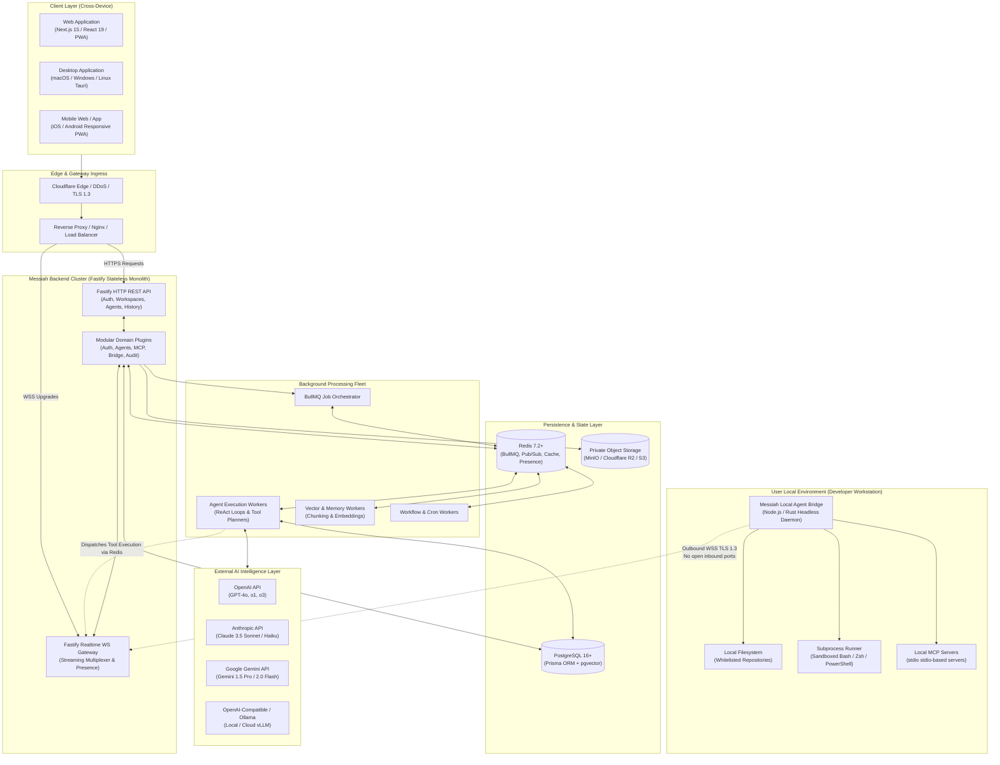
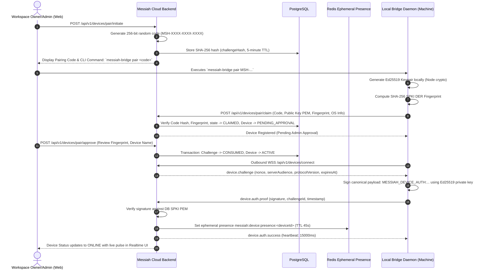
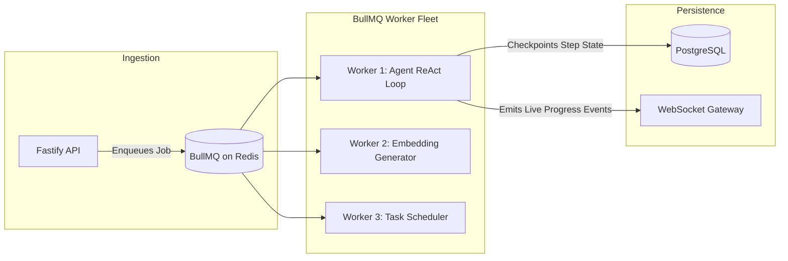
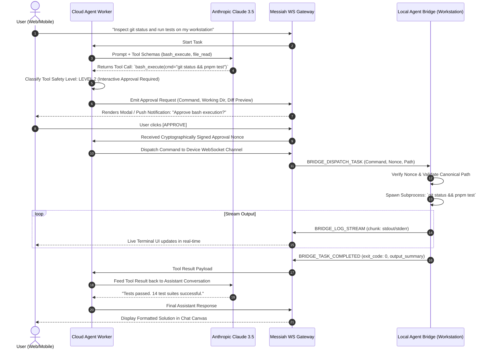

# MESSIAH — SYSTEM ARCHITECTURE SPECIFICATION

> **Document Stage**: Phase 0 — Architecture & Discovery  
> **Version**: 1.0.0  
> **Target Status**: Production Blueprint

---

## 1. System Overview & Architectural Paradigm

Messiah is designed as a **High-Throughput Modular Monolith** with distributed asynchronous workers.

### 1.1 Architectural Evaluation: Modular Monolith vs. Microservices

A common architectural antipattern in modern AI platforms is premature decomposition into dozens of microservices (e.g., an "auth service", "chat service", "agent service", and "device service"). For Messiah, microservice sprawl introduces:

- Network serialization latency between internal services, degrading realtime token streaming.
- Distributed transaction complexity across chat history, task states, and tool approvals.
- High operational cognitive load and costly multi-cluster orchestration for small-to-medium teams.

Instead, Messiah utilizes a **Modular Monolith** backend built on Fastify:

- **Single Process Core, Multiple Domain Modules**: Strict encapsulation of domain boundaries using Fastify plugins (`fastify-plugin`). Internal modules communicate via typed in-memory interfaces and a unified database client.
- **Asynchronous Work Offloading & State Authority**: CPU-intensive and long-running operations (agent reasoning loops, bridge task queuing) are dispatched via **BullMQ** onto decoupled background worker processes. PostgreSQL and durable background jobs remain authoritative for persistent task states and execution checkpoints.
- **Ephemeral Realtime Distribution**: Redis Pub/Sub is leveraged strictly for ephemeral realtime distribution (token chunks, presence, terminal log streaming), not durable task storage.
- **Horizontal Elasticity**: The Fastify 5 HTTP/WebSocket server is completely stateless. Multiple instances scale out behind a reverse proxy (e.g., Cloudflare / Nginx / Traefik), synchronizing ephemeral realtime events and connection states across instances via **Redis Pub/Sub** and **Redis Hashes**.

---

## 2. High-Level Architecture Topology



---

## 3. Frontend Architecture

### 3.1 Technology Stack & Directory Conventions

- **Framework**: Next.js 16 (App Router), React 19, TypeScript (Strict Mode).
- **Styling**: Tailwind CSS with custom CSS variables for obsidian/neon tokens.
- **Component Primitives**: shadcn/ui (Radix UI headless primitives for WCAG-compliant accessibility).
- **Animation**: Framer Motion for layout transitions, modals, and spring physics.
- **Data Fetching & Server State**: TanStack React Query v5 with optimistic mutations and automatic cache invalidation.
- **Client & Transient State**: Zustand (lightweight stores for active view modes, inspector panels, audio states, terminal drawer size).
- **Optional 3D Engine**: Three.js, React Three Fiber (R3F), and `@react-three/drei` used strictly where a real visual feature benefits from it; kept performance-conscious and optional.

### 3.2 Route & Layout Topology (Phase 1B Implementation)

```
apps/web/
├── proxy.ts                           # Next.js 16 Proxy Convention for Session Refresh & Guards
├── app/
│   ├── layout.tsx                     # Root layout, fonts, dark theme tokens
│   ├── page.tsx                       # Dashboard Command Center (protected)
│   ├── login/page.tsx                 # Email/Password sign-in
│   ├── signup/page.tsx                # User registration & workspace provisioning
│   ├── forgot-password/page.tsx       # Password recovery request
│   ├── reset-password/page.tsx        # Password update completion
│   ├── auth/callback/route.ts         # Supabase Auth code exchange handler
│   └── globals.css                    # Obsidian palette design tokens
├── components/
│   ├── Header.tsx                     # Top bar, user avatar, active workspace, telemetry
│   └── Sidebar.tsx                    # Navigation links & domain triggers
└── lib/
    └── supabase/                      # Isolated Supabase client utilities
        ├── client.ts                  # Browser client (createBrowserClient)
        ├── server.ts                  # Server client (createServerClient + cookies)
        ├── middleware.ts              # Session refresh core (updateSession)
        └── proxy.ts                   # Proxy convention exporter
```
│   │   ├── layout.tsx                 # Responsive Shell (Sidebar, Presence, Nav)
│   │   ├── [workspaceSlug]/
│   │   │   ├── chat/
│   │   │   │   ├── [threadId]/page.tsx # Universal Chat & Swarm Canvas
│   │   │   ├── agents/
│   │   │   │   ├── page.tsx           # Agent Registry & Creation Wizard
│   │   │   ├── devices/
│   │   │   │   ├── page.tsx           # Enrolled Devices & Local Bridge Monitor
│   │   │   ├── workflows/
│   │   │   │   ├── page.tsx           # Visual DAG Automation Builder
│   │   │   ├── settings/
│   │   │   │   ├── providers/page.tsx # AI Model Provider API Key Management
│   │   │   │   └── security/page.tsx  # Audit Logs, MFA, Session Controls
```

### 3.3 3D Agent Swarm & Topology Visualization Pipeline

The 3D canvas represents agents, connected local bridges, active MCP tools, and data transfers as an interactive node constellation:

- **Three.js / React Three Fiber Scene**:
  - **Agent Nodes**: Custom shader-based glowing spheres displaying state (Idle, Thinking, Tool Invocation, Error) through color and vertex displacement.
  - **Connection Arcs**: Dynamic quadratic bezier curves connecting communicating agents, populated with animated instanced point particles representing token streaming velocity.
  - **Camera Controls**: OrbitControls with locked damping and bounded elevation angles.
- **Accessibility & Hardware Degradation Graceful Fallback**:
  - The client runs a lightweight capability check at initialization:
    ```typescript
    const isLowPower =
      navigator.hardwareConcurrency <= 4 ||
      /Android|iPhone|iPad/i.test(navigator.userAgent);
    const prefersReducedMotion = window.matchMedia(
      "(prefers-reduced-motion: reduce)",
    ).matches;
    ```
  - If low power is detected or `prefersReducedMotion` is active, the 3D canvas is completely bypassed and replaced with a high-performance **2D SVG Force-Directed Graph** rendered via D3-force calculations in a web worker.

### 3.4 Responsive Multi-Pane Desktop & Mobile Shell

The frontend shell adapts dynamically across screen viewports:

- **Desktop (>= 1280px)**: 4-column HUD:
  1. Collapsible Activity Icon Rail (48px).
  2. Workspace & Thread Navigation Drawer (260px).
  3. Central Chat Canvas & Swarm 3D Viewport (Flexible).
  4. Collapsible Inspector / Tool Execution / Terminal Drawer (360px–500px).
- **Tablet / Small Desktop (768px - 1279px)**: 2-column view with sliding modal drawer for tool inspections.
- **Mobile (< 768px)**: Single column focused entirely on conversational interaction and one-tap approval actions, utilizing bottom sheet drawers for context switching.

---

## 4. Backend Architecture

### 4.1 Framework Selection & Performance Rationale

Messiah selects **Fastify 5** running on a currently supported Node.js LTS release (Node.js 24/26 LTS):

- **Low Overhead & High Throughput**: Fastify 5 achieves superior request handling with minimal event-loop latency, which is vital when multiplexing concurrent streaming connections.
- **Native JSON Schema Compilation**: Fastify uses `fast-json-stringify` and `ajv` to compile validation schemas into high-speed serialization functions.
- **Clean Plugin Architecture**: Encapsulates plugins with distinct scoping, preventing accidental global leakages.

### 4.2 Modular Domain Plugins Structure

```
apps/server/src/
├── plugins/
│   ├── core/
│   │   ├── prisma.ts               # Database connection lifecycle
│   │   ├── redis.ts                # Redis client & Pub/Sub connectors
│   │   ├── auth.ts                 # Supabase JWT validation & RBAC guards
│   │   ├── websocket.ts            # Fastify WebSocket multiplexer
│   │   └── crypto.ts               # AES-256-GCM envelope encryption helpers
│   └── modules/
│       ├── workspaces/             # Multi-tenant workspace management
│       ├── agents/                 # Agent registry, templates, configuration
│       ├── providers/              # Model connectors (OpenAI, Anthropic, Gemini)
│       ├── mcp/                    # Model Context Protocol client engine
│       ├── chat/                   # Conversation threads, messages, branching
│       ├── devices/                # Device registry, pairing token generator
│       ├── bridge/                 # Local Agent Bridge WS dispatcher
│       ├── tasks/                  # Task queues, execution monitoring
│       ├── memory/                 # Vector memory, pgvector queries
│       └── audit/                  # Append-only tamper-evident audit logs
```

### 4.3 Database Access & ORM Layer

- Primary database: **PostgreSQL 16+**.
- Query and Data Modeling: **Prisma ORM** for type-safe database queries, automated schema migrations, and connection pooling.
- High-Performance Vector Storage: **pgvector** native extension accessed via raw Prisma SQL queries (`$queryRaw`) for Cosine Distance (`<=>`) index-accelerated similarity searches.

---

## 5. Realtime Communication Engine & Wire Protocol

### 5.1 Transport Architecture

- Realtime communication is established over **WebSockets (TLS 1.3 / WSS)** using `@fastify/websocket`.
- Client and bridge connections authenticate during the initial HTTP upgrade handshake via `Sec-WebSocket-Protocol` containing a short-lived bearer token, preventing unauthenticated TCP socket allocation.
- **Heartbeat & Liveness**: Bidirectional ping/pong every 30 seconds. Clients failing to reply within 10 seconds are terminated to prevent zombie socket leaks.

### 5.2 Wire Protocol Message Framing

All messages across the WebSocket gateway conform to a standardized JSON envelope:

```typescript
export interface WSEnvelope<T = unknown> {
  id: string; // Unique message UUID
  type: WSMessageType; // Event type enum
  channel: string; // Topic: 'thread:123', 'device:456', 'workspace:789'
  timestamp: number; // Epoch millisecond timestamp
  payload: T; // Strongly typed payload
}

export type WSMessageType =
  // Client -> Server
  | "CLIENT_SUBSCRIBE"
  | "CLIENT_UNSUBSCRIBE"
  | "CLIENT_PROMPT_SUBMIT"
  | "CLIENT_APPROVAL_DECISION"

  // Server -> Client
  | "SERVER_STREAM_CHUNK"
  | "SERVER_AGENT_THINKING"
  | "SERVER_TOOL_CALL_INITIATED"
  | "SERVER_APPROVAL_REQUIRED"
  | "SERVER_TASK_PROGRESS"
  | "SERVER_DEVICE_PRESENCE"
  | "SERVER_ERROR"

  // Bridge <-> Server
  | "BRIDGE_HANDSHAKE"
  | "BRIDGE_HEARTBEAT"
  | "BRIDGE_DISPATCH_TASK"
  | "BRIDGE_LOG_STREAM"
  | "BRIDGE_TASK_COMPLETED";
```

### 5.3 Distributed Scalability with Redis Pub/Sub

When multiple backend instances run in production:

1. Client A connects to Backend Instance 1 and subscribes to `thread:xyz`.
2. Agent Worker finishes an inference step and publishes a token chunk event to Redis channel `ws:thread:xyz`.
3. Backend Instances 1, 2, and 3 receive the Redis Pub/Sub event.
4. Only Instance 1 has an active socket for Client A on `thread:xyz`, so Instance 1 forwards the frame over the local WebSocket to Client A.

---

## 6. Local Agent Bridge Architecture

The Local Agent Bridge is a critical architectural differentiator of Messiah. It allows cloud-orchestrated agents to operate on local developer environments safely without requiring open inbound firewall ports.

### 6.1 Daemon Execution Characteristics

- **Headless Node.js / Rust Daemon**: Engineered to run as an unprivileged background daemon or user-space process (`launchd` on macOS, systemd user service on Linux, Windows Service / Tray app).
- **Resource Footprint**: < 50MB RAM footprint when idle; near-zero CPU usage.
- **Outbound Only**: Does NOT listen on `0.0.0.0` or open any local HTTP/TCP ports. Eliminates attack surfaces from local network eavesdroppers.

### 6.2 Mutual Authentication & Pairing Sequence (Phase 4A Implemented)



### 6.3 Sandboxed Execution Engine & Defense-in-Depth

The Bridge daemon enforces strict local containment using defense-in-depth: explicit capabilities, sandboxing, least privilege, canonical path verification, and human interactive approval (a command blacklist alone is not sufficient):

- **Explicit Capability & Privilege Boundaries**: Tools declare granular permissions (e.g., `fs:read`, `fs:write`, `process:exec`). The bridge enforces least privilege, rejecting actions outside the granted scope.
- **Canonical Path Enclosure**: Bridge configuration requires specifying one or more allowed root paths:
  ```json
  {
    "allowed_roots": [
      "/Users/developer/projects/messiah",
      "/Users/developer/repos"
    ]
  }
  ```
  Every file read, write, or command working directory must resolve via `fs.realpathSync()` to a canonical path prefixed by an allowed root. Any attempt to access `/etc/passwd`, `~/.ssh`, or traverse via `../` throws an uncatchable security exception.
- **Subprocess Execution Quarantine & Interactive Approval**:
  - Environment variables: System environment variables are stripped. Only sanitized base paths (`PATH`, `USER`) and explicitly configured project variables are injected.
  - Interactive approval: Potentially mutating commands require explicit human confirmation.
  - Process limits: Subprocesses are executed under strict CPU time limits and maximum memory constraints. Output streams (`stdout`, `stderr`) are buffered and throttled to prevent terminal buffer flooding.

---

## 7. Asynchronous Task Execution Pipeline



### 7.1 Queue Topology

1. **`agent-task-queue`**: Executes multi-turn LLM reasoning loops. Jobs are assigned priority (High, Normal, Low) and workspace-level concurrency concurrency limits (e.g., max 5 parallel autonomous loops per workspace).
2. **`bridge-dispatch-queue`**: Holds tool commands waiting for an offline bridge to reconnect or awaiting user interactive approval.
3. **`embedding-queue`**: Ingests conversation transcripts and uploaded documentation, computes vector embeddings in batches, and inserts them into `pgvector`.

### 7.2 Checkpointing & Cooperative Cancellation

- **Step Checkpointing**: At the conclusion of every turn (LLM response or tool execution), the worker updates `task_steps` in PostgreSQL. If a worker node crashes or is restarted during deployment, another worker picks up the job and resumes from the last completed step.
- **Cooperative Cancellation**: When a user clicks "Cancel" in the UI, a cancellation flag is written to Redis. The worker checks `isCancelled(taskId)` before every LLM inference call and tool dispatch, ensuring instantaneous termination and preventing unnecessary API token expenses.

---

## 8. End-to-End Execution Sequence: Tool Invocation with HITL



---

## 9. Deployment Topology & Infrastructure Boundaries

```
                                  [ INTERNET ]
                                        |
                            +-----------v-----------+
                            |   Cloudflare Edge     |
                            |  WAF / DDoS / DNS     |
                            +-----------+-----------+
                                        |
                         +--------------v--------------+
                         |      Ingress / TLS Proxy    |
                         |   (Traefik / Nginx / ALB)   |
                         +--------------+--------------+
                                        |
                 +----------------------+----------------------+
                 |                                             |
    +------------v------------+                   +------------v------------+
    |  Next.js Frontend Pods  |                   | Fastify API / WS Pods   |
    |  (Stateless Web Tier)   |                   | (Stateless Backend Tier)|
    +-------------------------+                   +------------+------------+
                                                               |
                                                  +------------+------------+
                                                  | BullMQ Worker Fleet     |
                                                  | (Scale-to-load Workers) |
                                                  +------------+------------+
                                                               |
                 +---------------------------------------------+
                 |
     +-----------v-----------+    +-----------------------+    +-----------------------+
     | Managed PostgreSQL 16 |    | Managed Redis Cluster |    | S3 / Cloudflare R2    |
     | (Primary + Read Replica|    | (Persistence + Pub/Sub|    | (Encrypted Object     |
     |  + pgvector extension) |    |  + Queue Storage)     |    |  Storage for Artifacts)|
     +-----------------------+    +-----------------------+    +-----------------------+
```

### 9.1 Environment Segregation

- **Local Development**: Fully orchestrated via `docker-compose.yml` spinning up PostgreSQL (with pgvector), Redis, MinIO (local S3), the Fastify backend, and the Next.js dev server.
- **Production Infrastructure**: Kubernetes deployment or containerized cloud instances (e.g., AWS ECS, Fly.io, or Render) with managed database instances (Supabase / AWS Aurora Postgres), managed Redis (Upstash / AWS ElastiCache), and Cloudflare R2 object storage.

---

## 10. AI Provider Connectivity & Encrypted Credential Vault (Phase 2A)

Phase 2A introduces the dedicated intelligence integration layer and zero-trust credential vault:

1. **`@messiah/providers` Package**:
   - Encapsulates official provider SDKs (`openai`, `@anthropic-ai/sdk`, `@google/genai`).
   - Normalizes provider capabilities, model lists, and standardized error taxonomies.
   - Enforces zero-token credential verification via non-billable catalog metadata endpoints.
2. **Encrypted Credential Vault**:
   - `AES-256-GCM` authenticated symmetric encryption.
   - 12-byte cryptographically secure random IVs and 16-byte authentication tags.
   - Key versioning (`v1`, `v2`) with KMS abstraction layer (`IKmsService` / `LocalKmsService`).
   - Zero-plaintext persistence: Plaintext API keys never touch disk, database records, logs, or frontend responses.
3. **Workspace Isolation & RBAC**:
   - Every provider connection is strictly scoped to a Workspace.
   - Only `OWNER` and `ADMIN` members may create, update, re-test, or delete provider connections.
   - `MEMBER` and `VIEWER` roles are rejected with HTTP 403 Forbidden.
   - Cross-workspace queries are strictly rejected with HTTP 404 Not Found to prevent tenant enumeration.

---

## 11. Universal AI Chat & Realtime Streaming Engine (Phase 2B)

Phase 2B introduces conversational intelligence and real-time streaming:

1. **Realtime WebSocket Gateway**:
   - Endpoint: `ws://<host>/api/v1/realtime` backed by `@fastify/websocket`.
   - Authenticated via single-use, 30-second cryptographic connection tickets (`POST /api/v1/realtime/ticket`).
   - Thread subscriptions multiplexed across threads and devices using Redis Pub/Sub.
2. **Asynchronous Generation Engine**:
   - Immediate HTTP return (`201 Created`) with background execution dispatch.
   - Checkpointing to PostgreSQL every 200 characters or 1.5s to preserve state across network hiccups.
   - Concurrency serialization: only 1 active run (`STREAMING`/`PENDING`) per thread.
   - Idempotency key tracking to eliminate duplicate LLM generation runs.
3. **Cancellation & Orphan Reconciliation**:
   - `POST /api/v1/generation-runs/:runId/cancel` signals in-memory `AbortController` to halt provider streams.
   - Startup reconciliation worker heals any orphaned runs into `FAILED` state upon server boot.
4. **Universal Frontend Chat Workspace**:
   - Next.js 16 App Router route `/chat` (and `/chat/[threadId]`).
   - Real-time token streaming with live cursor, markdown parser with code highlighting, stop controls, and provider/model selector.

---

## 12. Execution Reliability & Security Hardening (Phase 2B.1)

Phase 2B.1 hardens the asynchronous conversation execution pipeline for enterprise-grade concurrency and security:

1. **Database-Enforced Concurrency & Idempotency**:
   - **PostgreSQL Partial Unique Index**: `idx_generation_runs_single_active_per_thread` on `generation_runs("thread_id") WHERE status IN ('PENDING', 'STREAMING')` guarantees at most one active generation per thread at the storage layer, eliminating application-level race conditions.
   - **Canonical SHA-256 Request Fingerprinting**: Request inputs are deterministically hashed. Reused idempotency keys with matching payloads replay the existing run (HTTP 200); reused keys with modified inputs are rejected (HTTP 422 `IDEMPOTENCY_KEY_REUSED_WITH_DIFFERENT_PAYLOAD`).
2. **Durable Background Execution (BullMQ + Transactional Outbox)**:
   - Dedicated `@messiah/worker` package with BullMQ queue (`messiah-chat-generation`).
   - Transactional Outbox pattern guarantees zero message loss across Redis network partitions.
   - Strict zero-retry policy (`attempts: 1`) on external LLM calls to prevent duplicate billing and financial exhaustion.
3. **Cross-Worker Distributed Cancellation**:
   - `cancellationService.requestCancellation(runId)` broadcasts abort signals across worker fleets via Redis Pub/Sub (`messiah:cancel:<runId>`).
   - Active worker instances intercept messages and invoke in-memory `AbortController.abort()`.
   - Immutable terminal state guarantees: runs in `COMPLETED`, `FAILED`, `CANCELLED`, or `INTERRUPTED` cannot be cancelled.
4. **WebSocket Production Security**:
   - Strict origin validation against `MESSIAH_ALLOWED_ORIGINS` in production (`NODE_ENV === "production"`). Localhost and 127.0.0.1 are never automatically trusted in production; untrusted origins are severed with RFC-compliant code 4403.
5. **Frontend Markdown Sanitization**:
   - Defense-in-depth URL protocol validation (`isSafeUrl`) allowing only `https:`, `http:`, `mailto:`, and relative paths; strictly disallowing `javascript:`, `data:`, `vbscript:`, `file:`.
   - Raw HTML entity escaping and mandatory `target="_blank" rel="noopener noreferrer"` attributes.

---

## 13. Model Context Protocol (MCP) Connections & Tool Registry (Phase 3A)

Phase 3A introduces remote MCP connection management and discovery conforming to the **2026-07-28 MCP Specification**:

1. **Dedicated Protocol Package (`@messiah/mcp`)**:
   - Official split packages: `@modelcontextprotocol/client` and `@modelcontextprotocol/core` (v2.4.0).
   - `McpTransportFactory`: Streamable HTTP remote transport (`StreamableHTTPClientTransport`) with legacy SSE fallback (`SSEClientTransport`). Zero stdio child process spawning.
   - `McpClientFactory`: Instantiates standard clients declaring capabilities (`roots`, `sampling`).
   - `McpConnectionManager`: Scoped session tracking partitioned by `workspaceId -> connectionId`.
2. **SSRF & Network Security Layer**:
   - Blocks private IPv4/IPv6, loopbacks (`127.0.0.1`), link-local, carrier-grade NAT, and cloud metadata (`169.254.169.254`, `fd00:ec2::254`).
   - Enforces HTTPS in production; blocks restricted system ports.
   - Socket-level DNS rebinding defense (`createSafeLookup` / `safeFetch`) hooks directly into socket connection to eliminate TOCTOU rebinding races.
3. **Deterministic Discovery & Schema Hashing**:
   - Unambiguous namespaced identifiers: `serverIdentifier.toolName`.
   - Deterministic SHA-256 `schemaHash` computed across canonical JSON to detect schema drift.
4. **Deny-by-Default Governance & Workspace Isolation**:
   - All newly discovered tools default to `REQUIRE_APPROVAL`.
   - Server annotations are informational metadata and never grant automatic authorization.
   - Model-triggered execution is strictly frozen in Phase 3A (`assertExecutionDisabled`).
5. **Obsidian Dark MCP Connection Center**:
   - Next.js 16 route `/settings/mcp` and detail route `/settings/mcp/[connectionId]`.
   - Live health testing, latency measurement, tool inspection, and permission management.

---

## 14. MCP Tool Execution & Controlled Multi-Turn Agent Engine (Phase 3B)

Phase 3B unlocks governed, multi-turn tool execution across all supported AI models:

1. **AI Gateway & Safe Tool Namespacing**:
   - Universal tool aliasing (`mcp__<connectionSlug>__<toolName>`) capped at 64 characters (`[a-zA-Z0-9_]`).
   - Provider-specific schema adapters for OpenAI (Responses API / Chat Completions), Anthropic (Messages API `tool_use`), and Google Gemini (`@google/genai` `functionDeclarations`).
2. **Deterministic Validation & Execution Pipeline**:
   - Pre-execution Ajv JSON Schema validation (Draft-07 / 2020-12) rejecting remote `$ref` URIs, payloads $> 64\text{KB}$, and nesting depth $> 10$.
   - Tool calls dispatched via official MCP TypeScript Client (`@modelcontextprotocol/client` v2) over SSRF-protected `safeFetch` with a strict 30,000ms timeout.
3. **Single-Use Human-in-the-Loop Approval Governance**:
   - Single-use authorization tokens with 5-minute dynamic TTL.
   - Dual SHA-256 cryptographic binding (`schemaHash` and `argumentsHash`). Any mutation between authorization and execution aborts the run.
   - Non-blocking worker lifecycle: BullMQ workers transition the run to `AWAITING_APPROVAL` and exit immediately without blocking node threads. Resumed runs re-enqueue under fresh job identifiers (`${runId}-resume-${timestamp}`).
4. **Multi-Turn Agent Loop & Resource Guardrails**:
   - Hard execution budgets: max 6 rounds, max 10 tool calls, max 10-minute wall-clock execution deadline.
   - Repetition guard: aborts on 3 consecutive identical tool calls to prevent agent recursion loops.
5. **Untrusted Data Sanitization & Secret Redaction**:
   - Tool outputs capped at 512KB.
   - Automated credential redaction matching Bearer tokens, OpenAI/Anthropic/Gemini keys, AWS keys, and private key blocks.
   - Strict protocol stripping (`javascript:`, `vbscript:`, `data:text/html`).
   - Tool outputs are strictly passed as `TOOL` messages and never injected into system/developer prompts.

## 15. Agent Execution Reliability & Approval Security (Phase 3B.1)

Phase 3B.1 hardens the multi-turn agent engine against distributed race conditions, transport failures, and cross-provider incompatibilities (detailed in [`docs/AGENT_EXECUTION_RELIABILITY.md`](file:///Users/rishaankumar/Desktop/messiah/docs/AGENT_EXECUTION_RELIABILITY.md)):

1. **Provider Protocol Separation**:
   - Strict separation between OpenAI Responses API (`function_call`/`function_call_output` with `call_id`) and Chat Completions (`tool_calls`/`role: "tool"` with `tool_call_id`).
   - Anthropic multi-tool result merging into a single user turn containing multiple `ToolResultBlockParam` blocks.
   - Google Gemini `functionResponse` parts consolidation with thinking candidate filtering.
2. **Deterministic Collision-Resistant Tool Aliasing**:
   - Scoped alias structure: `mcp__<connectionSlug>_<connectionIdSuffix>__<toolName>` ($\le 64$ characters).
   - Prevents collisions between identical tool names across multiple connected MCP servers.
3. **Durable Transactional Outbox Resumption**:
   - Approval execution is bound to a single atomic PostgreSQL transaction verifying approver role (`OWNER`/`ADMIN`), cryptographic hashes, and row status (`updateMany` with `status: "PENDING"` throwing `ALREADY_DECIDED` on race).
   - Generates durable `OutboxEvent` (`eventType: "generation.resume"`).
   - Dual-dispatch: Fast-path enqueue with deterministic `jobId: ${runId}-resume-${outboxEventId}` backed by `ChatQueueManager.sweepOutbox()` background resilience.
4. **Execution Outcome Correctness (`UNKNOWN_OUTCOME`)**:
   - Distinguishes deterministic application errors (`FAILED`) from severed sockets (`ECONNRESET`, `UND_ERR_SOCKET`) or gateway timeouts (`ETIMEDOUT`, 504).
   - Indeterminate states are classified as `UNKNOWN_OUTCOME` and mutating operations are strictly barred from automatic retry.
5. **Approval UI Hardening**:
   - Sensitive credential masking (`••••••••••••`) with interactive reveal toggle in `ToolApprovalCard`.
   - External data disclosure warning identifying external MCP host and AI provider recipients.
   - Cross-device concurrent decision rejection banner (`ALREADY_DECIDED`).

## 16. Local Agent Execution, Workstation Sandboxing & Cross-Device Control (Phase 4B)

Phase 4B connects Messiah's Local Agent Bridge (`apps/bridge-daemon`) to genuine workstation execution capabilities governed by cryptographic task signing and OS containment (detailed in [`docs/LOCAL_EXECUTION_ENGINE.md`](file:///Users/rishaankumar/Desktop/messiah/docs/LOCAL_EXECUTION_ENGINE.md)):

1. **Signed Task Authorization (`TaskAuthorizationService`)**:
   - Server generates HMAC-SHA256 signed envelopes over canonical payload `MESSIAH_TASK_AUTH:...` with 256-bit `nonce`, `argumentsHash`, `resourceScopes`, and TTL.
   - Local daemon validates signature, TTL, and unused nonce via `ReplayGuard` (with fail-closed SHA-256 integrity checks) before touching any capability.
2. **Workstation Capability Broker (13 Capabilities)**:
   - Granular capability dispatch covering filesystem (`list`, `read`, `search`, `create`, `modify`, `delete`), local stdio MCP (`discover`, `invoke`), sandboxed process execution (`run`, `inspect`), and workstation subagents (`start`, `status`, `cancel`).
3. **Canonical Path Containment (`PathGuard`)**:
   - Realpath canonical resolution (`realpathSync`) and `lstatSync` segment traversal preventing symlink escapes and `../` traversal outside approved project roots, plus sensitive credential path exclusions (`.ssh`, `.aws`, `.gcp`, `.env`, keychains).
   - Optimistic concurrency control (`expectedPreviousSha256`) on atomic file writes.
4. **Workstation Process Sandboxing (`ProcessSandbox`)**:
   - Zero shell interpolation (`shell: false` with strict argument arrays), stripped sensitive host env variables, scoped destination/port network allowlists (`networkAllowedHosts` / `networkAllowedPorts`) blocking blanket unrestricted egress, enforced memory/process ceilings, 1MB output truncation, and `SIGKILL` process-tree cleanup on timeout/cancel.
5. **Cross-Device Control & Review (`apps/web`)**:
   - Real-time capability and policy configurator at `/settings/devices/[deviceId]/capabilities`.
   - Execution target selector in `ChatWorkspace` enabling users on phones/tablets/other browsers to direct tasks to paired online workstations with live `stdout`/`stderr` streaming and single-use human approval governance.

---

## 17. Multi-Agent Orchestration & Swarm Topology (Phase 5)

Phase 5 introduces Supervisor–Worker multi-agent orchestration inside `@messiah/agents`, integrated directly with Messiah's existing BullMQ queue (`messiah-chat-generation`), Transactional Outbox (`swarm.dispatch` / `swarm.resume`), MCP execution engine, Local Agent Bridge, and WebSocket gateway (`/api/v1/realtime`):

1. **Agent Registry & Configuration Snapshotting (`/api/v1/agents`)**:
   - Full workspace-scoped CRUD, starter templates (`supervisor`, `research`, `developer`, `reviewer`, `analyst`, `assistant`), non-mutating test prompt preview, duplication, archival, and immutable `AgentConfigurationVersion` snapshotting on every update.
2. **Acyclic DAG Compiler & Planner (`SwarmDagValidator` + `SwarmPlanner`)**:
   - Generates structured JSON execution plans validated with Zod and compiled with Kahn's topological sorting to reject cycles (`CYCLE_DETECTED`), unknown dependencies, unauthorized agent assignments, and duplicate task fingerprints.
3. **Durable Concurrent Runtime (`SwarmExecutionRuntime`)**:
   - Executes ready dependency waves concurrently up to `maxConcurrency`, transitions downstream tasks cleanly if upstream dependencies fail (`SKIPPED`), enforces token/cost/duration ceilings, pauses cleanly on pre-run plan approval (`AWAITING_PLAN_APPROVAL`) and MCP/Bridge human approvals (`AWAITING_APPROVAL`), and completes via bounded Supervisor synthesis into `AgentArtifact` deliverables and linked chat thread messages.
4. **3D Agent Constellation & Accessible 2D Fallback (`apps/web`)**:
   - Lazy-loaded Three.js WebGL constellation (`/swarms` and `/swarms/[runId]`) synchronized over live `swarm.*` WebSocket events (`swarm.subscribe` + `swarm.snapshot` reconciliation).
   - Automatic accessible 2D SVG/list topology fallback for WebGL failures, `prefers-reduced-motion: reduce`, low-concurrency hardware, or manual toggle, plus contextual node inspector and inline Swarm launcher in `ChatWorkspace`.

---

_End of Document: Messiah System Architecture Specification._
