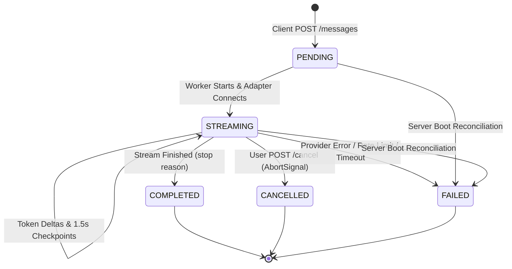

# MESSIAH — Universal Chat & Realtime Streaming Engine

## 1. Executive Summary

The **MESSIAH Universal Chat & Realtime Streaming Engine** provides the high-performance execution backbone for asynchronous conversational intelligence across heterogeneous AI model providers (OpenAI, Anthropic Claude, and Google Gemini).

Designed for multi-device cross-platform synchronization, the engine decouples HTTP request acceptance from LLM stream execution. Client network disconnects do not abort LLM runs unless explicitly requested by the user. State transitions are durably recorded in PostgreSQL via periodic checkpoints, while low-latency tokens are multiplexed to active frontend clients over Redis Pub/Sub and WebSocket gateways.

---

## 2. Core Architectural Principles

1. **Decoupled Asynchronous Execution & Transactional Outbox**:
   - `POST /api/v1/threads/:threadId/messages` creates persistent records (`USER` message, `ASSISTANT` placeholder message in `PENDING` state, `GenerationRun` in `PENDING` state with `startedAt: null`, `IdempotencyKey`, and `OutboxEvent`) inside a single ACID transaction.
   - The HTTP response returns immediately with `201 Created` containing the run metadata.
   - Background execution is enqueued to BullMQ (`messiah-chat-generation`) via deterministic `jobId: run.id`, backed by a periodic Outbox sweeper to ensure zero lost dispatches across Redis reconnections.

2. **Database-Enforced Single Active Run Concurrency Guard**:
   - Concurrency is enforced at the database level by a PostgreSQL partial unique index:
     `idx_generation_runs_single_active_per_thread ON generation_runs(thread_id) WHERE status IN ('PENDING', 'STREAMING')`.
   - Application-level pre-checks reject concurrent calls early, while the database index eliminates TOCTOU race conditions. Concurrent inserts catch `P2002` and map to `409 Conflict` (`CONCURRENT_RUN_ACTIVE`).

3. **Database-Enforced Idempotency & SHA-256 Fingerprinting**:
   - Every request with an `idempotencyKey` computes a deterministic SHA-256 fingerprint over its canonical JSON parameters (`prompt`, `provider`, `model`, `systemPrompt`, `temperature`, `maxTokens`).
   - A dedicated `IdempotencyKey` model with composite unique constraint `(threadId, key)` tracks keys in PostgreSQL.
   - If a matching key and fingerprint exist, the existing messages and run are replayed with `200 OK`.
   - If a key is reused with a modified payload, the request is rejected with `422 Unprocessable Entity` (`IDEMPOTENCY_KEY_REUSED_WITH_DIFFERENT_PAYLOAD`).

4. **Zero-Retry LLM Execution Policy**:
   - BullMQ chat generation jobs are configured with `attempts: 1`.
   - External LLM calls are never automatically retried to prevent catastrophic duplicate billing and provider quota exhaustion.

5. **Cryptographically Bound Transient Credential Decryption**:
   - Credentials are encrypted at rest using AES-256-GCM `v2` with Additional Authenticated Data (AAD) bound to `workspaceId`, `providerConnectionId`, `provider`, and `keyVersion`.
   - Credentials are only decrypted in transient memory during background execution and immediately dereferenced. Plaintext keys never touch logs, client payloads, or error objects.

6. **Periodic Database Checkpointing & Redis Pub/Sub Multiplexing**:
   - Every streaming token is published to Redis Pub/Sub channel `messiah:thread:<threadId>` (with local EventEmitter fallback in single-node/test environments).
   - Assistant message content is incrementally checkpointed to PostgreSQL every 200 characters or 1,500ms to guarantee persistent progress across abrupt outages.

7. **Cross-Worker Distributed Cancellation Propagation**:
   - When a user clicks "Stop Generation" (`POST /api/v1/generation-runs/:runId/cancel`), `cancellationService` sets `cancellationRequestedAt` in PostgreSQL and broadcasts to Redis Pub/Sub channel `messiah:cancel:<runId>`.
   - The worker holding the in-memory `AbortController` halts its streaming iterator, and the run and assistant message transition to `CANCELLED`.
   - Terminal runs (`COMPLETED`, `FAILED`, `CANCELLED`, `INTERRUPTED`) cannot be cancelled.

8. **Startup Orphan Reconciliation**:
   - Upon Fastify server boot, `ReconciliationService.reconcileOrphanedRuns()` queries for any `GenerationRun` or `Message` left in `PENDING` or `STREAMING` states from an unexpected process kill or node restart.
   - All orphaned runs are healed to `FAILED` or `INTERRUPTED` with explicit error code `SERVER_RESTARTED_DURING_EXECUTION`, guaranteeing no threads remain permanently locked.

---

## 3. Asynchronous Execution Lifecycle & State Machine

### State Definitions

| State | Entity | Description |
| :--- | :--- | :--- |
| `PENDING` | `Message`, `GenerationRun` | Database placeholder created; background streaming task dispatched. |
| `STREAMING` | `Message`, `GenerationRun` | Provider adapter active; emitting token deltas to Redis Pub/Sub. Periodic DB checkpoints active. |
| `COMPLETED` | `Message`, `GenerationRun` | Stream ended successfully. Final content saved, token usage (input, output, cached) recorded. |
| `CANCELLED` | `Message`, `GenerationRun` | Client invoked cancellation endpoint. In-flight tokens retained; run marked cancelled. |
| `FAILED` | `Message`, `GenerationRun` | Execution failed due to provider rate limit, network timeout, invalid credentials, or startup reboot. |

---

## 4. Context History Assembly & Window Budgeting

The `ContextBuilder` (`apps/server/src/services/chat/contextBuilder.ts`) constructs sanitized LLM prompt histories:

1. **Role Normalization**:
   - Only `USER` and `ASSISTANT` messages with status `COMPLETED` or `CANCELLED` (with content) are included.
   - Pending or failed runs without content are excluded to prevent hallucination propagation.
2. **System Prompt Injection**:
   - User or workspace-level system instructions are separated from conversation history and formatted according to provider SDK specifications:
     - OpenAI: Responses API instructions or Chat Completions `system` message.
     - Anthropic: Top-level `system` property in `client.messages.stream`.
     - Google Gemini: Injected into `config.systemInstruction`.
3. **Reasoning Delta Suppression**:
   - Internal reasoning tokens (e.g. Anthropic `thinking_delta`) are strictly isolated and never leaked into client message feeds.

---

## 5. Security & Verification Guarantees

- **Anti-IDOR Protection**: All thread, message, and run operations query through `verifyThreadAccess(userId, threadId)` which validates workspace membership before returning data. Unauthorized requests receive `404 Not Found` to prevent resource enumeration.
- **Transient Memory Decryption**: Decrypted API keys are held strictly in local function scopes.
- **CORS & Origin Hardening**: Fastify WebSocket upgrades validate the `Origin` header against allowed frontend origins.

---

## 6. Multi-Turn Tool Execution & Approval Governance (Phase 3B)

Phase 3B extends the chat execution engine with a governed multi-turn agent loop:

1. **`AWAITING_APPROVAL` Run State**:
   - When a model requests an MCP tool requiring authorization, the run transitions to `AWAITING_APPROVAL`.
   - The BullMQ worker finishes cleanly without blocking the worker thread.
   - The user receives a `tool.approval_requested` event and reviews the action in the UI.
2. **Resumption & Job Deduplication Bypass**:
   - Approving the request marks the approval as `APPROVED` and re-enqueues the run with a unique job ID (`${runId}-resume-${timestamp}`).
   - The worker executes the tool, records the result in a `TOOL` role message, and submits the updated history back to the model for the next reasoning round.
3. **Execution Limits & Repetition Guards**:
   - Hard maximum of 6 rounds and 10 tool calls per run.
   - Repetition guard aborts execution if identical tool calls occur 3 times consecutively.
   - 30-second socket timeout on all MCP tool executions.

