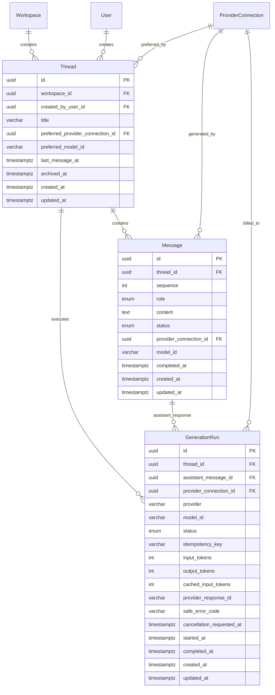

# MESSIAH — Conversation & Realtime Chat Data Model

## 1. Overview

The conversation subsystem in Messiah provides relational persistence for conversational threads, sequential messages, and AI generation runs across all connected providers and models.

The schema is implemented via **Prisma ORM** with **PostgreSQL** storage, strictly enforcing workspace tenant isolation and anti-IDOR protections.

---

## 2. Entity-Relationship Model

---

## 3. Database Constraints & Invariants

### 1. Monotonic Message Sequencing
- `Message` enforces a composite unique constraint: `@@unique([threadId, sequence])`.
- Messages within a thread are strictly ordered by sequence number (1, 2, 3, ...), guaranteeing deterministic history reconstruction even when message creation timestamps coincide.
- Index: `@@index([threadId, sequence(sort: Asc)])`.

### 2. Idempotency Tracking
- `GenerationRun` records `idempotencyKey` per thread.
- Index: `@@index([threadId, idempotencyKey])`.
- When an API consumer retries a request with the same idempotency key, the server returns the existing run and messages without duplicate LLM invocation or database rows.

### 3. Concurrency Protection
- `GenerationRun` tracks statuses: `PENDING`, `STREAMING`, `COMPLETED`, `FAILED`, `CANCELLED`.
- A thread cannot execute more than one run in `PENDING` or `STREAMING` status simultaneously.
- Index: `@@index([threadId, status])`.

### 4. Cascade & Deletion Rules
- When a `Thread` is deleted, all child `Message` and `GenerationRun` records are removed automatically (`onDelete: Cascade`).
- When a `ProviderConnection` is deleted, historical messages retain their message content while the connection reference is set to null (`onDelete: SetNull`).

---

## 4. Migration History

| Migration Name | Applied In | Description |
| :--- | :--- | :--- |
| `0_init` | Phase 1A / 1B | Baseline PostgreSQL schema (Users, Workspaces, Memberships). |
| `1_provider_connections` | Phase 2A | Encrypted credentials, provider connections, audit logs. |
| `2_chat_engine` | Phase 2B | Threads, Messages, Generation Runs, enums (`MessageRole`, `MessageStatus`, `RunStatus`). |
