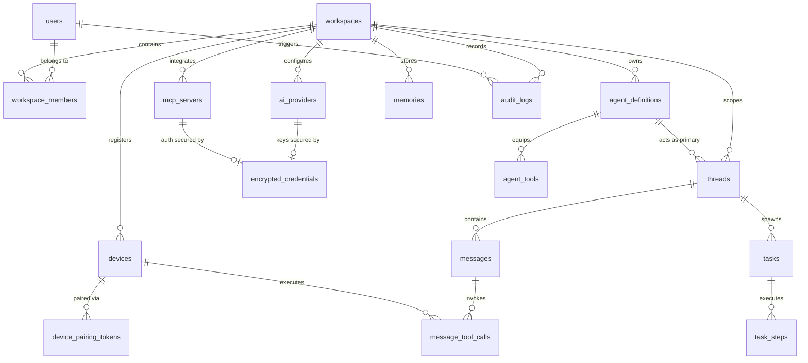

# MESSIAH — DATABASE SCHEMA & PERSISTENCE SPECIFICATION

> **Document Stage**: Phase 1B Complete — Authentication & Tenancy Baseline  
> **Version**: 1.1.0  
> **Target Database Engine**: PostgreSQL 16+ (with `pgcrypto`)  
> **ORM & Migration Tool**: Prisma ORM v6 (`prisma migrate dev`, baselined at `0_init`)

---

## 1. Architectural Strategy & Extensions

The Messiah persistence layer uses **PostgreSQL 16+** as the central relational store, combining ACID guarantees for transactional states (users, workspaces, credentials, tool approvals) with future extensibility for semantic memory retrieval.

> **Phase 1 Implementation Note**: For the initial scaffolding and development phases, base PostgreSQL entities and core relations are configured first. The `pgvector` extension and vector memory tables (`Memory`) are deferred until semantic retrieval is introduced in Phase 6.

### PostgreSQL Extensions (Target Configuration)

```sql
-- Enable cryptographic helpers and UUID generation
CREATE EXTENSION IF NOT EXISTS "uuid-ossp";
CREATE EXTENSION IF NOT EXISTS "pgcrypto";

-- Vector operations deferred to Phase 6:
-- CREATE EXTENSION IF NOT EXISTS "vector";
```

---

## 2. Entity-Relationship Architecture Diagram



---

## 3. Comprehensive Prisma Schema Definition

This schema serves as the canonical source of truth for database migrations (`prisma/schema.prisma`):

```prisma
datasource db {
  provider   = "postgresql"
  url        = env("DATABASE_URL")
  extensions = [pgcrypto, vector]
}

generator client {
  provider        = "prisma-client-js"
  previewFeatures = ["postgresqlExtensions"]
}

// ---------------------------------------------------------
// 1. IDENTITY & TENANCY MODULE
// ---------------------------------------------------------

enum WorkspaceRole {
  OWNER
  ADMIN
  MEMBER
  VIEWER
}

model User {
  id               String            @id @default(dbgenerated("gen_random_uuid()")) @db.Uuid
  email            String            @unique @db.VarChar(255)
  fullName         String?           @map("full_name") @db.VarChar(128)
  avatarUrl        String?           @map("avatar_url") @db.Text
  externalProvider String            @default("supabase") @map("external_provider") @db.VarChar(64)
  externalId       String            @unique @map("external_id") @db.VarChar(128)
  metadata         Json              @default("{}") @db.JsonB
  createdAt        DateTime          @default(now()) @map("created_at") @db.Timestamptz(6)
  updatedAt        DateTime          @updatedAt @map("updated_at") @db.Timestamptz(6)

  // Relations
  memberships      WorkspaceMember[]
  ownedWorkspaces  Workspace[]       @relation("WorkspaceOwner")
  createdThreads   Thread[]          @relation("ThreadCreator")
  initiatedTasks   Task[]            @relation("TaskInitiator")
  enrolledDevices  Device[]          @relation("DeviceOwner")
  pairingTokens    DevicePairingToken[]
  auditLogs        AuditLog[]

  @@map("users")
}

model Workspace {
  id               String            @id @default(dbgenerated("gen_random_uuid()")) @db.Uuid
  name             String            @db.VarChar(64)
  slug             String            @unique @db.VarChar(64)
  ownerId          String            @map("owner_id") @db.Uuid
  plan             String            @default("pro") @db.VarChar(32)
  settings         Json              @default("{}") @db.JsonB
  createdAt        DateTime          @default(now()) @map("created_at") @db.Timestamptz(6)
  updatedAt        DateTime          @updatedAt @map("updated_at") @db.Timestamptz(6)

  // Relations
  owner            User              @relation("WorkspaceOwner", fields: [ownerId], references: [id], onDelete: Restrict)
  members          WorkspaceMember[]
  providers        AiProvider[]
  agents           AgentDefinition[]
  devices          Device[]
  mcpServers       McpServer[]
  threads          Thread[]
  tasks            Task[]
  memories         Memory[]
  auditLogs        AuditLog[]
  pairingTokens    DevicePairingToken[]

  @@index([ownerId])
  @@map("workspaces")
}

model WorkspaceMember {
  id          String        @id @default(dbgenerated("gen_random_uuid()")) @db.Uuid
  workspaceId String        @map("workspace_id") @db.Uuid
  userId      String        @map("user_id") @db.Uuid
  role        WorkspaceRole @default(MEMBER)
  createdAt   DateTime      @default(now()) @map("created_at") @db.Timestamptz(6)
  updatedAt   DateTime      @updatedAt @map("updated_at") @db.Timestamptz(6)

  // Relations
  workspace   Workspace     @relation(fields: [workspaceId], references: [id], onDelete: Cascade)
  user        User          @relation(fields: [userId], references: [id], onDelete: Cascade)

  @@unique([workspaceId, userId])
  @@index([userId])
  @@map("workspace_members")
}

// ---------------------------------------------------------
// 2. SECURITY & ENCRYPTED CREDENTIALS MODULE
// ---------------------------------------------------------

enum CredentialParentType {
  AI_PROVIDER
  MCP_SERVER
  DEVICE
  WORKSPACE_CUSTOM
}

model EncryptedCredential {
  id             String               @id @default(dbgenerated("gen_random_uuid()")) @db.Uuid
  parentType     CredentialParentType @map("parent_type")
  parentId       String               @map("parent_id") @db.Uuid
  encryptedBlob  String               @map("encrypted_blob") @db.Text  // Base64 AES-256-GCM ciphertext
  iv             String               @map("iv") @db.VarChar(32)       // 96-bit initialization vector
  authTag        String               @map("auth_tag") @db.VarChar(32) // 128-bit authentication tag
  keyVersion     Int                  @default(1) @map("key_version")  // Key rotation tracker
  createdAt      DateTime             @default(now()) @map("created_at") @db.Timestamptz(6)
  updatedAt      DateTime             @updatedAt @map("updated_at") @db.Timestamptz(6)

  @@unique([parentType, parentId])
  @@index([parentId])
  @@map("encrypted_credentials")
}

// ---------------------------------------------------------
// 3. AI PROVIDERS & ENCRYPTED CREDENTIAL VAULT (Implemented Phase 2A)
// ---------------------------------------------------------

enum ProviderStatus {
  ACTIVE
  INVALID_CREDENTIALS
  RATE_LIMITED
  SUSPENDED
}

model ProviderConnection {
  id              String               @id @default(uuid()) @db.Uuid
  workspaceId     String               @map("workspace_id") @db.Uuid
  provider        String               @db.VarChar(64)       // e.g. "openai" | "anthropic" | "gemini"
  displayName     String               @map("display_name") @db.VarChar(128)
  status          ProviderStatus       @default(ACTIVE)
  capabilities    Json                 @default("{}") @db.JsonB
  createdByUserId String?              @map("created_by_user_id") @db.Uuid
  lastValidatedAt DateTime?            @map("last_validated_at") @db.Timestamptz(6)
  createdAt       DateTime             @default(now()) @map("created_at") @db.Timestamptz(6)
  updatedAt       DateTime             @updatedAt @map("updated_at") @db.Timestamptz(6)

  // Relations
  workspace       Workspace            @relation(fields: [workspaceId], references: [id], onDelete: Cascade)
  createdByUser   User?                @relation("CreatedConnections", fields: [createdByUserId], references: [id], onDelete: SetNull)
  credential      EncryptedCredential?

  @@unique([workspaceId, provider, displayName])
  @@index([workspaceId])
  @@index([provider])
  @@map("provider_connections")
}

model EncryptedCredential {
  id                   String             @id @default(uuid()) @db.Uuid
  providerConnectionId String             @unique @map("provider_connection_id") @db.Uuid
  ciphertext           String             @db.Text
  initializationVector String             @map("initialization_vector") @db.VarChar(64)
  authenticationTag    String             @map("authentication_tag") @db.VarChar(64)
  keyVersion           String             @default("v1") @map("key_version") @db.VarChar(32)
  createdAt            DateTime           @default(now()) @map("created_at") @db.Timestamptz(6)
  updatedAt            DateTime           @updatedAt @map("updated_at") @db.Timestamptz(6)

  // Relations
  connection           ProviderConnection @relation(fields: [providerConnectionId], references: [id], onDelete: Cascade)

  @@index([providerConnectionId])
  @@map("encrypted_credentials")
}

model AuditLog {
  id           String    @id @default(uuid()) @db.Uuid
  workspaceId  String    @map("workspace_id") @db.Uuid
  actorId      String?   @map("actor_id") @db.Uuid
  action       String    @db.VarChar(64)
  resourceType String    @map("resource_type") @db.VarChar(64)
  resourceId   String?   @map("resource_id") @db.VarChar(64)
  details      Json      @default("{}") @db.JsonB
  ipAddress    String?   @map("ip_address") @db.VarChar(45)
  userAgent    String?   @map("user_agent") @db.Text
  createdAt    DateTime  @default(now()) @map("created_at") @db.Timestamptz(6)

  // Relations
  workspace    Workspace @relation(fields: [workspaceId], references: [id], onDelete: Cascade)
  actor        User?     @relation("AuditActor", fields: [actorId], references: [id], onDelete: SetNull)

  @@index([workspaceId])
  @@index([action])
  @@index([createdAt])
  @@map("audit_logs")
}

enum AgentMode {
  SINGLE
  ORCHESTRATOR
  WORKER
}

model AgentDefinition {
  id           String      @id @default(dbgenerated("gen_random_uuid()")) @db.Uuid
  workspaceId  String      @map("workspace_id") @db.Uuid
  name         String      @db.VarChar(64)
  description  String?     @db.VarChar(512)
  avatarUrl    String?     @map("avatar_url") @db.Text
  systemPrompt String      @map("system_prompt") @db.Text
  providerId   String      @map("provider_id") @db.Uuid
  modelId      String      @map("model_id") @db.VarChar(64)     // e.g. "claude-3-5-sonnet-20241022"
  temperature  Float       @default(0.7) @db.Real
  maxTokens    Int         @default(4096) @map("max_tokens")
  mode         AgentMode   @default(SINGLE)
  isTemplate   Boolean     @default(false) @map("is_template")
  isArchived   Boolean     @default(false) @map("is_archived")
  createdById  String      @map("created_by_id") @db.Uuid
  createdAt    DateTime    @default(now()) @map("created_at") @db.Timestamptz(6)
  updatedAt    DateTime    @updatedAt @map("updated_at") @db.Timestamptz(6)

  // Relations
  workspace    Workspace   @relation(fields: [workspaceId], references: [id], onDelete: Cascade)
  provider     AiProvider  @relation(fields: [providerId], references: [id], onDelete: Restrict)
  tools        AgentTool[]
  threads      Thread[]
  memories     Memory[]

  @@index([workspaceId])
  @@index([providerId])
  @@map("agent_definitions")
}

enum ToolType {
  BUILTIN
  MCP
  LOCAL_BRIDGE
  REST_API
}

model AgentTool {
  id               String          @id @default(dbgenerated("gen_random_uuid()")) @db.Uuid
  agentId          String          @map("agent_id") @db.Uuid
  toolType         ToolType        @map("tool_type")
  toolName         String          @map("tool_name") @db.VarChar(128)
  configuration    Json            @default("{}") @db.JsonB
  isEnabled        Boolean         @default(true) @map("is_enabled")
  approvalRequired Boolean         @default(false) @map("approval_required")
  createdAt        DateTime        @default(now()) @map("created_at") @db.Timestamptz(6)

  // Relations
  agent            AgentDefinition @relation(fields: [agentId], references: [id], onDelete: Cascade)

  @@unique([agentId, toolName])
  @@index([agentId])
  @@map("agent_tools")
}

// ---------------------------------------------------------
// 4. DEVICE MANAGEMENT & LOCAL AGENT BRIDGE
// ---------------------------------------------------------

enum DeviceType {
  MACOS
  WINDOWS
  LINUX
  IOS
  ANDROID
  WEB
}

enum DeviceStatus {
  ONLINE
  OFFLINE
  PAIRED
  REVOKED
}

model Device {
  id             String             @id @default(dbgenerated("gen_random_uuid()")) @db.Uuid
  workspaceId    String             @map("workspace_id") @db.Uuid
  userId         String             @map("user_id") @db.Uuid
  deviceName     String             @map("device_name") @db.VarChar(64)
  deviceType     DeviceType         @map("device_type")
  publicKey      String             @map("public_key") @db.Text       // Ed25519 Public Key (PEM or Base64)
  platformInfo   Json               @default("{}") @map("platform_info") @db.JsonB
  status         DeviceStatus       @default(PAIRED)
  lastHeartbeatAt DateTime?         @map("last_heartbeat_at") @db.Timestamptz(6)
  pairedAt       DateTime           @default(now()) @map("paired_at") @db.Timestamptz(6)
  createdAt      DateTime           @default(now()) @map("created_at") @db.Timestamptz(6)
  updatedAt      DateTime           @updatedAt @map("updated_at") @db.Timestamptz(6)

  // Relations
  workspace      Workspace          @relation(fields: [workspaceId], references: [id], onDelete: Cascade)
  user           User               @relation("DeviceOwner", fields: [userId], references: [id], onDelete: Cascade)
  executedCalls  MessageToolCall[]  @relation("ExecutionDevice")
  approvedCalls  MessageToolCall[]  @relation("ApprovalDevice")

  @@index([workspaceId])
  @@index([userId])
  @@map("devices")
}

model DevicePairingToken {
  id                String    @id @default(dbgenerated("gen_random_uuid()")) @db.Uuid
  workspaceId       String    @map("workspace_id") @db.Uuid
  userId            String    @map("user_id") @db.Uuid
  tokenHash         String    @unique @map("token_hash") @db.VarChar(64) // SHA-256 hash of plaintext OTP
  expiresAt         DateTime  @map("expires_at") @db.Timestamptz(6)
  usedAt            DateTime? @map("used_at") @db.Timestamptz(6)
  deviceFingerprint String?   @map("device_fingerprint") @db.VarChar(255)
  createdAt         DateTime  @default(now()) @map("created_at") @db.Timestamptz(6)

  // Relations
  workspace         Workspace @relation(fields: [workspaceId], references: [id], onDelete: Cascade)
  user              User      @relation(fields: [userId], references: [id], onDelete: Cascade)

  @@index([tokenHash])
  @@map("device_pairing_tokens")
}

// ---------------------------------------------------------
// 5. MCP INTEGRATION MODULE
// ---------------------------------------------------------

enum McpTransportType {
  STDIO
  SSE
  WEBSOCKET
}

enum McpStatus {
  ACTIVE
  INACTIVE
  ERROR
}

model McpServer {
  id            String           @id @default(dbgenerated("gen_random_uuid()")) @db.Uuid
  workspaceId   String           @map("workspace_id") @db.Uuid
  name          String           @db.VarChar(64)
  transportType McpTransportType @map("transport_type")
  serverUrl     String?          @map("server_url") @db.VarChar(512)
  command       String?          @db.VarChar(255)                  // For stdio transport via Bridge
  args          String[]         @default([])
  status        McpStatus        @default(ACTIVE)
  toolCache     Json             @default("[]") @map("tool_cache") @db.JsonB
  createdAt     DateTime         @default(now()) @map("created_at") @db.Timestamptz(6)
  updatedAt     DateTime         @updatedAt @map("updated_at") @db.Timestamptz(6)

  // Relations
  workspace     Workspace        @relation(fields: [workspaceId], references: [id], onDelete: Cascade)

  @@unique([workspaceId, name])
  @@index([workspaceId])
  @@map("mcp_servers")
}

// ---------------------------------------------------------
// 6. CONVERSATIONS & CHAT HISTORY (Phase 2B Applied Schema)
// ---------------------------------------------------------

enum MessageRole {
  USER
  ASSISTANT
}

enum MessageStatus {
  PENDING
  STREAMING
  COMPLETED
  FAILED
  CANCELLED
  INTERRUPTED
}

enum RunStatus {
  PENDING
  STREAMING
  COMPLETED
  FAILED
  CANCELLED
  INTERRUPTED
}

enum OutboxStatus {
  PENDING
  PROCESSING
  PROCESSED
  FAILED
}

model Thread {
  id                            String              @id @default(uuid()) @db.Uuid
  workspaceId                   String              @map("workspace_id") @db.Uuid
  createdByUserId               String              @map("created_by_user_id") @db.Uuid
  title                         String              @default("New Conversation") @db.VarChar(255)
  preferredProviderConnectionId String?             @map("preferred_provider_connection_id") @db.Uuid
  preferredModelId              String?             @map("preferred_model_id") @db.VarChar(128)
  lastMessageAt                 DateTime            @default(now()) @map("last_message_at") @db.Timestamptz(6)
  archivedAt                    DateTime?           @map("archived_at") @db.Timestamptz(6)
  createdAt                     DateTime            @default(now()) @map("created_at") @db.Timestamptz(6)
  updatedAt                     DateTime            @updatedAt @map("updated_at") @db.Timestamptz(6)

  // Relations
  workspace                     Workspace           @relation(fields: [workspaceId], references: [id], onDelete: Cascade)
  createdByUser                 User                @relation("CreatedThreads", fields: [createdByUserId], references: [id], onDelete: Cascade)
  preferredProviderConnection   ProviderConnection? @relation(fields: [preferredProviderConnectionId], references: [id], onDelete: SetNull)
  messages                      Message[]
  generationRuns                GenerationRun[]
  idempotencyKeys               IdempotencyKey[]

  @@index([workspaceId, archivedAt, lastMessageAt(sort: Desc)])
  @@index([workspaceId])
  @@index([createdByUserId])
  @@map("threads")
}

model Message {
  id                   String              @id @default(uuid()) @db.Uuid
  threadId             String              @map("thread_id") @db.Uuid
  sequence             Int
  role                 MessageRole
  content              String              @db.Text
  status               MessageStatus       @default(COMPLETED)
  providerConnectionId String?             @map("provider_connection_id") @db.Uuid
  modelId              String?             @map("model_id") @db.VarChar(128)
  completedAt          DateTime?           @map("completed_at") @db.Timestamptz(6)
  createdAt            DateTime            @default(now()) @map("created_at") @db.Timestamptz(6)
  updatedAt            DateTime            @updatedAt @map("updated_at") @db.Timestamptz(6)

  // Relations
  thread               Thread              @relation(fields: [threadId], references: [id], onDelete: Cascade)
  providerConnection   ProviderConnection? @relation(fields: [providerConnectionId], references: [id], onDelete: SetNull)
  generationRuns       GenerationRun[]     @relation("AssistantMessage")

  @@unique([threadId, sequence])
  @@index([threadId, sequence(sort: Asc)])
  @@index([threadId, createdAt])
  @@map("messages")
}

model GenerationRun {
  id                      String              @id @default(uuid()) @db.Uuid
  threadId                String              @map("thread_id") @db.Uuid
  assistantMessageId      String              @map("assistant_message_id") @db.Uuid
  providerConnectionId    String              @map("provider_connection_id") @db.Uuid
  provider                String              @db.VarChar(64)
  modelId                 String              @map("model_id") @db.VarChar(128)
  status                  RunStatus           @default(PENDING)
  idempotencyKey          String?             @map("idempotency_key") @db.VarChar(128)
  requestFingerprint      String?             @map("request_fingerprint") @db.VarChar(64)
  startedAt               DateTime?           @map("started_at") @db.Timestamptz(6)
  completedAt             DateTime?           @map("completed_at") @db.Timestamptz(6)
  inputTokens             Int                 @default(0) @map("input_tokens")
  outputTokens            Int                 @default(0) @map("output_tokens")
  cachedInputTokens       Int                 @default(0) @map("cached_input_tokens")
  providerResponseId      String?             @map("provider_response_id") @db.VarChar(255)
  safeErrorCode           String?             @map("safe_error_code") @db.VarChar(64)
  cancellationRequestedAt DateTime?           @map("cancellation_requested_at") @db.Timestamptz(6)
  createdAt               DateTime            @default(now()) @map("created_at") @db.Timestamptz(6)
  updatedAt               DateTime            @updatedAt @map("updated_at") @db.Timestamptz(6)

  // Relations
  thread                  Thread              @relation(fields: [threadId], references: [id], onDelete: Cascade)
  assistantMessage        Message             @relation("AssistantMessage", fields: [assistantMessageId], references: [id], onDelete: Cascade)
  providerConnection      ProviderConnection  @relation(fields: [providerConnectionId], references: [id], onDelete: Restrict)
  idempotencyKeyRecord    IdempotencyKey?

  @@index([threadId, status])
  @@index([threadId, createdAt(sort: Desc)])
  @@index([idempotencyKey])
  @@map("generation_runs")
}

// PostgreSQL Partial Unique Index applied via raw migration:
// CREATE UNIQUE INDEX "idx_generation_runs_single_active_per_thread" 
// ON "generation_runs" ("thread_id") 
// WHERE status IN ('PENDING', 'STREAMING');

model IdempotencyKey {
  id                 String         @id @default(uuid()) @db.Uuid
  workspaceId        String         @map("workspace_id") @db.Uuid
  userId             String         @map("user_id") @db.Uuid
  threadId           String         @map("thread_id") @db.Uuid
  key                String         @db.VarChar(128)
  requestFingerprint String         @map("request_fingerprint") @db.VarChar(64)
  generationRunId    String?        @unique @map("generation_run_id") @db.Uuid
  userMessageId      String?        @map("user_message_id") @db.Uuid
  assistantMessageId String?        @map("assistant_message_id") @db.Uuid
  lockedAt           DateTime       @default(now()) @map("locked_at") @db.Timestamptz(6)
  expiresAt          DateTime       @map("expires_at") @db.Timestamptz(6)
  createdAt          DateTime       @default(now()) @map("created_at") @db.Timestamptz(6)

  // Relations
  workspace          Workspace      @relation(fields: [workspaceId], references: [id], onDelete: Cascade)
  user               User           @relation(fields: [userId], references: [id], onDelete: Cascade)
  thread             Thread         @relation(fields: [threadId], references: [id], onDelete: Cascade)
  generationRun      GenerationRun? @relation(fields: [generationRunId], references: [id], onDelete: SetNull)

  @@unique([threadId, key])
  @@index([workspaceId])
  @@index([expiresAt])
  @@map("idempotency_keys")
}

model OutboxEvent {
  id            String       @id @default(uuid()) @db.Uuid
  eventType     String       @map("event_type") @db.VarChar(64)
  aggregateType String       @map("aggregate_type") @db.VarChar(64)
  aggregateId   String       @map("aggregate_id") @db.Uuid
  payload       Json         @db.JsonB
  status        OutboxStatus @default(PENDING)
  retryCount    Int          @default(0) @map("retry_count")
  errorDetails  String?      @map("error_details") @db.Text
  processedAt   DateTime?    @map("processed_at") @db.Timestamptz(6)
  createdAt     DateTime     @default(now()) @map("created_at") @db.Timestamptz(6)
  updatedAt     DateTime     @updatedAt @map("updated_at") @db.Timestamptz(6)

  @@index([status, createdAt])
  @@index([aggregateId])
  @@map("outbox_events")
}

model Message {
  id              String            @id @default(dbgenerated("gen_random_uuid()")) @db.Uuid
  threadId        String            @map("thread_id") @db.Uuid
  role            MessageRole
  senderType      String            @map("sender_type") @db.VarChar(32) // "user" | "agent:uuid" | "bridge:uuid"
  senderId        String?           @map("sender_id") @db.Uuid
  content         String            @db.Text
  contentTokens   Int               @default(0) @map("content_tokens")
  totalTokens     Int               @default(0) @map("total_tokens")
  parentMessageId String?           @map("parent_message_id") @db.Uuid
  sequenceNumber  Int               @map("sequence_number")
  status          MessageStatus     @default(COMPLETED)
  errorMessage    String?           @map("error_message") @db.Text
  createdAt       DateTime          @default(now()) @map("created_at") @db.Timestamptz(6)
  updatedAt       DateTime          @updatedAt @map("updated_at") @db.Timestamptz(6)

  // Relations
  thread          Thread            @relation(fields: [threadId], references: [id], onDelete: Cascade)
  parentMessage   Message?          @relation("MessageHierarchy", fields: [parentMessageId], references: [id], onDelete: SetNull)
  childMessages   Message[]         @relation("MessageHierarchy")
  toolCalls       MessageToolCall[]

  @@unique([threadId, sequenceNumber])
  @@index([threadId])
  @@index([parentMessageId])
  @@map("messages")
}

enum ToolCallStatus {
  PENDING_APPROVAL
  APPROVED
  REJECTED
  EXECUTING
  COMPLETED
  FAILED
}

model MessageToolCall {
  id                 String         @id @default(dbgenerated("gen_random_uuid()")) @db.Uuid
  messageId          String         @map("message_id") @db.Uuid
  toolCallId         String         @map("tool_call_id") @db.VarChar(128) // LLM tool_call_id
  toolName           String         @map("tool_name") @db.VarChar(128)
  toolType           ToolType       @map("tool_type")
  arguments          Json           @db.JsonB
  result             Json?          @db.JsonB
  status             ToolCallStatus @default(COMPLETED)
  approvalDeviceId   String?        @map("approval_device_id") @db.Uuid
  executionDeviceId  String?        @map("execution_device_id") @db.Uuid
  executionTimeMs    Int?           @map("execution_time_ms")
  errorMessage       String?        @map("error_message") @db.Text
  createdAt          DateTime       @default(now()) @map("created_at") @db.Timestamptz(6)
  updatedAt          DateTime       @updatedAt @map("updated_at") @db.Timestamptz(6)

  // Relations
  message            Message        @relation(fields: [messageId], references: [id], onDelete: Cascade)
  approvalDevice     Device?        @relation("ApprovalDevice", fields: [approvalDeviceId], references: [id], onDelete: SetNull)
  executionDevice    Device?        @relation("ExecutionDevice", fields: [executionDeviceId], references: [id], onDelete: SetNull)

  @@index([messageId])
  @@index([toolCallId])
  @@map("message_tool_calls")
}

// ---------------------------------------------------------
// 7. TASK EXECUTION & MONITORING
// ---------------------------------------------------------

enum TaskStatus {
  QUEUED
  RUNNING
  PAUSED
  COMPLETED
  FAILED
  CANCELLED
}

model Task {
  id               String      @id @default(dbgenerated("gen_random_uuid()")) @db.Uuid
  workspaceId      String      @map("workspace_id") @db.Uuid
  threadId         String?     @map("thread_id") @db.Uuid
  initiatingUserId String      @map("initiating_user_id") @db.Uuid
  status           TaskStatus  @default(QUEUED)
  priority         Int         @default(0)
  progressPercent  Int         @default(0) @map("progress_percent")
  errorDetails     Json?       @map("error_details") @db.JsonB
  startedAt        DateTime?   @map("started_at") @db.Timestamptz(6)
  completedAt      DateTime?   @map("completed_at") @db.Timestamptz(6)
  createdAt        DateTime    @default(now()) @map("created_at") @db.Timestamptz(6)
  updatedAt        DateTime    @updatedAt @map("updated_at") @db.Timestamptz(6)

  // Relations
  workspace        Workspace   @relation(fields: [workspaceId], references: [id], onDelete: Cascade)
  thread           Thread?     @relation(fields: [threadId], references: [id], onDelete: SetNull)
  initiator        User        @relation("TaskInitiator", fields: [initiatingUserId], references: [id], onDelete: Restrict)
  steps            TaskStep[]

  @@index([workspaceId])
  @@index([status])
  @@map("tasks")
}

model TaskStep {
  id              String      @id @default(dbgenerated("gen_random_uuid()")) @db.Uuid
  taskId          String      @map("task_id") @db.Uuid
  stepIndex       Int         @map("step_index")
  stepType        String      @map("step_type") @db.VarChar(64)
  description     String      @db.VarChar(255)
  inputPayload    Json        @default("{}") @map("input_payload") @db.JsonB
  outputPayload   Json?       @map("output_payload") @db.JsonB
  status          TaskStatus  @default(QUEUED)
  executionTimeMs Int?        @map("execution_time_ms")
  createdAt       DateTime    @default(now()) @map("created_at") @db.Timestamptz(6)

  // Relations
  task            Task        @relation(fields: [taskId], references: [id], onDelete: Cascade)

  @@unique([taskId, stepIndex])
  @@index([taskId])
  @@map("task_steps")
}

// ---------------------------------------------------------
// 8. VECTOR MEMORY (pgvector)
// ---------------------------------------------------------

enum MemoryScope {
  WORKSPACE
  AGENT
  USER
}

enum MemoryType {
  SEMANTIC
  EPISODIC
  FACTUAL
}

model Memory {
  id          String                      @id @default(dbgenerated("gen_random_uuid()")) @db.Uuid
  workspaceId String                      @map("workspace_id") @db.Uuid
  agentId     String?                     @map("agent_id") @db.Uuid
  scope       MemoryScope                 @default(WORKSPACE)
  memoryType  MemoryType                  @default(SEMANTIC) @map("memory_type")
  content     String                      @db.Text
  // Vector dimension 1536 for OpenAI text-embedding-3-small, or 3072 for text-embedding-3-large
  embedding   Unsupported("vector(1536)")
  metadata    Json                        @default("{}") @db.JsonB
  createdAt   DateTime                    @default(now()) @map("created_at") @db.Timestamptz(6)
  updatedAt   DateTime                    @updatedAt @map("updated_at") @db.Timestamptz(6)

  // Relations
  workspace   Workspace                   @relation(fields: [workspaceId], references: [id], onDelete: Cascade)
  agent       AgentDefinition?            @relation(fields: [agentId], references: [id], onDelete: Cascade)

  @@index([workspaceId])
  @@index([agentId])
  @@map("memories")
}

// ---------------------------------------------------------
// 9. AUDIT LOGS & COMPLIANCE
// ---------------------------------------------------------

model AuditLog {
  id           String    @id @default(dbgenerated("gen_random_uuid()")) @db.Uuid
  workspaceId  String    @map("workspace_id") @db.Uuid
  userId       String?   @map("user_id") @db.Uuid
  action       String    @db.VarChar(64)       // e.g. "tool.approved", "device.paired"
  resourceType String    @map("resource_type") @db.VarChar(64)
  resourceId   String?   @map("resource_id") @db.VarChar(64)
  ipAddress    String?   @map("ip_address") @db.VarChar(45)
  userAgent    String?   @map("user_agent") @db.Text
  details      Json      @default("{}") @db.JsonB
  createdAt    DateTime  @default(now()) @map("created_at") @db.Timestamptz(6)

  // Relations
  workspace    Workspace @relation(fields: [workspaceId], references: [id], onDelete: Cascade)
  user         User?     @relation(fields: [userId], references: [id], onDelete: SetNull)

  @@index([workspaceId])
  @@index([action])
  @@index([createdAt])
  @@map("audit_logs")
}
```

---

## 4. Raw DDL, Indexes & Vector Optimization

While Prisma manages the majority of relations, production performance requires specialized PostgreSQL indexes and vector structures created via raw SQL migrations:

```sql
-- 1. HNSW Index for rapid approximate nearest neighbor (ANN) vector searches
-- Uses cosine distance operator (<=>) with optimal m and ef_construction parameters
CREATE INDEX IF NOT EXISTS idx_memories_embedding_hnsw
ON memories
USING hnsw (embedding vector_cosine_ops)
WITH (m = 16, ef_construction = 64);

-- 2. High-performance compound indexes for thread message pagination
CREATE INDEX IF NOT EXISTS idx_messages_thread_seq_desc
ON messages (thread_id ASC, sequence_number DESC);

-- 3. Composite index for active task queue queries
CREATE INDEX IF NOT EXISTS idx_tasks_workspace_status_priority
ON tasks (workspace_id, status, priority DESC);

-- 4. Fast lookup index for active device heartbeats
CREATE INDEX IF NOT EXISTS idx_devices_heartbeat
ON devices (workspace_id, status, last_heartbeat_at);
```

### High-Performance Semantic Search Query Example

```sql
-- Retrieve the top 5 most relevant memories for an agent given a prompt query vector
SELECT
    id,
    content,
    metadata,
    1 - (embedding <=> $1::vector) AS similarity_score
FROM memories
WHERE workspace_id = $2::uuid
  AND (agent_id = $3::uuid OR agent_id IS NULL)
ORDER BY embedding <=> $1::vector ASC
LIMIT 5;
```

---

## 5. Tenancy Isolation & Row Level Security (RLS)

To enforce zero-leakage multi-tenancy, PostgreSQL Row Level Security (RLS) policies are configured for Supabase Auth integrations:

```sql
-- Enable RLS on core multi-tenant tables
ALTER TABLE workspaces ENABLE ROW LEVEL SECURITY;
ALTER TABLE workspace_members ENABLE ROW LEVEL SECURITY;
ALTER TABLE threads ENABLE ROW LEVEL SECURITY;
ALTER TABLE messages ENABLE ROW LEVEL SECURITY;
ALTER TABLE devices ENABLE ROW LEVEL SECURITY;
ALTER TABLE encrypted_credentials ENABLE ROW LEVEL SECURITY;

-- Helper function: Extract authenticated user ID from JWT claim
CREATE OR REPLACE FUNCTION auth.current_user_id()
RETURNS uuid AS $$
  SELECT NULLIF(current_setting('request.jwt.claims', true)::json->>'sub', '')::uuid;
$$ LANGUAGE sql STABLE;

-- Helper function: Verify workspace membership
CREATE OR REPLACE FUNCTION auth.is_workspace_member(ws_id uuid)
RETURNS boolean AS $$
  SELECT EXISTS (
    SELECT 1 FROM workspace_members
    WHERE workspace_id = ws_id
      AND user_id = auth.current_user_id()
  );
$$ LANGUAGE sql STABLE SECURITY DEFINER;

-- RLS Policy: Users can only view workspaces they belong to
CREATE POLICY workspace_member_read_policy ON workspaces
FOR SELECT USING (auth.is_workspace_member(id));

-- RLS Policy: Thread access bounded by workspace membership
CREATE POLICY thread_workspace_policy ON threads
FOR ALL USING (auth.is_workspace_member(workspace_id));

-- RLS Policy: Messages access bounded by thread workspace
CREATE POLICY message_thread_policy ON messages
FOR ALL USING (
  EXISTS (
    SELECT 1 FROM threads
    WHERE threads.id = messages.thread_id
      AND auth.is_workspace_member(threads.workspace_id)
  )
);
```

---

## 6. Table Partitioning & Data Lifecycle Strategy

In large-scale agent workspaces, `messages` and `audit_logs` generate high ingestion volumes. To prevent index degradation:

1. **Time-Based Partitioning**: `messages` and `audit_logs` are partitioned by range on `created_at` (monthly partitions):
   ```sql
   -- Partitioning example for audit_logs
   CREATE TABLE audit_logs_partitioned (
       id uuid NOT NULL,
       workspace_id uuid NOT NULL,
       action varchar(64) NOT NULL,
       created_at timestamptz(6) NOT NULL,
       -- other columns...
       PRIMARY KEY (id, created_at)
   ) PARTITION BY RANGE (created_at);
   ```
2. **Cold Storage Archival**: Partitions older than 90 days are automatically archived to compressed Parquet files in S3-compatible private object storage, keeping primary transactional database sizes lean and performant.

---

## 7. Model Context Protocol (MCP) Persistence (Phase 3A)

Migration `4_mcp_connections` introduces dedicated schema tables for remote MCP connections, encrypted credentials, discovered tool definitions, and tool governance permissions:

```sql
-- MCP Server Connections
CREATE TABLE "mcp_server_connections" (
    "id" UUID NOT NULL DEFAULT gen_random_uuid(),
    "workspace_id" UUID NOT NULL REFERENCES "workspaces"("id") ON DELETE CASCADE,
    "name" VARCHAR(128) NOT NULL,
    "endpoint_url" TEXT NOT NULL,
    "transport_type" "McpTransportType" NOT NULL DEFAULT 'STREAMABLE_HTTP',
    "status" "McpConnectionStatus" NOT NULL DEFAULT 'DISCONNECTED',
    "protocol_version" VARCHAR(64),
    "server_name" VARCHAR(128),
    "server_version" VARCHAR(64),
    "server_capabilities" JSONB NOT NULL DEFAULT '{}',
    "authentication_status" "McpAuthStatus" NOT NULL DEFAULT 'NONE',
    "last_connected_at" TIMESTAMPTZ(6),
    "last_validated_at" TIMESTAMPTZ(6),
    "last_error_code" VARCHAR(64),
    "created_by_user_id" UUID REFERENCES "users"("id") ON DELETE SET NULL,
    "created_at" TIMESTAMPTZ(6) NOT NULL DEFAULT CURRENT_TIMESTAMP,
    "updated_at" TIMESTAMPTZ(6) NOT NULL,
    PRIMARY KEY ("id")
);

-- MCP Credentials (Vault v2 AAD Encrypted)
CREATE TABLE "mcp_credentials" (
    "id" UUID NOT NULL DEFAULT gen_random_uuid(),
    "connection_id" UUID NOT NULL UNIQUE REFERENCES "mcp_server_connections"("id") ON DELETE CASCADE,
    "auth_type" "McpAuthType" NOT NULL DEFAULT 'NONE',
    "encrypted_access_token" TEXT,
    "encrypted_refresh_token" TEXT,
    "token_issuer" VARCHAR(255),
    "granted_scopes" TEXT[] DEFAULT ARRAY[]::TEXT[],
    "encryption_key_version" VARCHAR(16) NOT NULL DEFAULT 'v2',
    "token_expires_at" TIMESTAMPTZ(6),
    "client_information" JSONB,
    "created_at" TIMESTAMPTZ(6) NOT NULL DEFAULT CURRENT_TIMESTAMP,
    "updated_at" TIMESTAMPTZ(6) NOT NULL,
    PRIMARY KEY ("id")
);

-- Discovered MCP Tool Definitions
CREATE TABLE "mcp_tool_definitions" (
    "id" UUID NOT NULL DEFAULT gen_random_uuid(),
    "connection_id" UUID NOT NULL REFERENCES "mcp_server_connections"("id") ON DELETE CASCADE,
    "tool_name" VARCHAR(128) NOT NULL,
    "display_name" VARCHAR(255),
    "description" TEXT,
    "input_schema" JSONB NOT NULL,
    "output_schema" JSONB,
    "annotations" JSONB,
    "cache_metadata" JSONB,
    "discovered_at" TIMESTAMPTZ(6) NOT NULL DEFAULT CURRENT_TIMESTAMP,
    "schema_hash" VARCHAR(64) NOT NULL,
    "is_available" BOOLEAN NOT NULL DEFAULT true,
    "created_at" TIMESTAMPTZ(6) NOT NULL DEFAULT CURRENT_TIMESTAMP,
    "updated_at" TIMESTAMPTZ(6) NOT NULL,
    PRIMARY KEY ("id"),
    CONSTRAINT "mcp_tool_definitions_connection_id_tool_name_key" UNIQUE ("connection_id", "tool_name")
);

-- MCP Tool Permissions (Deny-by-Default Governance)
CREATE TABLE "mcp_tool_permissions" (
    "id" UUID NOT NULL DEFAULT gen_random_uuid(),
    "workspace_id" UUID NOT NULL REFERENCES "workspaces"("id") ON DELETE CASCADE,
    "tool_definition_id" UUID NOT NULL UNIQUE REFERENCES "mcp_tool_definitions"("id") ON DELETE CASCADE,
    "permission_mode" "McpPermissionMode" NOT NULL DEFAULT 'REQUIRE_APPROVAL',
    "requires_approval" BOOLEAN NOT NULL DEFAULT true,
    "configured_by_user_id" UUID REFERENCES "users"("id") ON DELETE SET NULL,
    "created_at" TIMESTAMPTZ(6) NOT NULL DEFAULT CURRENT_TIMESTAMP,
    "updated_at" TIMESTAMPTZ(6) NOT NULL,
    PRIMARY KEY ("id")
);
```

---

## 8. MCP Tool Execution & Approval Persistence (Phase 3B)

Migration `5_mcp_tool_execution` introduces durable persistence for tool invocation lifecycle tracking and human authorization governance:

```sql
-- Tool Call Lifecycle Status
CREATE TYPE "ToolCallStatus" AS ENUM (
    'PROPOSED',
    'AWAITING_APPROVAL',
    'APPROVED',
    'EXECUTING',
    'SUCCEEDED',
    'FAILED',
    'DENIED',
    'CANCELLED',
    'EXPIRED',
    'UNKNOWN_OUTCOME'
);

-- Tool Approval Decision Status
CREATE TYPE "ToolApprovalStatus" AS ENUM (
    'PENDING',
    'APPROVED',
    'DENIED',
    'EXPIRED'
);

-- Generation Run Status Extension: Adds 'AWAITING_APPROVAL'
ALTER TYPE "RunStatus" ADD VALUE IF NOT EXISTS 'AWAITING_APPROVAL';

-- Message Role Extension: Adds 'SYSTEM' and 'TOOL'
ALTER TYPE "MessageRole" ADD VALUE IF NOT EXISTS 'SYSTEM';
ALTER TYPE "MessageRole" ADD VALUE IF NOT EXISTS 'TOOL';

-- MCP Tool Calls Record
CREATE TABLE "mcp_tool_calls" (
    "id" UUID NOT NULL DEFAULT gen_random_uuid(),
    "generation_run_id" UUID NOT NULL REFERENCES "generation_runs"("id") ON DELETE CASCADE,
    "thread_id" UUID NOT NULL REFERENCES "threads"("id") ON DELETE CASCADE,
    "workspace_id" UUID NOT NULL REFERENCES "workspaces"("id") ON DELETE CASCADE,
    "tool_definition_id" UUID NOT NULL REFERENCES "mcp_tool_definitions"("id") ON DELETE CASCADE,
    "connection_id" UUID NOT NULL REFERENCES "mcp_server_connections"("id") ON DELETE CASCADE,
    "provider_call_id" VARCHAR(128) NOT NULL,
    "provider_tool_alias" VARCHAR(64) NOT NULL,
    "tool_name" VARCHAR(128) NOT NULL,
    "schema_hash" VARCHAR(64) NOT NULL,
    "arguments_hash" VARCHAR(64) NOT NULL,
    "arguments_preview" JSONB NOT NULL DEFAULT '{}',
    "status" "ToolCallStatus" NOT NULL DEFAULT 'PROPOSED',
    "result" JSONB,
    "is_error" BOOLEAN NOT NULL DEFAULT false,
    "error_message" TEXT,
    "duration_ms" INTEGER,
    "completed_at" TIMESTAMPTZ(6),
    "created_at" TIMESTAMPTZ(6) NOT NULL DEFAULT CURRENT_TIMESTAMP,
    "updated_at" TIMESTAMPTZ(6) NOT NULL,
    PRIMARY KEY ("id")
);

-- MCP Tool Approvals Record (Single-use, 5m TTL)
CREATE TABLE "mcp_tool_approvals" (
    "id" UUID NOT NULL DEFAULT gen_random_uuid(),
    "tool_call_id" UUID NOT NULL UNIQUE REFERENCES "mcp_tool_calls"("id") ON DELETE CASCADE,
    "workspace_id" UUID NOT NULL REFERENCES "workspaces"("id") ON DELETE CASCADE,
    "requested_by_user_id" UUID REFERENCES "users"("id") ON DELETE SET NULL,
    "decided_by_user_id" UUID REFERENCES "users"("id") ON DELETE SET NULL,
    "status" "ToolApprovalStatus" NOT NULL DEFAULT 'PENDING',
    "arguments_hash" VARCHAR(64) NOT NULL,
    "schema_hash" VARCHAR(64) NOT NULL,
    "expires_at" TIMESTAMPTZ(6) NOT NULL,
    "decided_at" TIMESTAMPTZ(6),
    "rejection_reason" TEXT,
    "created_at" TIMESTAMPTZ(6) NOT NULL DEFAULT CURRENT_TIMESTAMP,
    "updated_at" TIMESTAMPTZ(6) NOT NULL,
    PRIMARY KEY ("id")
);

CREATE INDEX "mcp_tool_calls_run_id_idx" ON "mcp_tool_calls"("generation_run_id");
CREATE INDEX "mcp_tool_calls_thread_id_idx" ON "mcp_tool_calls"("thread_id");
CREATE INDEX "mcp_tool_calls_status_idx" ON "mcp_tool_calls"("status");
CREATE INDEX "mcp_tool_approvals_workspace_status_idx" ON "mcp_tool_approvals"("workspace_id", "status");
CREATE INDEX "mcp_tool_approvals_expires_at_idx" ON "mcp_tool_approvals"("expires_at");
```

---

_End of Document: Messiah Database Schema & Persistence Specification._
