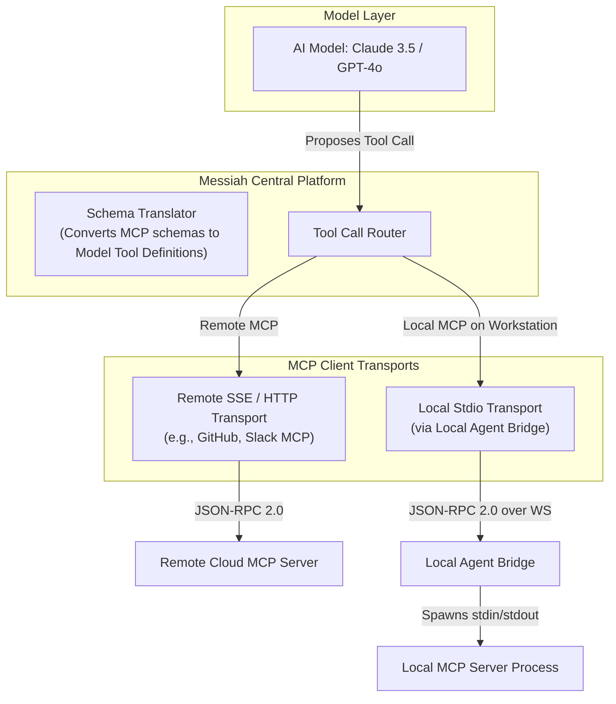
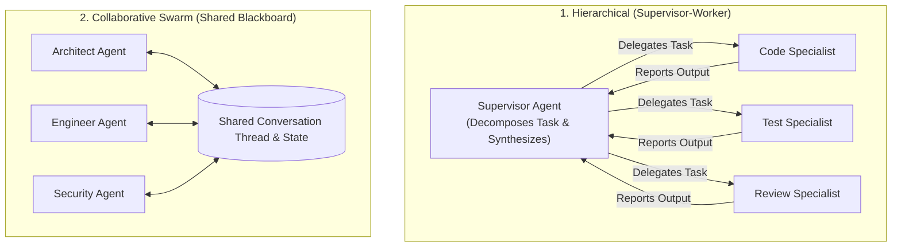

# MESSIAH — INTEGRATION STRATEGY & CONNECTOR SPECIFICATION

> **Document Stage**: Phase 0 — Architecture & Discovery  
> **Version**: 1.0.0  
> **Target Standards**: Model Context Protocol (MCP v1.0), OpenAPI 3.1, JSON-RPC 2.0

---

## 1. Architectural Distinction: The Four Core Abstractions

A fundamental design flaw in many agent platforms is blurring the lines between _what generates text_, _what decides the next step_, _what provides capabilities_, and _where code actually executes_.

Messiah strictly separates these into four discrete architectural layers:

```
+---------------------------------------------------------------------------------------+
|                                1. AI MODEL PROVIDERS                                  |
|   (Inference Engines: Text generation, Token streaming, Multimodal, Embeddings)       |
|            OpenAI API  |  Anthropic API  |  Google Gemini  |  Ollama / vLLM           |
+-------------------------------------------+-------------------------------------------+
                                            ^
                                            | (Prompts, Function Schemas, Completions)
                                            v
+---------------------------------------------------------------------------------------+
|                                2. AGENT RUNTIMES                                      |
|    (Execution Controllers: Decision loops, ReAct, Context management, Orchestration)  |
|            Single Agent Loop  |  Plan-and-Solve  |  Hierarchical Swarm                |
+-------------------------------------------+-------------------------------------------+
                                            ^
                                            | (Tool Invocations & Resource Reads)
                                            v
+---------------------------------------------------------------------------------------+
|                                3. MCP TOOL ECOSYSTEM                                  |
|   (Standardized Capabilities: Schema definitions, Documentation, Server Resources)    |
|            GitHub MCP  |  Postgres MCP  |  Slack MCP  |  Custom Enterprise MCP        |
+-------------------------------------------+-------------------------------------------+
                                            ^
                                            | (Execution Requests via Outbound WS)
                                            v
+---------------------------------------------------------------------------------------+
|                                4. LOCAL AGENT BRIDGES                                 |
|   (Local Execution Hosts: Sandboxed OS runners, File I/O, Subprocess execution)       |
|            macOS Bridge  |  Linux Devbox Bridge  |  Windows Studio Bridge             |
+---------------------------------------------------------------------------------------+
```

| Layer                 | Responsibility                                                                    | Input                           | Output                               | Stateless?       |
| :-------------------- | :-------------------------------------------------------------------------------- | :------------------------------ | :----------------------------------- | :--------------- |
| **1. Model Provider** | Raw mathematical intelligence and token probability generation.                   | Formatted Prompt + Tool Schemas | Token Stream + Tool Call Requests    | Yes              |
| **2. Agent Runtime**  | Multi-turn reasoning loops, context window budget, goal tracking.                 | User Goal + Available Tools     | Step-by-Step Actions & Conclusions   | No (Stateful)    |
| **3. MCP Tools**      | Exposing structured operations and resources to models via standardized protocol. | JSON Arguments                  | Structured Result / Resource Payload | Mostly Stateless |
| **4. Local Bridge**   | Sandboxed physical execution on a developer machine.                              | Command / File Mutation         | Output Stream (stdout/stderr) / Diff | No (Host State)  |

---

## 2. Standardized Connector Interfaces (TypeScript Contracts)

All integrations implement canonical, strictly typed TypeScript interfaces.

### 2.1 Model Provider Contract (`IModelProvider`)

```typescript
export interface ModelMessage {
  role: "system" | "user" | "assistant" | "tool";
  content: string | MultimodalContent[];
  name?: string;
  toolCallId?: string;
  toolCalls?: ModelToolCall[];
}

export interface MultimodalContent {
  type: "text" | "image_url" | "document";
  text?: string;
  imageUrl?: { url: string; detail?: "low" | "high" | "auto" };
  documentUrl?: { url: string; mimeType: string };
}

export interface ModelToolCall {
  id: string;
  type: "function";
  function: {
    name: string;
    arguments: string; // Serialized JSON string
  };
}

export interface ModelToolDefinition {
  name: string;
  description: string;
  parameters: Record<string, unknown>; // JSON Schema v7
}

export interface CompletionOptions {
  model: string;
  temperature?: number;
  maxTokens?: number;
  tools?: ModelToolDefinition[];
  toolChoice?:
    | "auto"
    | "required"
    | "none"
    | { type: "function"; function: { name: string } };
  signal?: AbortSignal;
}

export interface StreamChunk {
  deltaText?: string;
  deltaToolCalls?: Array<{
    index: number;
    id?: string;
    name?: string;
    argumentsChunk?: string;
  }>;
  finishReason?: "stop" | "tool_calls" | "length" | "content_filter" | null;
  usage?: {
    promptTokens: number;
    completionTokens: number;
    totalTokens: number;
  };
}

export interface IModelProvider {
  readonly providerId: string;
  readonly providerName: string;

  /**
   * Generates a streaming chat completion.
   */
  chatCompletionStream(
    messages: ModelMessage[],
    options: CompletionOptions,
  ): AsyncIterable<StreamChunk>;

  /**
   * Generates vector embeddings for semantic search.
   */
  generateEmbeddings(texts: string[], model?: string): Promise<number[][]>;

  /**
   * Lists available models under this provider account.
   */
  listModels(): Promise<
    Array<{ id: string; name: string; contextWindow: number }>
  >;

  /**
   * Verifies the authenticity and validity of configured credentials.
   */
  validateCredentials(apiKey: string, baseUrl?: string): Promise<boolean>;
}
```

---

### 2.2 Agent Runtime Contract (`IAgentRuntime`)

```typescript
export interface AgentState {
  taskId: string;
  status:
    | "IDLE"
    | "THINKING"
    | "WAITING_TOOL"
    | "WAITING_APPROVAL"
    | "COMPLETED"
    | "FAILED"
    | "CANCELLED";
  currentStep: number;
  totalStepsMax: number;
  messages: ModelMessage[];
  pendingApprovals: ToolApprovalRequest[];
}

export interface ToolApprovalRequest {
  id: string;
  toolName: string;
  arguments: Record<string, unknown>;
  deviceId?: string;
  riskLevel: "LEVEL_0" | "LEVEL_1" | "LEVEL_2";
  createdAt: number;
}

export interface IAgentRuntime {
  /**
   * Initializes and executes an autonomous or ReAct task.
   */
  startTask(
    taskId: string,
    initialGoal: string,
    agentConfig: AgentConfiguration,
  ): Promise<void>;

  /**
   * Processes a single reasoning turn in the loop.
   */
  step(taskId: string): Promise<AgentState>;

  /**
   * Submits a human approval or rejection decision.
   */
  handleApprovalDecision(
    taskId: string,
    approvalId: string,
    approved: boolean,
    feedback?: string,
  ): Promise<void>;

  /**
   * Cooperatively halts active execution.
   */
  cancelTask(taskId: string, reason?: string): Promise<void>;

  /**
   * Retrieves the current snapshot state of the runtime.
   */
  getState(taskId: string): Promise<AgentState>;
}
```

---

### 2.3 Model Context Protocol Client Contract (`IMCPClient`)

```typescript
export interface MCPTool {
  name: string;
  description: string;
  inputSchema: Record<string, unknown>;
}

export interface MCPResource {
  uri: string;
  name: string;
  description?: string;
  mimeType?: string;
}

export interface IMCPClient {
  /**
   * Connects to the MCP server via specified transport.
   */
  connect(): Promise<void>;

  /**
   * Closes connection cleanly.
   */
  disconnect(): Promise<void>;

  /**
   * Discovers tools registered on the server.
   */
  listTools(): Promise<MCPTool[]>;

  /**
   * Invokes an MCP tool by name.
   */
  callTool(
    name: string,
    args: Record<string, unknown>,
  ): Promise<{
    content: Array<{
      type: "text" | "image" | "resource";
      text?: string;
      data?: string;
    }>;
    isError?: boolean;
  }>;

  /**
   * Discovers available resources.
   */
  listResources(): Promise<MCPResource[]>;

  /**
   * Reads a resource by URI.
   */
  readResource(uri: string): Promise<{
    contents: Array<{
      uri: string;
      mimeType?: string;
      text?: string;
      blob?: string;
    }>;
  }>;
}
```

---

### 2.4 Local Agent Bridge Contract (`ILocalBridge`)

```typescript
export interface BridgeCommandRequest {
  taskId: string;
  commandId: string;
  command: string;
  cwd: string;
  env?: Record<string, string>;
  timeoutMs?: number;
  approvalNonce: string;
}

export interface BridgeLogChunk {
  commandId: string;
  stream: "stdout" | "stderr";
  chunk: string;
  timestamp: number;
}

export interface BridgeCommandResult {
  commandId: string;
  exitCode: number;
  durationMs: number;
  error?: string;
}

export interface ILocalBridge {
  registerDevice(token: string, publicKey: string): Promise<void>;
  dispatchCommand(request: BridgeCommandRequest): Promise<void>;
  streamProcessOutput(): AsyncIterable<BridgeLogChunk>;
  terminateCommand(commandId: string): Promise<void>;
}
```

---

## 3. AI Model Provider Connectors

### 3.1 OpenAI Connector (`OpenAIProvider`)

- **Supported Models**: `gpt-4o`, `gpt-4o-mini`, `o1`, `o3-mini`.
- **Special Capabilities**:
  - Structured Outputs with `response_format: { type: "json_schema" }`.
  - Reasoning effort control for `o1` and `o3-mini` (`reasoning_effort: "low" | "medium" | "high"`).
  - Parallel function calling parsing and stream accumulation.

### 3.2 Anthropic Connector (`AnthropicProvider`)

- **Supported Models**: `claude-3-5-sonnet-20241022`, `claude-3-5-haiku-20241022`, `claude-3-opus-20240229`.
- **Special Capabilities**:
  - Prompt Caching using `cache_control: { type: "ephemeral" }` on large system prompts and tool schemas (dramatically reduces latency and cost by up to 90%).
  - Detailed tool use framing using Anthropic Content Block format (`type: "tool_use"`).
  - Thinking budget parameters for extended reasoning.

### 3.3 Google Gemini Connector (`GeminiProvider`)

- **Supported Models**: `gemini-1.5-pro-latest`, `gemini-1.5-flash-latest`, `gemini-2.0-flash-exp`.
- **Special Capabilities**:
  - Ultra-large context window ingestion (up to 2 million tokens for codebases, audio, video).
  - Native multimodal streaming.
  - Native function calling adapter translating JSON schemas to Gemini `FunctionDeclaration`.

### 3.4 OpenAI-Compatible Generic Connector (`GenericOpenAICompatibleProvider`)

- **Targets**: Ollama, vLLM, LocalAI, Groq, Mistral, OpenRouter.
- **Configurable Attributes**: Custom `baseUrl`, custom model identifier, and optional auth token.
- **Handling Local Models**: Graceful handling of local model quirks (e.g., standardizing tool call syntax when smaller models produce pseudo-JSON).

---

## 4. MCP (Model Context Protocol) Integration

Messiah implements Anthropic's **Model Context Protocol (v1.0)** as a core architectural building block:



### 4.1 Transport Routing:

1. **Streamable HTTP (Preferred Remote)**: The modern MCP specification standardizes on Streamable HTTP for high-throughput, low-latency remote communication.
2. **Local Stdio MCP (`stdio`, Preferred Local)**: For tools executing on the developer's local machine (e.g., local Git repository MCP, filesystem MCP, Docker MCP), Messiah dispatches the tool call through the **Local Agent Bridge**, which spawns the MCP server locally over standard input/output (`stdio`) and forwards JSON-RPC frames over the secure WebSocket tunnel.
3. **Legacy HTTP+SSE Transport**: Retained for backward compatibility with early MCP servers that only support legacy Server-Sent Events.

---

## 5. Agent Runtime & Multi-Agent Coordination

### 5.1 The ReAct Reasoning Loop

The default runtime implements a resilient ReAct loop:

1. **Observation & Synthesis**: Formats conversation history, active system prompt, workspace memory embeddings, and tool definitions.
2. **LLM Inference**: Streams tokens from the selected model provider.
3. **Tool Call Interception**: Detects if the model requested one or more tool calls.
4. **Capability & Approval Check**:
   - If Level 0 (Read-Only): Dispatches immediately.
   - If Level 2 (HITL Required): Pauses the loop, checkpoints state in PostgreSQL, and alerts the user on Web/Mobile.
5. **Execution & Feedback**: Appends tool results to the thread as role `tool` and loops back to Step 1.
6. **Termination**: Exits when the model returns a final text response with `finishReason: "stop"`, or reaches `totalStepsMax` (safety limit).

### 5.2 Multi-Agent Topologies

Messiah supports two multi-agent collaboration patterns:



### 5.3 Infinite Loop & Billing Guards

To prevent infinite agent recursion:

- **Max Step Budget**: Hard default limit of 25 reasoning steps per task.
- **Cycle Detection**: Detects if an agent calls the exact same tool with identical arguments more than 3 consecutive times without progress, halting execution and notifying the user.
- **Per-Task Token Ceiling**: Execution aborts if cumulative token usage exceeds a configurable threshold (e.g., 200,000 tokens).

---

## 6. Resilience, Retries & Fallback Strategy

### 6.1 Exponential Backoff with Jitter

For HTTP 429 (Rate Limit) and 503 (Overloaded) responses:
$$\text{delay} = \min(\text{maxDelay}, \text{baseDelay} \times 2^{\text{attempt}}) \pm \text{jitter}$$

- Base delay: 1,000ms. Max delay: 30,000ms. Max retries: 3.

### 6.2 Automatic Provider Failover Routing

Workspaces can configure a secondary fallback model:

```json
{
  "primary": { "provider": "ANTHROPIC", "model": "claude-3-5-sonnet-20241022" },
  "fallback": { "provider": "OPENAI", "model": "gpt-4o" }
}
```

If Anthropic returns a persistent 5xx outage error, the runtime automatically transparently switches inference to OpenAI GPT-4o, notifying the user via a non-intrusive UI badge.

---

## 7. Model Context Protocol (MCP) Integration Strategy (Phase 3A & 3B)

Messiah targets the **2026-07-28 MCP Specification** using the official TypeScript SDK v2 (`@modelcontextprotocol/client` and `@modelcontextprotocol/core`):

### 7.1 Phased Implementation
- **Phase 3A (Current Milestone)**:
  - Transport connectivity: Remote Streamable HTTP with legacy SSE fallback. Zero stdio child process spawning.
  - Multi-tenant connection management: `McpConnectionManager` tracking isolated sessions per workspace.
  - Enterprise SSRF defense: Blocking private, loopback, link-local, carrier-grade NAT, and cloud metadata IPs.
  - Socket-level DNS rebinding defense (`safeFetch` / `createSafeLookup`).
  - Discovery & schema hashing: SHA-256 drift detection and `serverIdentifier.toolName` namespacing.
  - Governance & permission model: Deny-by-default (`REQUIRE_APPROVAL`), OWNER/ADMIN RBAC, and Phase 3A execution freeze.
  - Obsidian dark MCP Connection Center at `/settings/mcp` and `/settings/mcp/:connectionId`.
- **Phase 3B (Next Milestone)**:
  - Agent ReAct loop integration with discovered MCP tools.
  - LLM tool-calling format translation (OpenAI function calling, Anthropic tool use, Gemini function declarations).
  - Human-in-the-loop (HITL) approval UI and streaming execution feedback.
  - Audit trails for all tool invocations and output sanitization.

---

## 8. Multi-Agent Swarm Runtime Integration (Phase 5)

- **Unified Package Architecture (`@messiah/agents`)**: Shared DAG compilation (`SwarmDagValidator`), scoped inter-agent context construction (`SwarmContextBuilder`), Supervisor LLM planning/synthesis (`SwarmPlanner`), and durable runtime (`SwarmExecutionRuntime`) imported identically by both embedded `apps/server` workers and standalone `apps/worker` processes on `CHAT_GENERATION_QUEUE_NAME`.
- **Provider Reuse**: All planning, worker execution, and final synthesis passes route directly through `defaultProviderRegistry.getAdapter(...)` (`OpenAIAdapter`, `AnthropicAdapter`, `GeminiAdapter`) and decrypt credentials on demand via `VaultService`.
- **Unified Approval & Bridge Loop**: Both MCP `ToolApproval` records (`toolApprovalService`) and Workstation `BridgeTask` completions (`deviceConnectionGateway` / `deviceTaskService`) persist durable `swarm.resume` `OutboxEvent` entries so paused swarms resume reliably without polling or orphan leaks.

---

## 9. Embedding Providers, pgvector Memory & Durable Workflow Runtime Integration (Phase 6)

- **Provider Embeddings (`@messiah/providers`)**: Extended `IProviderAdapter` and `EmbeddingService` with batch-capable vector generation (`OpenAIAdapter.embedTexts` for `text-embedding-3-small`/`text-embedding-3-large`, `GeminiAdapter.embedTexts` for `gemini-embedding-001`/`text-embedding-004`) plus transient backoff and graceful lexical fallback (`ts_rank_cd` + `ILIKE`) whenever embedding providers are offline or unconfigured.
- **Prompt Memory Integration (`@messiah/memory`)**: Both Chat execution (`GenerationExecutionEngine` and `ChatGenerationWorker`) and Swarm workers (`SwarmExecutionRuntime`) retrieve authorized `PERSONAL`, `WORKSPACE`, and `AGENT` memories transparently prior to model invocation, with optional opted-in scrubbed auto-capture and manual "Remember" saving from `ChatWorkspace`.
- **Unified Workflow Execution (`@messiah/workflows`)**: Workflow runs share the existing `CHAT_GENERATION_QUEUE_NAME = "messiah-chat-generation"` BullMQ queue (`workflow.execute`), Transactional Outbox (`workflow.dispatch` / `workflow.resume`), PostgreSQL cron sweeper (`WorkflowSchedulerEngine`), internal domain event bus (`WorkflowEventRouter`), `ToolApprovalService`, `DeviceTaskService`, and `/api/v1/realtime` (`workflow.subscribe` + `workflow.snapshot`).

---

## 10. Cross-Platform Clients, Push Delivery & Observability Integration (Phase 7)

- **Shared Web Frontend Across Surfaces**: Both the installable Progressive Web App (`apps/web`), Tauri 2 desktop client (`apps/desktop`), and Capacitor 8 mobile shell (`apps/mobile`) reuse the single Next.js 16 React 19 UI and shared domain contracts (`@messiah/shared`).
- **Tauri Bridge Integration (`apps/desktop` -> `apps/bridge-daemon`)**: Desktop IPC commands supervise user-space local Bridge execution (`messiah_bridge_start`, `messiah_bridge_stop`, `messiah_bridge_status`) while preserving Ed25519 OS Keychain credentials, project root restrictions, signed task envelopes (`MESSIAH_TASK_AUTH:...`), and explicit admin authorization governance.
- **Realtime Multiplexed Workspace Stream (`/api/v1/realtime`)**: `workspace.subscribe` subscribes clients cleanly to `notificationStreamPublisher` events (`notification.created`), pushing live unread counters and unified approval snapshots directly into `Header` and `/approvals`.
- **VAPID Web Push & Service Worker (`web-push` + `/sw.js`)**: When `VAPID_PUBLIC_KEY` and `VAPID_PRIVATE_KEY` are provisioned, `NotificationService` dispatches encrypted Web Push notifications to registered `WEB_PWA` devices and automatically deactivates endpoints returning HTTP `404` or `410`.
- **Prometheus Telemetry (`/metrics`)**: Exposes process memory gauges, HTTP counter, PostgreSQL/Redis readiness probes, `pgvector` extension health, transactional outbox backlog counts, active paired bridges, and published workflow counts cleanly for `infrastructure/production/prometheus.yml`.

---

_End of Document: Messiah Integration Strategy & Connector Specification._
