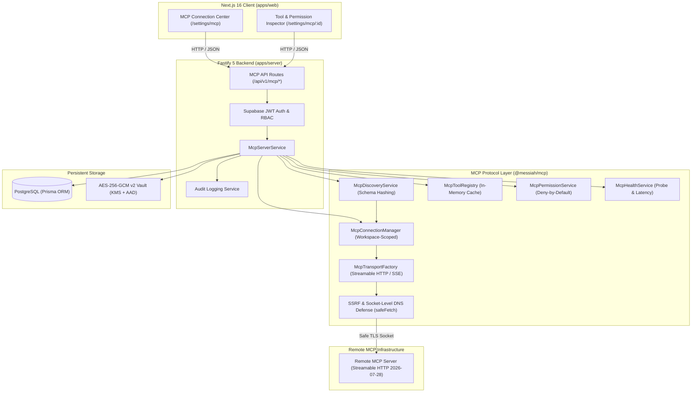

# MESSIAH — MCP Architecture

## 1. Executive Summary

MESSIAH connects modern generative intelligence with real-world enterprise infrastructure. In **Phase 3A (MCP Server Connections & Tool Registry)**, Messiah introduces an enterprise-grade Model Context Protocol (MCP) connection, discovery, and governance layer based on the **2026-07-28 MCP Specification** and the official TypeScript SDK v2 (`@modelcontextprotocol/client` and `@modelcontextprotocol/core`).

Phase 3A focuses exclusively on **connectivity, discovery, schema validation, and granular permission configuration**. AI-driven, model-triggered execution is strictly disabled during Phase 3A and scheduled for Phase 3B.

---

## 2. Architecture Overview

---

## 3. Core Component Responsibilities

### 3.1 `@messiah/mcp` (Dedicated MCP Package)
A dedicated, framework-agnostic TypeScript package encapsulating MCP SDK v2 integration conforming to the 2026-07-28 specification:
- **`McpTransportFactory`**: Instantiates official `StreamableHTTPClientTransport` with `redirectPolicy: "same-origin"` and legacy `SSEClientTransport` fallback. Integrates `safeFetch` and authenticated request dispatching.
- **`McpClientFactory`**: Instantiates modern `@modelcontextprotocol/client` `Client` instances operating statelessly with version identifiers (`messiah/1.0.0`). Deprecated capabilities (`roots`, `sampling`, `logging`) are omitted from client defaults.
- **`McpConnectionManager`**: Tracks active sessions partitioned strictly by `workspaceId -> connectionId`. Guarantees multi-tenant session isolation and clean disconnects.
- **`McpDiscoveryService`**: Queries `listTools` from remote servers, normalizes schemas, computes deterministic SHA-256 `schemaHash` values to detect server tool modifications, and formats unambiguous namespaced identifiers (`serverIdentifier.toolName`).
- **`McpToolRegistry`**: Manages in-memory tool caching per workspace, respecting protocol cache metadata and TTLs, with connection-level invalidation on configuration updates.
- **`McpPermissionService`**: Enforces strict deny-by-default execution policy (`REQUIRE_APPROVAL`). Asserts that tool execution is disabled during Phase 3A/3A.1 (`assertExecutionDisabled`).
- **`McpHealthService`**: Performs non-mutating health probes, measuring roundtrip latency, protocol version compatibility, and server capabilities.
- **`McpAuthService`**: Coordinates RFC 9728 protected resource discovery, RFC 8414 authorization server discovery with RFC 9207 issuer validation, PKCE S256 challenge generation, authorization code exchange, and token refresh.

### 3.2 Enterprise SSRF & Network Security Layer
- **`validateMcpEndpointUrl`**: Enforces HTTPS in production, explicit production egress-port policy (Port 443 by default), blocks restricted infrastructure ports (22, 25, 445, 5432, 6379...), detects evasive octal/hex/dword IP encodings, and rejects private IPv4/IPv6, loopback (`127.0.0.1`), link-local (`169.254.0.0/16`), cloud metadata (`169.254.169.254`, `fd00:ec2::254`), carrier-grade NAT (`100.64.0.0/10`), and 6to4 addresses (`2002::/16`).
- **`safeFetch` & Undici Dispatcher**: Hooks directly into Undici socket-level DNS lookups via `connect: { lookup: createSafeLookup }`, resolving addresses and re-validating them immediately before socket connection to prevent DNS rebinding TOCTOU race conditions while preserving TLS SNI certificate validation. Manually validates redirect hops (max 3) and automatically strips `Authorization` and `Cookie` headers on cross-origin redirects.

### 3.3 Server Layer (`apps/server`)
- **`McpServerService`**: Coordinates database transactions, RBAC validation (requiring `OWNER` or `ADMIN` roles for management operations), credential encryption via `VaultService`, discovery persistence, and audit logging.
- **`mcpRoutes`**: RESTful API endpoints at `/api/v1/mcp/*` with Zod validation and comprehensive anti-IDOR protections.

### 3.4 Client Layer (`apps/web`)
- **`/settings/mcp`**: Obsidian dark command center for viewing, connecting, health testing, and removing MCP server connections.
- **`/settings/mcp/:connectionId`**: Detailed inspection page displaying server capabilities, protocol version, discovered tools list, expandable JSON Schema viewers, and permission mode controls.

---

## 4. MCP Tool Execution & Multi-Turn Agent Loop (Phase 3B)

Phase 3B transitions discovered MCP tools from inspection into **active, controlled AI execution**:

### 4.1 Safe Tool Aliasing & Namespace Isolation
- Formatted as `mcp__<connectionSlug>__<toolName>` (max 64 chars, `[a-zA-Z0-9_]`).
- Provider-agnostic translation for OpenAI, Anthropic, and Google Gemini.

### 4.2 Two-Phase Human Approval Protocol
- Unprompted auto-execution permitted only for verified `READ_ONLY` or `EXPLICITLY_AUTHORIZED` tools.
- High-impact keywords (`delete`, `drop`, `pay`, `deploy`, `sudo`, `reboot`, etc.) automatically force approval even if nominally authorized.
- Single-use approval tokens bound to dual SHA-256 hashes (`schemaHash`, `argumentsHash`) with 5-minute dynamic TTL.
- Non-blocking worker pause & resume: BullMQ workers exit cleanly on `AWAITING_APPROVAL`, re-enqueuing with a fresh job ID when the user approves.

### 4.3 Multi-Turn ReAct Orchestration
- Managed inside `@messiah/worker` multi-turn loop.
- Enforces strict budgets: max 6 rounds, max 10 tool calls, max 30s timeout per call, max 10m run duration.
- Repetition guard terminates execution if identical tool calls repeat 3 consecutive times.

### 4.4 Untrusted Data Sanitization
- Result payloads capped at 512KB.
- Regex scanner redacts sensitive Bearer tokens, OpenAI/Anthropic/Gemini keys, and PEM private keys.
- Strips dangerous protocols (`javascript:`, `vbscript:`, `data:text/html`).
- Tool results are passed exclusively inside `TOOL` role messages and never injected into system instructions.
