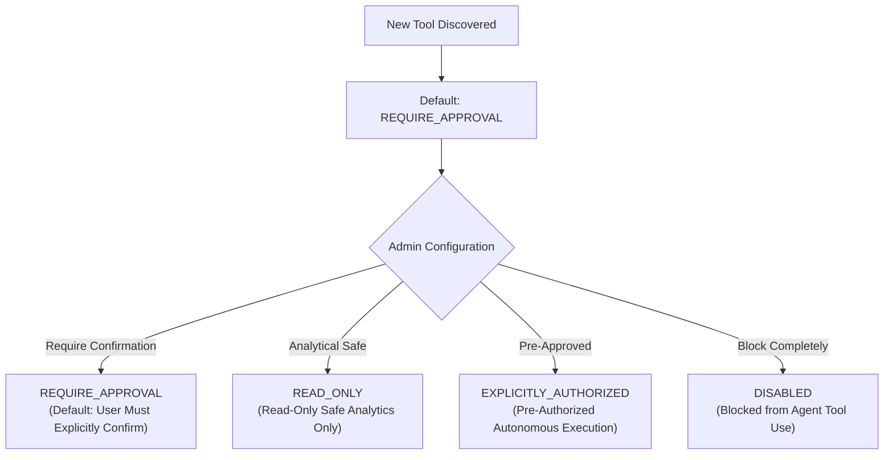

# MESSIAH — MCP Authorization & Governance

## 1. Governance Principles

The Model Context Protocol integration in MESSIAH enforces strict, enterprise-grade access control and governance:

1. **Workspace Boundary Isolation**: MCP connections, credentials, and tool permissions are strictly scoped to a single workspace. No cross-workspace leakage or global tool sharing exists.
2. **Deny-by-Default Execution**: Discovered tools default immediately to `REQUIRE_APPROVAL`.
3. **Informational-Only Annotations**: Tool annotations provided by remote servers (e.g. `readOnly: true`, `audience: ["all"]`) are treated strictly as metadata. Messiah never automatically authorizes execution based on untrusted server annotations.
4. **Phase 3A Execution Freeze**: Model-triggered execution of tools is disabled in Phase 3A. Invocation attempts throw `McpPermissionError: MCP_EXECUTION_DISABLED_PHASE_3A`.
5. **Anti-IDOR Enforcement**: Accessing an MCP connection in an unauthorized workspace returns `404 Not Found` rather than `403 Forbidden`, preventing discovery of private workspace identifiers.

---

## 2. Workspace Role Matrix

| Action | OWNER | ADMIN | MEMBER | VIEWER |
| :--- | :---: | :---: | :---: | :---: |
| List MCP Connections | Yes | Yes | Yes | Yes |
| Inspect Connection Details & Tools | Yes | Yes | Yes | Yes |
| Create MCP Connection | Yes | Yes | No (403) | No (403) |
| Update Endpoint / Credentials | Yes | Yes | No (403) | No (403) |
| Connect & Discover Tools | Yes | Yes | No (403) | No (403) |
| Run Health Probes | Yes | Yes | No (403) | No (403) |
| Configure Tool Permissions | Yes | Yes | No (403) | No (403) |
| Delete Connection | Yes | Yes | No (403) | No (403) |

---

## 3. Tool Permission Modes

Each discovered tool definition is associated with a distinct permission policy in `mcp_tool_permissions`:



### 3.1 `REQUIRE_APPROVAL` (Default)
- **Policy**: The tool is discoverable and available to models, but any planned invocation requires explicit human administrator or user confirmation before running.
- **Assignment**: Automatically assigned to every tool upon initial discovery.

### 3.2 `READ_ONLY`
- **Policy**: Tool may be executed automatically only if the operation has been audited and designated as side-effect free (e.g., SELECT queries, metadata queries, file reads).

### 3.3 `EXPLICITLY_AUTHORIZED`
- **Policy**: Pre-authorized for autonomous agent execution within conversation threads in this workspace. Must be explicitly granted by an `OWNER` or `ADMIN`.

### 3.4 `DISABLED`
- **Policy**: Tool is completely hidden from model schemas and blocked from invocation under all conditions.

---

## 4. Phase 3A Enforcement

In Phase 3A:
```typescript
McpPermissionService.assertExecutionDisabled(toolName: string): void {
  throw new McpPermissionError(
    `Execution of tool '${toolName}' is disabled in Phase 3A. Tool execution is scheduled for Phase 3B.`,
    "MCP_EXECUTION_DISABLED_PHASE_3A",
    403
  );
}
```
All discovered tools and permissions configured in the UI are persisted in PostgreSQL ready for Phase 3B activation.
