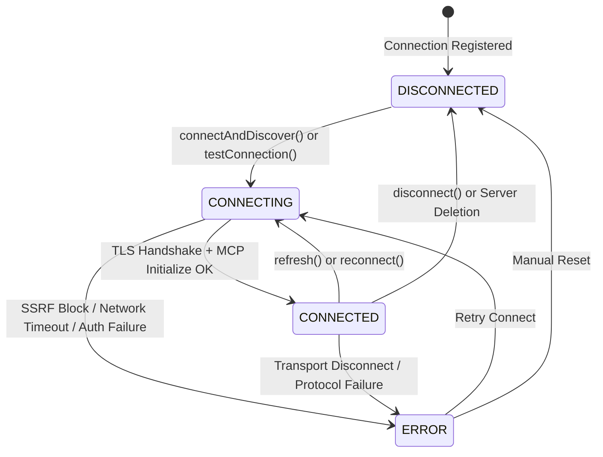

# MESSIAH — MCP Connection Lifecycle

## 1. Lifecycle Overview

The Model Context Protocol (MCP) connection lifecycle in MESSIAH manages remote server sessions according to the **2026-07-28 MCP Specification**. All transport sessions are managed dynamically in memory by `McpConnectionManager` and persisted in PostgreSQL via `McpServerConnection`.



---

## 2. Lifecycle Phases

### Phase 1: Registration (`DISCONNECTED`)
- Administrator (`OWNER` or `ADMIN`) provides:
  - Connection display name
  - Remote endpoint URL
  - Transport type (`STREAMABLE_HTTP` or `SSE`)
  - Authentication configuration (`NONE`, `BEARER`, or `OAUTH`)
- Endpoint URL is validated against the SSRF security policy:
  - HTTPS enforced in production.
  - Private IPv4/IPv6, loopbacks, carrier-grade NAT, and cloud metadata blocked.
  - Restricted infrastructure ports (22, 25, 445) blocked.
- If a Bearer token is provided:
  - Encrypted using `VaultService` (AES-256-GCM v2) with Additional Authenticated Data (AAD):
    `messiah:vault:v2:${workspaceId}:${connectionId}:mcp`
  - Stored securely in `mcp_credentials`. Plaintext is never persisted or logged.
- Initial database status: `DISCONNECTED`.

### Phase 2: Negotiation & Initialization (`CONNECTING`)
- `McpConnectionManager.connect(context)` is initiated.
- State transitions to `CONNECTING`.
- Transport instantiated via `McpTransportFactory.createTransport()`:
  - Primary transport: `StreamableHTTPClientTransport` using `safeFetch`.
  - Legacy fallback: `SSEClientTransport`.
- Official MCP SDK client initialized with capabilities:
  ```json
  {
    "roots": { "listChanged": true },
    "sampling": {}
  }
  ```
- Client sends MCP `initialize` request to negotiate protocol revision:
  - Target protocol version: `2026-07-28`.
  - Server capabilities and metadata (`serverName`, `serverVersion`, `capabilities`) are extracted and stored.

### Phase 3: Active Discovery (`CONNECTED`)
- Client invokes `client.listTools()`.
- Discovered tools are normalized and registered:
  - Namespaced tool identifier formatted: `serverIdentifier.toolName`.
  - Deterministic SHA-256 `schemaHash` computed across name, description, input schema, and output schema.
  - Upserted into `mcp_tool_definitions`.
  - Newly discovered tools automatically receive `REQUIRE_APPROVAL` default permission in `mcp_tool_permissions`.
  - Missing tools from previous discoveries are flagged `isAvailable: false`.
- Discovered tools are cached in `McpToolRegistry` memory cache.
- State transitions to `CONNECTED`.
- `lastConnectedAt` and `lastValidatedAt` timestamps updated.

### Phase 4: Non-Mutating Health Probes (`McpHealthService`)
- Operators can trigger ad-hoc health probes via `POST /api/v1/mcp/connections/:id/test`.
- Measures:
  - Roundtrip connection latency in milliseconds.
  - Protocol version compatibility.
  - Server identity and version.
  - Discovered tools count.
- Does not modify database status or tool permissions.

### Phase 5: Re-discovery & Refresh (`CONNECTED` -> `CONNECTING` -> `CONNECTED`)
- Invoked via `POST /api/v1/mcp/connections/:id/refresh`.
- Re-queries `listTools()`, detects schema changes via `schemaHash`, updates definitions, and invalidates in-memory cache.

### Phase 6: Graceful Disconnection & Cleanup (`DISCONNECTED`)
- Triggered by connection deletion or transport updates.
- In-memory active session is closed (`client.close()`).
- In-memory registry cache is evicted (`toolRegistry.invalidateConnection()`).
- Database cascade deletes associated credentials, tool definitions, and tool permissions.
