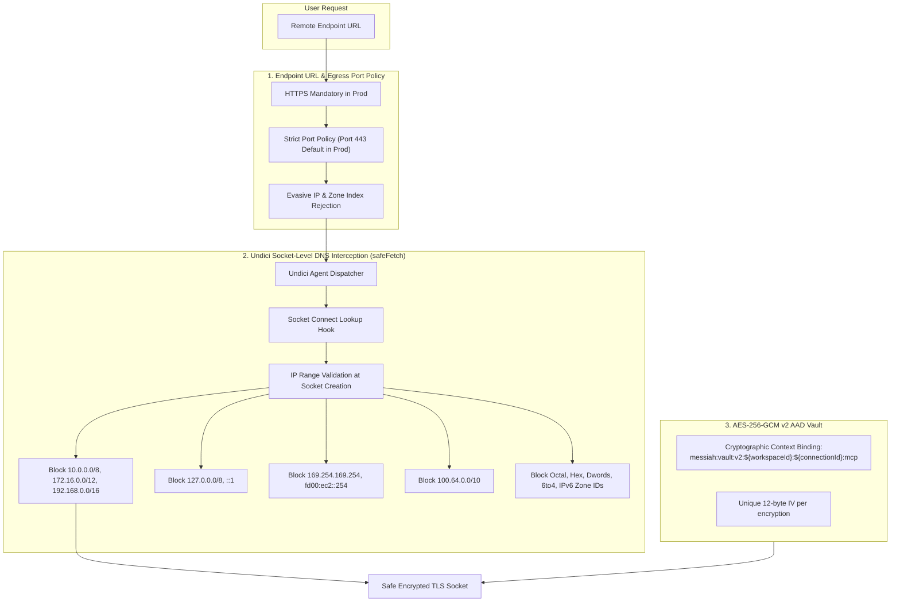

# MESSIAH — MCP Security Architecture & Protocol Hardening

## 1. Threat Model & Security Posture

Remote Model Context Protocol (MCP) servers run outside Messiah's trust boundary. Connecting external endpoints introduces significant attack surfaces:
- **Server-Side Request Forgery (SSRF)**: Attackers manipulating endpoint URLs to probe internal networks, cloud metadata, or loopback daemons.
- **DNS Rebinding**: Dynamic DNS servers returning a benign public IP at validation time, followed by a local private IP when the connection socket opens (TOCTOU).
- **Socket-Level Undici Interception Bypass**: In Node.js 18+ and Node 24, global `fetch` is backed by Undici and ignores traditional `http.Agent` / `https.Agent`.
- **Evasive IP Encoding & Port Manipulation**: Bypassing naive string filters using octal (`0177.0.0.1`), hexadecimal (`0x7f.0.0.1`), dword integers (`2130706433`), or non-standard egress ports.
- **OAuth Authorization Server Mix-Up Attacks**: Malicious authorization servers intercepting authorization codes or tokens across mismatched issuers.
- **Credential Interception & Transplantation**: Plaintext credentials leaking in logs or being transposed across tenant workspaces.
- **Unauthorized Autonomous Tool Invocation**: Malicious tools executing operations without human oversight.

---

## 2. Defensive Countermeasures



---

## 3. Network & SSRF Defenses

### 3.1 Explicit Production Egress-Port Policy
Messiah enforces an explicit allowlist policy for production egress rather than relying solely on blocked ports:
- **HTTPS Only**: Plaintext HTTP is prohibited in production.
- **Port 443 Default**: Outbound connections default strictly to standard HTTPS port 443.
- **Configurable Egress Ports**: Non-standard egress ports (e.g. 8443) are rejected unless explicitly configured via `allowedPorts` or `MCP_ALLOWED_EGRESS_PORTS`.
- **Infrastructure Port Guard**: Dangerous infrastructure ports (SSH 22, SMTP 25, DNS 53, SMB 445, Docker 2375/2376, Postgres 5432, Redis 6379/6380, etc.) are always rejected.

### 3.2 Evasive IP Representation & Zone Identifier Rejection
To prevent filter evasion, Messiah validates raw host strings and IP structures:
- **Octal IPv4**: Rejects segments with leading zeros (e.g. `0177.0.0.1`).
- **Hexadecimal IPv4**: Rejects `0x` prefixes (e.g. `0x7f.0.0.1`).
- **Dword Integer Notation**: Rejects pure decimal integer hosts (e.g. `2130706433`).
- **Short Numeric Notation**: Rejects dot-separated numeric hosts with fewer than 4 parts (e.g. `127.1`).
- **IPv6 Zone Identifiers / Scope IDs**: Rejects `%` and `%25` characters (e.g. `fe80::1%eth0`).
- **IPv4-Mapped IPv6**: Validates both dot notation (`::ffff:127.0.0.1`) and hex notation (`::ffff:7f00:1`).
- **6to4 Addresses**: Unpacks `2002::/16` addresses and tests embedded IPv4 bytes against private ranges.

### 3.3 Socket-Level DNS Interception via Undici Dispatcher
Standard URL validation checks IP addresses before initiating connections. A malicious domain can return a short TTL (e.g., 0 seconds) with a public IP on the initial check and a private IP (e.g., `169.254.169.254`) on the actual socket connect (TOCTOU DNS rebinding).

Because Node.js 18+ and Node 24 built-in `fetch` is backed by Undici and ignores traditional `http.Agent` / `https.Agent`, Messiah constructs a dedicated Undici `Agent` dispatcher with a custom `connect.lookup` hook:
```typescript
export function createSafeDispatcher(
  ssrfOptions: SsrfValidationOptions = {},
  timeoutMs = 15000
): UndiciAgent {
  const lookup = createSafeLookup(ssrfOptions);
  return new UndiciAgent({
    connect: {
      lookup,
      timeout: timeoutMs,
    },
  });
}
```
Every remote MCP HTTP request (protocol negotiation, tool listing, health probes, schema refresh, OAuth discovery, and token exchange) is routed through this Undici dispatcher. TLS SNI certificate validation is strictly preserved.

### 3.4 Safe Redirects & Credential Stripping
`safeFetch` manually handles redirects (`redirect: "manual"`):
- Limits maximum redirects to 3 hops (configurable).
- Re-validates target URLs against the SSRF and egress port policy on every redirect hop.
- If a redirect attempts to bounce to an internal host, link-local metadata, or private IP, it is immediately aborted.
- Automatically strips `Authorization`, `Proxy-Authorization`, and `Cookie` headers if the redirect origin differs from the initial origin.
- Adheres to HTTP semantics by converting POST to GET on 303 See Other.

---

## 4. OAuth Security & RFC 9207 Issuer Validation

Messiah's OAuth implementation (`@messiah/mcp/auth/mcpAuthService.ts`) implements RFC 9728 and RFC 8414 metadata discovery with strict RFC 9207 issuer validation:
1. **RFC 9207 Defense Against Mix-Up Attacks**:
   When exchanging authorization codes, the `iss` parameter returned by the authorization server is strictly validated against `serverMetadata.issuer` (or the authorization server origin). If an issuer mismatch is detected, `McpAuthError` is thrown and tokens are rejected.
2. **PKCE S256 Challenge & High-Entropy State**:
   High-entropy 32-byte cryptographically secure random values are used for PKCE code verifiers (hashed with SHA-256) and CSRF state parameters.
3. **Protected Refresh & Rotation**:
   OAuth token refresh requests use `safeFetch` with Undici dispatchers. New access and refresh tokens are immediately re-encrypted into the Vault using AES-256-GCM v2 with AAD.

---

## 5. Credential Vault v2 Context Binding

Bearer tokens and refresh tokens are encrypted using **AES-256-GCM** with **Additional Authenticated Data (AAD)**:
```
messiah:vault:v2:${workspaceId}:${connectionId}:mcp
```
### Security Guarantees:
- **No Token Transplantation**: An encrypted ciphertext copied from one workspace to another, or from one connection to another, fails authentication tag verification during decryption.
- **Audit Logging**: Audit records redact all keys matching `token`, `secret`, `key`, `password`, or `ciphertext`.
- **Zero Secret Exposure**: Public API endpoints return only connection and credential metadata (`authType`, `hasAccessToken: true`, `lastValidatedAt`), never raw credentials.

---

## 6. Threat Model Residual Risks & Limitations

> [!IMPORTANT]
> Software-level SSRF mitigations provide critical application-level defense-in-depth, but **cannot guarantee complete immunity** against all network-level attacks.
> 
> Production deployments must enforce **OS and network-level egress filtering** (VPC security groups, egress firewalls, outbound proxies, and container network policies) restricting egress to approved external networks.
> 
> Messiah makes **no claim of external third-party security certification** or absolute vulnerability immunity.
