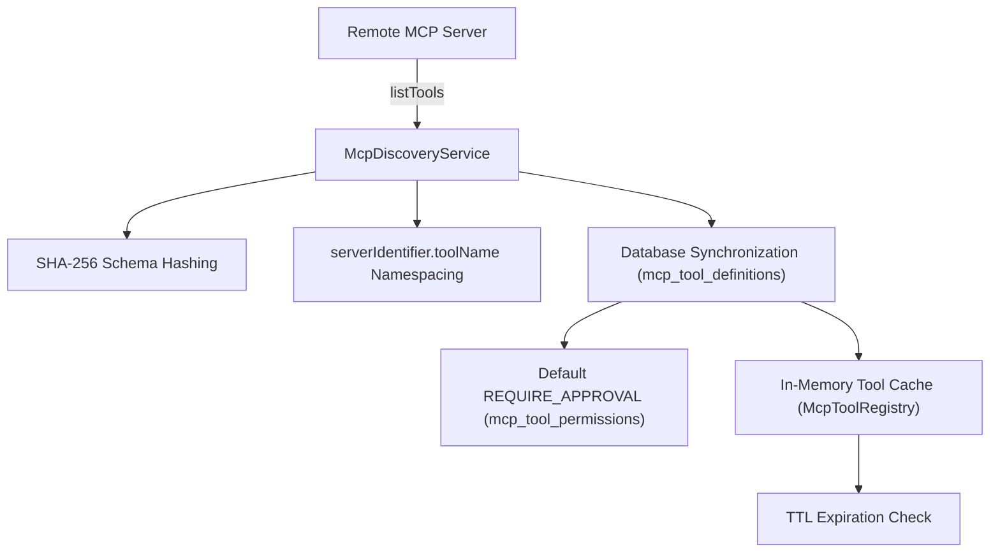

# MESSIAH — MCP Tool Registry & Discovery

## 1. Tool Registry Architecture

The Messiah MCP Tool Registry maintains a high-performance, synchronized directory of tools discovered across all connected MCP servers in a workspace.



---

## 2. Unambiguous Tool Namespacing

To prevent naming collisions between different MCP servers connected to the same workspace, tools are assigned a canonical namespaced identifier:

```typescript
// formatNamespacedName(serverIdentifier, toolName)
const namespacedName = `${cleanServer}.${cleanTool}`;
```

### Examples:
- Server `"PostgreSQL DB"` + Tool `"execute_sql"` $\rightarrow$ `"postgresql_db.execute_sql"`
- Server `"GitHub Internal"` + Tool `"create_issue"` $\rightarrow$ `"github_internal.create_issue"`
- Server `"DevTools Agent"` + Tool `"run_linter"` $\rightarrow$ `"devtools_agent.run_linter"`

---

## 3. Deterministic Schema Hashing

Remote tools may evolve over time (e.g. adding required parameters, changing parameter types, modifying descriptions). Messiah detects changes by calculating a deterministic SHA-256 hash over canonical JSON:

```typescript
public static computeSchemaHash(tool: {
  name: string;
  description?: string;
  inputSchema?: Record<string, unknown>;
  outputSchema?: Record<string, unknown>;
}): string {
  const canonical = JSON.stringify({
    name: tool.name,
    description: tool.description || "",
    inputSchema: tool.inputSchema || {},
    outputSchema: tool.outputSchema || null,
  });
  return crypto.createHash("sha256").update(canonical).digest("hex");
}
```

When `refresh` or `connect` discovers a tool:
- If `schemaHash` has changed: The database record is updated and in-memory cache is invalidated.
- If a previously registered tool is missing from discovery: `isAvailable` is marked `false`.

---

## 4. In-Memory Registry Caching

`McpToolRegistry` stores discovered tools in memory partitioned by `workspaceId -> connectionId`:
- **Workspace Segregation**: Tools belonging to Workspace A are completely inaccessible from Workspace B.
- **TTL Expiration**: Automatically purges entries when the remote server's cache TTL expires.
- **Instant Invalidation**: Connection updates, permission changes, or server removals instantly evict cached items.

---

## 5. Database Schema Reference

### `mcp_tool_definitions` Table
- `id` (UUID, Primary Key)
- `connection_id` (UUID, Foreign Key $\rightarrow$ `mcp_server_connections`)
- `tool_name` (VARCHAR 128)
- `display_name` (VARCHAR 255, Nullable)
- `description` (TEXT, Nullable)
- `input_schema` (JSONB)
- `output_schema` (JSONB, Nullable)
- `annotations` (JSONB, Nullable)
- `cache_metadata` (JSONB, Nullable)
- `discovered_at` (TIMESTAMPTZ)
- `schema_hash` (VARCHAR 64)
- `is_available` (BOOLEAN, Default: true)

Unique constraint: `@@unique([connection_id, tool_name])`

### `mcp_tool_permissions` Table
- `id` (UUID, Primary Key)
- `workspace_id` (UUID, Foreign Key $\rightarrow$ `workspaces`)
- `tool_definition_id` (UUID, Unique, Foreign Key $\rightarrow$ `mcp_tool_definitions`)
- `permission_mode` (ENUM: `DISABLED`, `READ_ONLY`, `REQUIRE_APPROVAL`, `EXPLICITLY_AUTHORIZED`)
- `requires_approval` (BOOLEAN, Default: true)
- `configured_by_user_id` (UUID, Nullable, Foreign Key $\rightarrow$ `users`)
- `created_at` / `updated_at` (TIMESTAMPTZ)
