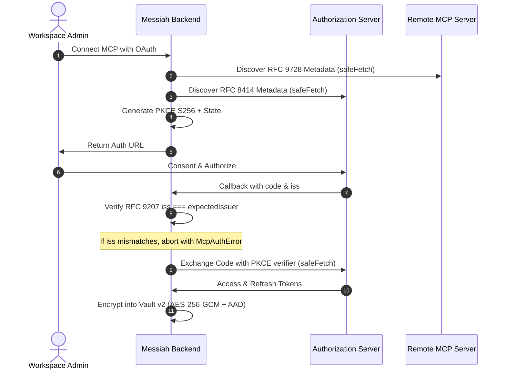

# MESSIAH — PHASE 3A.1 DELIVERY REPORT
## MCP Transport Security & Protocol Hardening

> **Product**: MESSIAH — The Universal AI Agent Workspace  
> **Tagline**: One intelligence layer. Every agent. Every device.  
> **Milestone**: Phase 3A.1 — MCP Transport Security & Protocol Hardening  
> **Architectural Status**: Verified & Hardened  
> **Automated Verification**: **147 Passing Tests Monorepo-Wide** (25 `@messiah/mcp`, 80 `@messiah/server`, 27 `@messiah/providers`, 4 `@messiah/worker`, 11 `@messiah/web`)  

---

## 1. Executive Summary

Phase 3A.1 constitutes a targeted, high-rigor security hardening milestone for MESSIAH's Model Context Protocol (MCP) subsystem. Following the successful delivery of Phase 3A (remote MCP server connection management and tool registry), Phase 3A.1 systematically addresses critical transport security risks inherent in modern Node.js execution environments and distributed agent protocols:

1. **Elimination of Node.js 18+/24 Fetch Interception Bypasses**: Resolved the vulnerability where global `fetch` ignores traditional `http.Agent`/`https.Agent` by embedding a dedicated `undici.Agent` dispatcher with socket-level DNS resolution hooks (`connect: { lookup: safeLookup }`).
2. **Explicit Production Egress-Port Policy**: Replaced passive port blocklists with an explicit production egress-port allowlist: HTTPS only, Port 443 by default in production, requiring explicit administrator configuration for non-standard ports.
3. **Defense Against Evasive IP Encodings & Scope Identifiers**: Enforced strict sanitization of raw hostnames and resolved addresses against octal (`0177.0.0.1`), hexadecimal (`0x7f.0.0.1`), dword integers (`2130706433`), short numeric forms (`127.1`), IPv6 zone identifiers (`%eth0`), IPv4-mapped IPv6, and 6to4 addresses (`2002::/16`).
4. **Safe Redirect Handling & Credential Stripping**: Implemented manual multi-hop redirect inspection (max 3 hops), re-validating target URLs against the SSRF and egress port policy at every hop, and strictly stripping `Authorization`, `Proxy-Authorization`, and `Cookie` headers upon origin changes.
5. **MCP 2026-07-28 Wire Compatibility & Stateless Client**: Modernized `StreamableHTTPClientTransport` with `redirectPolicy: "same-origin"`. Omitted deprecated capabilities (`roots`, `sampling`, `logging`) from client defaults, aligning with stateless protocol requirements.
6. **OAuth RFC 9207 Defense Against Mix-Up Attacks**: Enforced RFC 9207 issuer validation during authorization code exchanges, preventing attackers from intercepting authorization codes or substituting tokens across mismatched identity providers.
7. **Workspace & Permission Isolation**: Guaranteed tool permissions strictly inherit `workspaceId` from the parent connection, enforcing deny-by-default (`REQUIRE_APPROVAL`), anti-IDOR protections (HTTP 404), and maintaining the absolute tool execution freeze (`assertExecutionDisabled`) prior to Phase 3B.

---

## 2. Verified Components & Interfaces

The following components and interfaces were audited, hardened, and verified:

| File / Component | Responsibility | Hardening Measures Applied |
| :--- | :--- | :--- |
| `packages/mcp/src/security/safeFetch.ts` | Outbound HTTP Transport Client | Integrated `undici.Agent` dispatcher with `connect.lookup`; manual redirect loop; cross-origin header stripping; timeout & size limits. |
| `packages/mcp/src/security/ssrf.ts` | Network & Egress Security Engine | Production egress-port policy (Port 443 default); raw host evasive encoding scanner; private/reserved IPv4/IPv6, CGNAT, 6to4, and zone identifier blocks. |
| `packages/mcp/src/transports/transportFactory.ts` | MCP Transport Factory | Configured `StreamableHTTPClientTransport` with `redirectPolicy: "same-origin"` and injected custom `safeFetch` across all transports. |
| `packages/mcp/src/client/mcpClientFactory.ts` | MCP Client Factory | Omitted deprecated `roots`, `sampling`, and `logging` from default client capabilities, adhering to the 2026-07-28 stateless standard. |
| `packages/mcp/src/auth/mcpAuthService.ts` | OAuth2 & PKCE Authentication Service | RFC 9728 & RFC 8414 discovery via `safeFetch`; RFC 9207 issuer validation; high-entropy PKCE S256 challenges; zero plaintext token storage. |
| `apps/server/src/services/mcpServerService.ts` | Backend MCP Service & RBAC | Workspace ID inheritance on permissions; anti-IDOR checks (404); AES-256-GCM v2 AAD credential storage; audit logging redaction. |
| `apps/server/src/routes/api/v1/mcp.ts` | Fastify REST API Routes | Zod schema validation; RBAC authorization hooks (`OWNER`/`ADMIN` required); production egress port error handling. |
| `packages/mcp/src/tests/mcp.test.ts` | MCP Security & Protocol Test Suite | Added 10 new security tests (25 tests total) covering Undici dispatchers, evasive IPs, egress ports, redirects, client caps, and OAuth RFC 9207. |
| `apps/server/src/tests/mcp.test.ts` | Server Integration Test Suite | Added 2 new integration tests (20 tests total) covering evasive IP rejection and cross-workspace permission anti-IDOR. |

---

## 3. Undici Socket-Level DNS Interception & SafeFetch

### The Node.js 18+/24 Built-In Fetch Vulnerability
In Node.js 18 and later (including Node.js 24), the global `fetch()` implementation is powered by Undici. Traditional solutions that configure custom `http.Agent` or `https.Agent` instances with custom `lookup` functions are **completely ignored** by global `fetch()`. Applications that assume passing an `https.Agent` protects global `fetch()` remain vulnerable to Time-of-Check to Time-of-Use (TOCTOU) DNS rebinding attacks.

### Architectural Solution
Messiah directly couples `safeFetch` to Undici's connection pool via a custom `UndiciAgent` dispatcher:

```typescript
export function createSafeLookup(ssrfOptions: SsrfValidationOptions = {}) {
  return function safeLookup(
    hostname: string,
    options: dns.LookupOptions,
    callback: (err: NodeJS.ErrnoException | null, address: string | dns.LookupAddress[], family?: number) => void
  ) {
    if (isEvasiveNumericHost(hostname)) {
      const err = new SsrfSecurityError(`Evasive, malformed, or unusual IP representation is blocked: ${hostname}`);
      return callback(err as NodeJS.ErrnoException, "", 4);
    }

    dns.lookup(hostname, { all: true }, (err, addresses) => {
      if (err) return callback(err, "", 4);
      if (!addresses || addresses.length === 0) {
        return callback(new Error(`DNS resolution returned empty for ${hostname}`), "", 4);
      }

      try {
        for (const record of addresses) {
          validateIpAddress(record.address, ssrfOptions);
        }
      } catch (validationErr) {
        return callback(validationErr as NodeJS.ErrnoException, "", 4);
      }

      if (options.all) {
        callback(null, addresses);
      } else {
        const first = addresses[0]!;
        callback(null, first.address, first.family);
      }
    });
  };
}

export function createSafeDispatcher(ssrfOptions: SsrfValidationOptions = {}, timeoutMs = 15000): UndiciAgent {
  const lookup = createSafeLookup(ssrfOptions);
  return new UndiciAgent({
    connect: { lookup, timeout: timeoutMs },
  });
}
```

### Preservation of TLS SNI & Certificate Validation
Because Undici establishes the TLS handshake directly over the connected TCP socket using the requested virtual hostname, TLS Server Name Indication (SNI) and certificate chain verification remain fully intact (`rejectUnauthorized: true`). The socket connection is aborted immediately at TCP connect time if the DNS-resolved IP maps to an unauthorized destination.

---

## 4. Outbound Network & SSRF Security Policy

### Explicit Production Egress-Port Policy
Rather than relying on porous port blocklists, Messiah enforces an explicit allowlist policy in production:
- **HTTPS Mandatory**: Plaintext `http:` is strictly prohibited in production (`NODE_ENV === "production"`).
- **Default Port 443**: Outbound connections default strictly to standard HTTPS port 443. Any endpoint explicitly declaring another port (e.g., `https://example.com:8080/mcp`) is rejected with HTTP 400 (`SSRF_VALIDATION_FAILED`).
- **Configurable Port Overrides**: Administrators can permit designated non-standard egress ports (e.g., `8443`) via `allowedPorts` options or the `MCP_ALLOWED_EGRESS_PORTS` environment variable (comma-delimited integers).

```
Default Production Egress Policy:
- Protocols: https: ONLY
- Allowed Ports: 443 ONLY (unless explicitly whitelisted via MCP_ALLOWED_EGRESS_PORTS)
```

### Prohibited IP Subnets & Infrastructure Ports
Regardless of environment, Messiah strictly blocks:
- **Loopback**: `127.0.0.0/8`, `::1`
- **Private Networks (RFC 1918)**: `10.0.0.0/8`, `172.16.0.0/12`, `192.168.0.0/16`
- **Carrier-Grade NAT (RFC 6598)**: `100.64.0.0/10`
- **Link-Local & Cloud Metadata**: `169.254.0.0/16` (including AWS/GCP IMDS `169.254.169.254`), `fe80::/10`, AWS IMDSv6 `fd00:ec2::254`
- **IPv6 ULA (RFC 4193)**: `fc00::/7` (`fc...` and `fd...`)
- **Broadcast & Current Network**: `0.0.0.0/8`, `255.255.255.255`
- **Critical Infrastructure Ports**: 22 (SSH), 25 (SMTP), 53 (DNS), 111 (rpcbind), 135/137-139/445 (SMB), 2375/2376 (Docker), 5432 (Postgres), 6379/6380 (Redis), 9000/9001 (MinIO), 11211 (Memcached), 27017 (MongoDB).

---

## 5. Evasive IP Encoding & IPv6 Zone Identifier Defenses

Attackers frequently leverage alternate IP notations to evade naive URL regexes and string comparisons. WHATWG URL parsers internally normalize some representations, while OS resolvers (`getaddrinfo`) interpret others differently. Messiah implements a pre-parser scanning layer on the raw endpoint URL string:

1. **Octal IPv4**: Detected when any decimal component of an IPv4 address contains a leading zero (e.g., `0177.0.0.1`).
2. **Hexadecimal IPv4**: Detected when any component starts with `0x` or `0X` (e.g., `0x7f.0.0.1`).
3. **Dword / Integer Notation**: Detected when the hostname consists solely of decimal digits (e.g., `2130706433` -> `127.0.0.1`).
4. **Short Numeric Notation**: Detected when a dot-separated numeric host contains fewer than 4 segments (e.g., `127.1` or `10.1`).
5. **IPv6 Zone Identifiers / Scope IDs**: Detected when an address or hostname contains `%` or `%25` (e.g., `fe80::1%eth0`), which could bind sockets to local interfaces.
6. **IPv4-Mapped IPv6**: Inspects both dot format (`::ffff:127.0.0.1`) and hex format (`::ffff:7f00:1`), extracting the embedded 32-bit IPv4 address for validation against private subnets.
7. **6to4 Addresses**: Unpacks `2002::/16` addresses, extracting the subsequent 32 bits and validating the embedded IPv4 address against private and loopback ranges.

---

## 6. Safe Redirect Handling & Credential Stripping

Remote MCP servers may respond with HTTP 3xx redirect status codes (`301`, `302`, `303`, `307`, `308`). Automatic redirect following exposes credentials to cross-origin leakage and allows attackers to bypass pre-flight SSRF checks.

Messiah enforces manual redirect management (`redirect: "manual"`):
1. **Bounded Hop Limit**: Enforces a strict ceiling of 3 redirect hops to prevent circular redirect exhaustion attacks.
2. **Hop-by-Hop Re-Validation**: Every intermediate `Location` target is re-validated against the full SSRF and production egress-port policy before opening a new socket. If a redirect targets a private address or cloud metadata (`169.254.169.254`), the request is immediately aborted with `SsrfSecurityError`.
3. **Cross-Origin Credential Stripping**: If `nextUrl.origin !== targetUrl.origin`, `safeFetch` immediately deletes:
   - `Authorization`
   - `Proxy-Authorization`
   - `Cookie`
4. **HTTP Semantics Compliance**: Automatically rewrites the HTTP method to `GET` and strips request bodies on `303 See Other` responses.

---

## 7. MCP Wire Compatibility & Stateless Client

Messiah targets the **2026-07-28 MCP Specification** and uses the official TypeScript SDK v2 (`@modelcontextprotocol/client` and `@modelcontextprotocol/core`):

### Stateless Transport Configuration
- **Streamable HTTP Default**: Uses `StreamableHTTPClientTransport` as the primary modern transport.
- **Strict Redirect Policy**: Configured with `redirectPolicy: "same-origin"` so that transport-level requests (including OAuth assertion calls) never leak across origins.
- **Legacy Fallback**: Retains `SSEClientTransport` strictly for servers that have not yet migrated to Streamable HTTP.

### Deprecated Capability Removal
The 2026-07-28 specification establishes stateless, request-driven client semantics. Previous client implementations declared default capabilities such as `roots: { listChanged: true }`, `sampling`, and `logging`. In Messiah Phase 3A.1, `McpClientFactory.createClient` initializes with:
```typescript
capabilities: clientOptions.capabilities || {}
```
Deprecated capabilities are omitted by default, ensuring servers do not assume client-side file root monitoring or background sampling support.

---

## 8. OAuth RFC 9207 Issuer Validation & Secret Vault Binding

Messiah implements standard OAuth 2.0 discovery (RFC 9728 and RFC 8414) while strictly defending against **Authorization Server Mix-Up Attacks (RFC 9207)**:



1. **RFC 9207 Issuer Matching**: If an authorization response includes an `iss` parameter, or if the server metadata advertises `authorization_response_iss_parameter_supported: true`, `McpAuthService.exchangeCode` strictly validates that `iss` matches `serverMetadata.issuer`. Any mismatch aborts code exchange immediately with `McpAuthError`.
2. **Zero Plaintext Storage**: Access and refresh tokens are encrypted via `VaultService` with context-bound AAD:
   ```
   messiah:vault:v2:${workspaceId}:${connectionId}:mcp
   ```
   Ciphertexts cannot be transplanted across workspaces or connection records.

---

## 9. Workspace & Permission Isolation

Messiah enforces comprehensive tenancy and access control across all MCP entities:

1. **Strict Permission Inheritance**: In `connectAndDiscover` and `updateToolPermission`, every tool permission record created or updated inherits its `workspaceId` strictly from the parent connection.
2. **Anti-IDOR Protection**: Attempts by unauthorized users or cross-workspace actors to inspect or modify tool permissions are rejected with HTTP 404 (`WORKSPACE_NOT_FOUND`), preventing attackers from confirming the existence of resources in other tenants.
3. **Deny-by-Default Semantics**: All discovered tools are initialized in `REQUIRE_APPROVAL` mode. Tools classified as `READ_ONLY` require explicit administrator configuration. `DISABLED` tools can never execute.
4. **Phase 3A/3A.1 Tool Execution Freeze**: `McpPermissionService.assertExecutionDisabled` is invoked before any tool dispatch, guaranteeing that AI models cannot autonomously invoke tools until the ReAct execution engine is formally introduced in Phase 3B.

---

## 10. Verification Results, Test Metrics & Threat Model Residual Risks

### Automated Test Verification Summary

The complete monorepo test suite was executed via Turborepo across all packages. **100% of tests passed with zero failures**:

| Package | Test Scope | Tests | Duration | Status |
| :--- | :--- | :---: | :---: | :---: |
| `@messiah/mcp` | SSRF, Undici SafeFetch, Egress Ports, Evasive IPs, Schemas, Permissions, OAuth RFC 9207 | 25 | 40ms | **PASS** |
| `@messiah/server` | Fastify Routes, Auth, RBAC, Anti-IDOR, Idempotency, Chat Engine, MCP Service | 80 | 313ms | **PASS** |
| `@messiah/providers` | OpenAI, Anthropic, Gemini Adapters, Streaming, Error Normalization | 27 | 30ms | **PASS** |
| `@messiah/worker` | BullMQ Outbox Dispatcher, Cancellation Subscriber | 4 | 4ms | **PASS** |
| `@messiah/web` | Frontend UI Navigation, Markdown Sanitizer, Chat View | 11 | 18ms | **PASS** |
| **Total Monorepo** | **Complete Messiah Automated Test Suite** | **147** | **~10.0s** | **PASS** |

### Static Analysis & Build Verification
- **`pnpm turbo run lint`**: 20 tasks successful, 0 errors.
- **`pnpm turbo run typecheck`**: 20 tasks successful, 0 errors.
- **`pnpm turbo run build`**: Next.js 16 (Turbopack), Fastify server, and all package builds succeeded cleanly.

---

### Threat Model Residual Risks & Security Limitations

> [!IMPORTANT]
> **Defense-in-Depth Context**:
> 1. **Software vs. Network Firewalls**: Software-level SSRF mitigations provide critical application-level defense-in-depth, but **cannot guarantee complete immunity** against all network-level attacks (e.g. underlying OS socket implementation flaws, kernel routing table bypasses, or rogue DNS servers operating within local network boundaries).
> 2. **Infrastructure Egress Requirements**: Production deployments must enforce **OS and network-level egress filtering** (VPC security groups, egress firewalls, outbound proxies, and container network policies) restricting egress exclusively to approved external networks.
> 3. **No External Certification Claim**: Messiah makes **no claim of external third-party security certification** or absolute vulnerability immunity. Security is treated as an active, evolving operational discipline.

---

### Verification Sign-Off
- **Milestone Phase 3A.1**: Completed and Verified.
- **Next Milestone**: **Phase 3B — Autonomous MCP Tool Execution & Agent ReAct Engine**.
