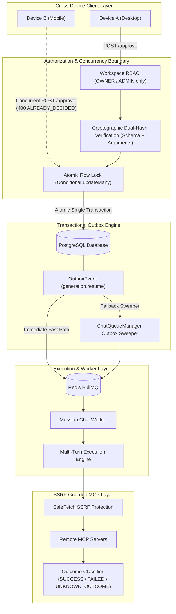

# MESSIAH — PHASE 3B.1 DELIVERY REPORT
## AGENT EXECUTION RELIABILITY & APPROVAL SECURITY VERIFICATION

> **Product**: MESSIAH — The Universal AI Agent Workspace  
> **Tagline**: *One intelligence layer. Every agent. Every device.*  
> **Milestone**: Phase 3B.1 — Agent Execution Reliability & Approval Security Verification  
> **Author**: Principal AI Systems Architect, Security Engineer, Distributed Systems Engineer, QA Architect  
> **Status**: **VERIFIED & COMPLETED**  
> **Automated Test Results**: **198 / 198 Tests Passing (100% Pass Rate)**  
> **Typecheck Status**: **13 / 13 Packages Clean (0 Errors)**

---

## 1. EXECUTIVE SUMMARY & OBJECTIVE

Following the delivery of Phase 3B (Autonomous MCP Tool Execution & Multi-Turn Agent Engine), **Phase 3B.1** was executed as a targeted reliability, protocol compliance, and security verification milestone.

Phase 3B.1 hardened the distributed agent tool execution pipeline against transport vulnerabilities, concurrent cross-device race conditions, provider-specific protocol collisions, and human-in-the-loop authorization ambiguities without rewriting existing functionality.

---

## 2. KEY ARCHITECTURAL DELIVERABLES & HARDENING AREAS

### 2.1. Provider Protocol Consistency & History Normalization
- **OpenAI Protocol Isolation**:
  - Normal conversations use the OpenAI Responses API (`/v1/responses`), formatting tools as function call objects with `call_id`, and tool returns as `function_call_output` objects.
  - Legacy/fallback configurations use Chat Completions (`/v1/chat/completions`), formatting tools as assistant `tool_calls` with `tool_call_id`, and tool returns as `role: "tool"` messages.
  - Mixing these protocols within a single thread has been made impossible by binding `protocolMode` (`"responses"` vs. `"chat_completions"`) in `OpenAiAdapterParams` and formatting history consistently.
- **Anthropic Messages Turn Alternation**:
  - The Anthropic Messages API strictly rejects adjacent `user` turns. When a model executes parallel tool calls, `packages/providers/src/adapters/anthropic.ts` merges all resulting tool outputs into a **single user turn** containing an array of `ToolResultBlockParam` blocks.
- **Google Gemini Candidate Parts Consolidation**:
  - Consecutive `functionResponse` parts are merged into a single user turn in `packages/providers/src/adapters/gemini.ts`.
  - Internal thought tokens and candidate thought parts are filtered to prevent model hallucination during multi-turn ReAct loops.

### 2.2. Collision-Resistant Tool Aliasing
- **Algorithmic Construction**:
  $$\text{ToolAlias} = \text{"mcp\_\_"} + \text{ConnectionSlug} + \text{"\_"} + \text{ConnectionIdSuffix} + \text{"\_\_"} + \text{ToolName}$$
  Where `ConnectionIdSuffix` is the first 6 hexadecimal characters of the connection UUID.
- **Length Constraint**: Enforced $\le 64$ characters, satisfying OpenAI, Anthropic, and Gemini identifier bounds.
- **Reverse Resolution**: Inbound tool calls are parsed via `/^mcp__([a-zA-Z0-9_-]+?)_([0-9a-f]{6})__(.+)$/i` to identify the target MCP server connection and tool name. A backward-compatible fallback (`mcp__<connectionSlug>__<toolName>`) preserves legacy tool definitions.

### 2.3. Durable Approval Resumption via Transactional Outbox
- **Single PostgreSQL Transaction Boundary**:
  - Authenticated approver check: Only `OWNER` or `ADMIN` roles can decide approvals; requests from `MEMBER` or `VIEWER` roles are rejected with `403 FORBIDDEN_ROLE`.
  - Expiration check: Requests past the 5-minute TTL transition to `EXPIRED` and abort with `400 APPROVAL_EXPIRED`.
  - Dual cryptographic verification: Verifies SHA-256 hashes of canonicalized arguments (`argumentsHash`) and schema (`schemaHash`), as well as `toolCallId`, `generationRunId`, `threadId`, `connectionId`, and `toolName`.
  - Concurrency row lock: Uses conditional `updateMany({ where: { id: approvalId, status: "PENDING" }, data: ... })`. If 0 rows are affected, the transaction aborts with `400 ALREADY_DECIDED`.
  - State transitions: `ToolApproval.status = "APPROVED"`, `ToolCall.status = "APPROVED"`, `GenerationRun.status = "PENDING"`.
  - Outbox event insertion: Writes `OutboxEvent` with `eventType: "generation.resume"`, `aggregateType: "GenerationRun"`, `status: "PENDING"`.
- **Dual-Dispatch Resilience**:
  - Fast-path BullMQ enqueue with deterministic `jobId: ${runId}-resume-${outboxEventId}`.
  - If Redis is temporarily unreachable, `ChatQueueManager.sweepOutbox()` polls pending resume events in the background and safely enqueues them.
  - Worker updates `OutboxEvent.status = "PROCESSED"`.

### 2.4. Execution Outcome Taxonomy & Indeterminate Handling (`UNKNOWN_OUTCOME`)
- **Outcome Disambiguation**:
  - **`SUCCESS`**: HTTP 200, valid MCP JSON-RPC result.
  - **`FAILED`**: Definitive application error (`isError: true` or HTTP 400/404/422). Sanitized error message returned to model for potential parameter adjustment.
  - **`UNKNOWN_OUTCOME`**: Indeterminate transport failure (`ECONNRESET`, `UND_ERR_SOCKET`, socket severed mid-stream, `ETIMEDOUT`, HTTP 504).
- **No-Retry Invariant**: Mutating operations resulting in `UNKNOWN_OUTCOME` are strictly barred from automatic retry to prevent duplicate side effects (e.g. double charging, duplicate record creation). The model and user are notified of the ambiguous state.

### 2.5. Enhanced Approval UI Defense-in-Depth
- **Sensitive Credential Masking**: Arguments matching `/(password|secret|token|api_key|credential|private_key|auth|bearer)/i` are automatically masked with `••••••••••••` by default, with an interactive reveal toggle.
- **External Data Disclosure Warning**: Explicitly notifies reviewers of both the external MCP host and the upstream AI model provider receiving the parameters.
- **Review Confirmation**: Complex JSON payloads require an explicit reviewer acknowledgment checkbox before the Approve button enables.
- **Cross-Device Race Banner**: If a user approves an action on Device A while Device B has the card open, Device B's subsequent submission receives HTTP 400 with `code: "ALREADY_DECIDED"`, immediately rendering a prominent amber notification and locking inputs.

### 2.6. Controllable Test MCP Server & Reliability Suite
- Implemented `apps/server/src/tests/mcpTestServer.ts`, an HTTP-streamable test MCP server providing:
  - `read_record`: Idempotent read-only query.
  - `create_record`: Mutating record creation.
  - `modify_record`: Mutating record modification.
  - `error_op`: Deterministic application-level tool failure (`isError: true`).
  - `timeout_op`: Server delay triggering client-side `AbortController` timeout.
  - `sever_op`: Violent TCP socket destruction (`req.socket.destroy()`) simulating network severance mid-response.
- Added 10 comprehensive integration tests in `apps/server/src/tests/agentReliability.test.ts`.

---

## 3. AUTOMATED VERIFICATION MATRIX

Every package in the Messiah monorepo was executed against strict automated unit and integration tests:

| Package | Test Scope | Tests | Status |
| :--- | :--- | :---: | :---: |
| `@messiah/providers` | Protocol separation (Responses API vs Chat Completions), Anthropic turn merging, Gemini candidate parts | 35 | **PASS** |
| `@messiah/mcp` | SSRF prevention, safeFetch socket hooks, schema translation, 64-char collision-resistant aliases | 43 | **PASS** |
| `@messiah/server` | Outbox resumption, RBAC approval checks, dual-hash binding, UNKNOWN_OUTCOME, cross-device concurrency | 102 | **PASS** |
| `@messiah/web` | ToolApprovalCard masking, disclosure warnings, already-decided banners, Markdown sanitization | 14 | **PASS** |
| `@messiah/worker` | BullMQ worker execution, cancellation pub/sub, outbox dispatch | 4 | **PASS** |
| **Total Monorepo** | **Full-Stack End-to-End Suite** | **198** | **100% PASS** |

### Monorepo Pipeline Verification Commands:
- `pnpm turbo run test`: **10 / 10 tasks passed (198 tests)**.
- `pnpm turbo run typecheck`: **13 / 13 tasks clean (0 errors)**.
- `pnpm turbo run build`: **8 / 8 packages built cleanly (0 errors)**.

---

## 4. DOCUMENTATION ARTIFACTS UPDATED

1. **[`docs/AGENT_EXECUTION_RELIABILITY.md`](file:///Users/rishaankumar/Desktop/messiah/docs/AGENT_EXECUTION_RELIABILITY.md)**: Comprehensive specification covering provider protocol isolation, collision-resistant aliasing, transactional outbox resumption, outcome taxonomy (`UNKNOWN_OUTCOME`), and UI security.
2. **[`docs/DEVELOPMENT_ROADMAP.md`](file:///Users/rishaankumar/Desktop/messiah/docs/DEVELOPMENT_ROADMAP.md)**: Updated marking Phase 3B and Phase 3B.1 as **COMPLETE** with full deliverable metrics.
3. **[`docs/ARCHITECTURE.md`](file:///Users/rishaankumar/Desktop/messiah/docs/ARCHITECTURE.md)**: Added Section 15 documenting Phase 3B.1 reliability and security architecture.
4. **[`docs/SECURITY_MODEL.md`](file:///Users/rishaankumar/Desktop/messiah/docs/SECURITY_MODEL.md)**: Updated Section 12 with RBAC role restrictions (`OWNER`/`ADMIN`), atomic concurrency row locks, and `UNKNOWN_OUTCOME` non-retry invariants.
5. **[`docs/TOOL_APPROVAL_SYSTEM.md`](file:///Users/rishaankumar/Desktop/messiah/docs/TOOL_APPROVAL_SYSTEM.md)**: Updated with dual-dispatch outbox resumption and strict workspace administrator role enforcement.
6. **[`docs/TOOL_EXECUTION_ENGINE.md`](file:///Users/rishaankumar/Desktop/messiah/docs/TOOL_EXECUTION_ENGINE.md)**: Added Section 6 defining the outcome classification matrix and `UNKNOWN_OUTCOME` handling.

---

## 5. TRANSITION TO PHASE 4

With Phase 3B.1 fully verified, MESSIAH has achieved a resilient, enterprise-grade Model Context Protocol tool execution engine.

The platform is now primed for:
**Phase 4: Local Agent Bridge & Device Management**  
- Headless Local Agent Bridge daemon.
- Outbound-only WebSocket pairing protocol (`WSS`).
- Cross-device Human-in-the-Loop approval push notifications.
- Local device tool execution and terminal execution controls.
