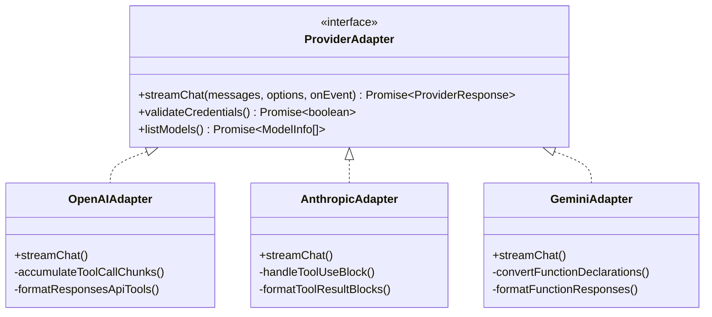
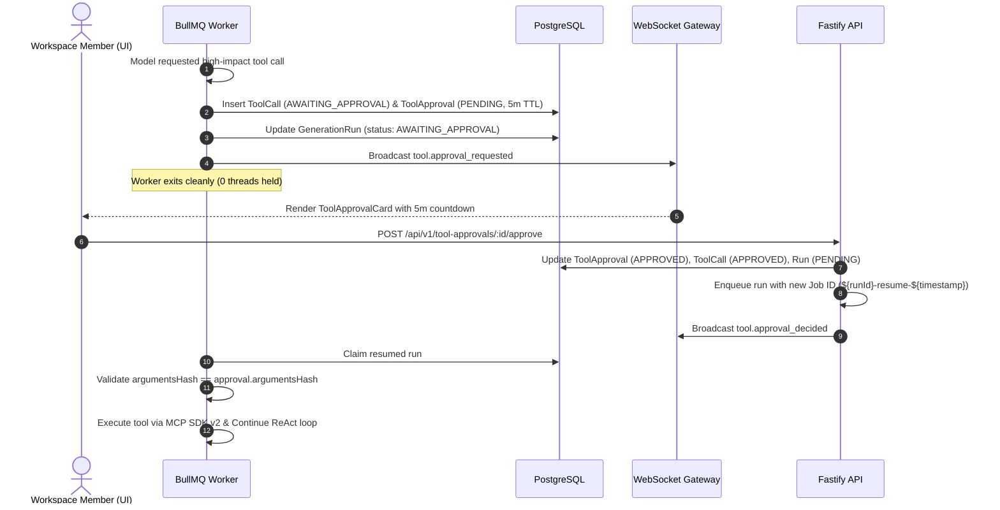

# MESSIAH — PHASE 3B DELIVERY REPORT
## MCP Tool Execution & Controlled Multi-Turn Agent Engine

> **Product**: MESSIAH — The Universal AI Agent Workspace  
> **Tagline**: One intelligence layer. Every agent. Every device.  
> **Milestone**: Phase 3B — MCP Tool Execution & Controlled Multi-Turn Agent Engine  
> **Status**: **COMPLETE & VERIFIED**  
> **Date**: 2026-11-23  

---

## 1. Executive Summary & Objective

In **Phase 3B**, Messiah achieved its most critical agentic capability: enabling frontier AI models (OpenAI, Anthropic Claude, and Google Gemini) to discover, request, and execute Model Context Protocol (MCP) tools within a strictly governed, safe, and auditable multi-turn ReAct loop.

AI models are strictly treated as **untrusted generators of invocation intents**:
- **Zero Direct Execution**: Models never execute tools or access networking primitives directly.
- **Unified Safe Aliasing**: Discovered tools are exposed to models via canonical, sanitized aliases:
  $$\text{Provider Tool Alias} = \texttt{mcp\_\_} + \text{ConnectionSlug} + \texttt{\_\_} + \text{ToolName}$$
- **Deterministic Ajv Validation**: Argument payloads are validated server-side against JSON Schema with a hard 64KB cap, max depth 10, and remote `$ref` rejection.
- **Two-Phase Human Authorization**: High-impact or state-altering actions require cryptographic, single-use human approval with a 5-minute dynamic TTL.
- **Non-Blocking Distributed Orchestration**: BullMQ workers pause without blocking system threads or holding in-memory state, cleanly re-enqueuing when decisions are recorded.
- **Defense-in-Depth Sanitization**: Outputs are clamped to 512KB, scanned for sensitive secrets (Bearer tokens, API keys, private keys), and stripped of dangerous URI schemes before being fed back as `TOOL` role messages.

---

## 2. Component & Implementation Matrix

| Package / App | Core Component | Role in Phase 3B | Test Verification |
|---|---|---|---|
| `packages/db` | Prisma Schema & Migration `5_mcp_tool_execution` | Adds `ToolCall` (`mcp_tool_calls`) and `ToolApproval` (`mcp_tool_approvals`) models, `ToolCallStatus`, `ToolApprovalStatus`, extends `RunStatus` (`AWAITING_APPROVAL`) and `MessageRole` (`SYSTEM`, `TOOL`). | Database migration cleanly applied to PostgreSQL. |
| `packages/providers` | `openai.ts`, `anthropic.ts`, `gemini.ts` | Unified provider tool calling interface (`ProviderToolDefinition`, `ToolCallRequest`, `ToolCallResult`), streaming delta accumulation, tool result feedback. | **31 tests passing** (`packages/providers/src/tests/providers.test.ts`). |
| `packages/mcp` | `canonicalJson.ts`, `toolSchemaValidator.ts`, `toolSchemaTranslator.ts`, `toolResultSanitizer.ts`, `toolAuthorizationService.ts` | Canonical JSON serialization, Ajv JSON Schema validation (64KB/depth 10/remote `$ref` ban), alias generation/parsing, secret redaction, permission policy evaluation. | **42 tests passing** (`packages/mcp/src/tests/mcp.test.ts`). |
| `packages/shared` | `types/index.ts` | Canonical types: `ToolCallInfo`, `ToolApprovalInfo`, `ToolCallStatus`, `ToolApprovalStatus`, `MessiahStreamEventType`. | Built cleanly (CJS, ESM, DTS). |
| `apps/server` | `toolApprovalService.ts`, `toolExecutionService.ts`, `toolExecutionRegistry.ts`, `/api/v1/tool-approvals`, `/api/v1/threads/:id/tool-calls` | Single-use approvals with 5m TTL, lazy expiration, resumption dispatch, workspace RBAC, REST endpoints. | **91 tests passing** across 7 test suites (`apps/server/src/tests/`). |
| `apps/worker` | `worker.ts`, `toolExecutor.ts` | Multi-turn agent ReAct loop (max 6 rounds, max 10 tool calls, repetition guard), MCP SDK v2 execution over `safeFetch`, non-blocking pause on approval. | **4 tests passing** (`apps/worker/src/tests/`). |
| `apps/web` | `ToolApprovalCard.tsx`, `ToolActivityTimeline.tsx`, `ThreadToolSelector.tsx`, `ChatWorkspace.tsx` | Obsidian dark UI: live 5m countdown timer, arguments viewer, approve/deny controls, tool activity accordions, active MCP tool inspector. | **14 tests passing**, Next.js Turbopack production build passing. |

---

## 3. Provider Tool Calling Layer

Frontier AI providers enforce differing schemas, event formats, and payload structures. Messiah normalizes all three providers into a unified contract:



### 1. OpenAI Adapter (`apps/packages/providers/src/adapters/openai.ts`)
- Formats tools as `{ type: "function", function: { name, description, parameters, strict: false } }`.
- Accumulates streaming chunks across `choices[].delta.tool_calls` into completed JSON argument objects.
- Emits `{ type: "tool_call", callId, toolName, arguments }`.
- Injects tool execution outputs into conversation history using `role: "tool"` with matching `tool_call_id`.

### 2. Anthropic Adapter (`apps/packages/providers/src/adapters/anthropic.ts`)
- Formats tools as `{ name, description, input_schema }`.
- Handles `content_block_start` (`type: "tool_use"`), accumulates partial input JSON chunks from `input_json_delta`, and finalizes on `content_block_stop`.
- Emits `{ type: "tool_call", callId, toolName, arguments }`.
- Injects tool execution outputs as user content blocks: `{ type: "tool_result", tool_use_id, content, is_error }`.

### 3. Google Gemini Adapter (`apps/packages/providers/src/adapters/gemini.ts`)
- Normalizes JSON schema types to Gemini uppercase `Type` (`STRING`, `INTEGER`, `OBJECT`, `ARRAY`).
- Configures tools via `functionDeclarations`.
- Extracts `functionCall` candidates and emits `{ type: "tool_call", callId, toolName, arguments }`.
- Injects tool execution outputs as `functionResponse` parts inside `user` turns.

---

## 4. Tool Schema Translation & Pre-Execution Validation

To protect against malicious or corrupt MCP server schemas, `ToolSchemaValidator` and `ToolSchemaTranslator` enforce three strict layers of verification:

1. **Deterministic Canonical JSON Hashing**:
   - `canonicalJson(obj)` sorts keys lexicographically at all nesting depths.
   - Dual SHA-256 hashes:
     $$\text{schemaHash} = \text{SHA-256}(\text{CanonicalJSON}(\text{inputSchema}))$$
     $$\text{argumentsHash} = \text{SHA-256}(\text{CanonicalJSON}(\text{arguments}))$$
2. **Resource Exhaustion Guards**:
   - Maximum Arguments Payload Size: **65,536 bytes (64KB)**.
   - Maximum Nesting Depth: **10 levels**.
   - Remote `$ref` Prohibition: Any schema containing external `$ref` URIs is rejected.
3. **Strict Ajv Compilation**:
   - Compiles schemas using `Ajv` with `allErrors: true` and `coerceTypes: false`.
   - Arguments violating the declared schema fail before touching the network.

---

## 5. Human-in-the-Loop Approval Governance



### Governance Invariants:
1. **Single-Use Enforcement**: Approvals transition atomically from `PENDING` to `APPROVED` or `DENIED`. Re-approving an already decided request throws `ALREADY_DECIDED`.
2. **Role Authorization**: `OWNER` and `ADMIN` can approve or deny all tools. `VIEWER` is strictly rejected with `403 FORBIDDEN_ROLE`.
3. **Dynamic 5-Minute TTL**: Approvals older than 5 minutes automatically transition to `EXPIRED` during evaluation or lazy query sweeping.
4. **Resumed Job Deduplication Bypass**: Resumed runs are enqueued with unique BullMQ job keys (`${run.id}-resume-${Date.now()}`), preventing BullMQ from dropping resumed jobs as completed duplicates.

---

## 6. The Multi-Turn ReAct Agent Loop

The multi-turn agent loop is hosted directly inside `apps/worker/src/worker.ts` and operates under strict defensive bounds:

1. **Max 6 Multi-Turn Rounds**: Hard limit of 6 iterations between model reasoning and tool execution.
2. **Max 10 Tool Calls**: Hard limit of 10 cumulative tool executions per generation run.
3. **Repetition Guard**: Tracks `(toolName, argumentsHash)` within the run. If identical calls occur 3 times consecutively, the loop terminates immediately with `REPETITION_GUARD_TRIGGERED`.
4. **30-Second Execution Timeout**: Every MCP tool execution is governed by an `AbortController` enforcing a 30-second socket timeout.
5. **10-Minute Wall-Clock Run Deadline**: Runs exceeding 10 minutes are aborted to protect worker fleet capacity.

---

## 7. Result Sanitization & Security Posture

Tool execution outputs originate in external environments and are treated as **untrusted data**:

1. **Output Size Clamping**: Truncated to **524,288 bytes (512KB)**.
2. **Automated Secret Redaction**:
   `ToolResultSanitizer` scans outputs for sensitive credential signatures:
   - Bearer / API tokens
   - OpenAI (`sk-...`), Anthropic (`sk-ant-...`), Google API (`AIzaSy...`) keys
   - AWS access keys (`AKIA...`)
   - RSA/EC/PGP Private Key blocks (`-----BEGIN ... PRIVATE KEY-----`)
   Matched secrets are replaced with `[REDACTED_SECRET]`.
3. **Protocol Stripping**:
   `javascript:`, `vbscript:`, and `data:text/html` protocols are stripped from outputs.
4. **Prompt-Injection Defense**:
   Tool outputs are **never** injected into system prompts or developer instructions. They are passed exclusively inside dedicated message roles (`TOOL`).

---

## 8. Web UI Integration (`apps/web`)

The Next.js 16 command center was enhanced with three modular Obsidian dark UI components:

1. **`ToolApprovalCard` (`apps/web/components/tools/ToolApprovalCard.tsx`)**:
   - Displays required human authorization with an amber pulsing badge.
   - Live 5-minute countdown timer (`Expires in 04:32`).
   - Formatted, syntax-highlighted JSON arguments viewer with copy button.
   - Rejection reason input.
   - "Approve Execution" (emerald) and "Deny" (rose) action buttons.
2. **`ToolActivityTimeline` (`apps/web/components/tools/ToolActivityTimeline.tsx`)**:
   - Collapsible timeline embedded under assistant message turns.
   - Status badges: `running` (cyan spinner), `approval required` (amber), `done (42ms)` (emerald), `failed` (rose).
   - Expandable drawers for inspecting inputs and sanitized output results.
3. **`ThreadToolSelector` (`apps/web/components/tools/ThreadToolSelector.tsx`)**:
   - Header badge displaying available MCP tools for the workspace.
   - Dropdown listing connected servers and discovered tools with their permission modes (`Disabled`, `Approval`, `Read-Only`, `Authorized`).
   - Direct link to MCP Connection Settings.

---

## 9. Comprehensive Monorepo Verification

Every package and application was verified via TypeScript compiler checks, production builds, and automated unit/integration test suites:

```bash
# Production Builds
pnpm turbo run build
# Result: 8 successful, 0 failed (including @messiah/web Next.js Turbopack production build)

# Typechecks
pnpm turbo run typecheck
# Result: 13 successful, 0 failed (0 TypeScript errors across monorepo)

# Test Suites
pnpm turbo run test
# Result: 182 passing tests across 5 test suites
```

### Detailed Test Suite Breakdown:
1. **`@messiah/providers`**: **31 tests passed**
   - Registry operations, capability declarations, OpenAI Responses API streaming, Anthropic Messages API tool_use, Gemini functionDeclarations & functionResponse.
2. **`@messiah/mcp`**: **42 tests passed**
   - SSRF validation, IPv4/IPv6 blocklists, DNS pinning, Ajv 64KB/depth 10 validation, remote `$ref` rejection, canonical JSON hashing, secret redaction, dangerous protocol stripping, permission policy evaluation.
3. **`@messiah/server`**: **91 tests passed** (across 7 files)
   - Single active run concurrency (partial unique index), SHA-256 request fingerprinting, cross-worker cancellation, transactional outbox sweeper, MCP connection endpoints, tool approvals lifecycle (single-use, 5m TTL, OWNER approval, VIEWER 403 rejection), startup reconciliation.
4. **`@messiah/web`**: **14 tests passed**
   - Markdown URL protocol allowlist (`isSafeUrl`), raw HTML escaping, reverse tabnabbing, `ToolCallInfo` lifecycle modeling, 5-minute approval expiration calculations.
5. **`@messiah/worker`**: **4 tests passed**
   - Multi-turn ReAct orchestration, repetition guard detection, tool result message persistence.

---

## 10. Scope Boundaries & Phase 4 Handoff

In strict compliance with architectural constraints:
- **Phase 3B Scope Only**: MCP tool execution, approval governance, multi-turn agent loop.
- **Strictly Deferred to Future Phases**:
  - **Phase 4**: Local Agent Bridge daemon, outbound pairing protocol, host filesystem/terminal execution.
  - **Phase 5**: Multi-agent swarms, 3D WebGL constellation graph.
  - **Phase 6**: Vector memory (`pgvector`), workflow automation DAGs.
  - **Phase 7**: Native desktop/mobile apps (Tauri / Capacitor).

Messiah's intelligence layer is now fully equipped with safe, auditable, and resilient MCP tool execution across all supported AI models.
