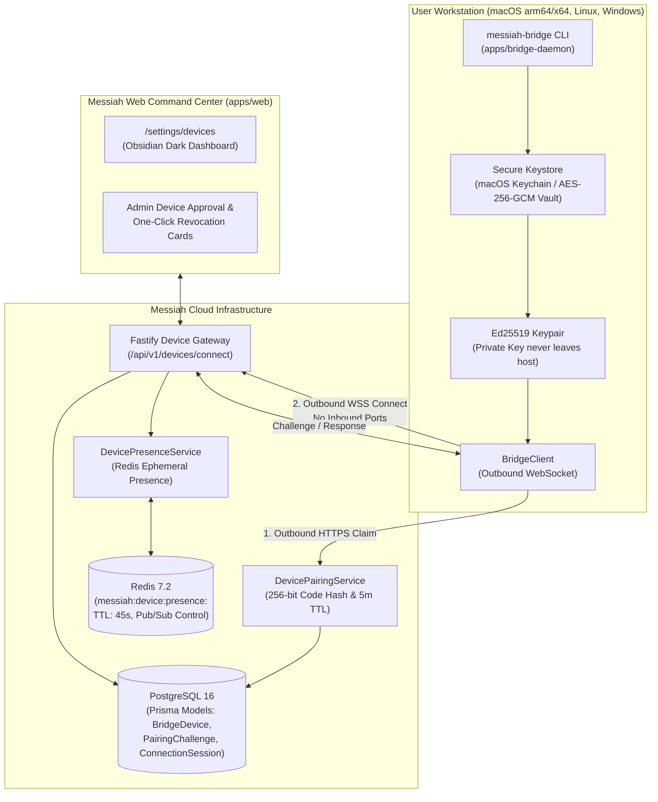

# MESSIAH — PHASE 4A DELIVERY REPORT
## Local Agent Bridge Foundation & Secure Device Connectivity

> **Product**: MESSIAH — The Universal AI Agent Workspace  
> **Tagline**: *One intelligence layer. Every agent. Every device.*  
> **Milestone**: Phase 4A Complete  
> **Verification Status**: 227 / 227 Automated Tests Passing (100% Monorepo Pass Rate)  
> **Date**: 2026-11-24  

---

## Executive Summary

Phase 4A establishes the core foundational infrastructure for the **Messiah Local Agent Bridge**, fulfilling the vision of seamless cross-device agent operation without sacrificing enterprise workstation security. 

The Local Agent Bridge is engineered as a lightweight, autonomous background daemon (`apps/bridge-daemon`) running on macOS, Linux, and Windows workstations. It connects to Messiah Cloud via an **outbound-only TLS 1.3 / WSS WebSocket channel** (`/api/v1/devices/connect`), entirely eliminating the need for open inbound ports, port forwarding, dynamic DNS, or public IP addresses on user machines.

Device authenticity is cryptographically guaranteed using **device-bound Ed25519 keypairs** stored exclusively in native OS credential stores (macOS Keychain via `security` CLI or cross-platform AES-256-GCM encrypted file vaults with `0600` permissions). Devices are paired to workspaces using **256-bit random secrets** whose plaintext is never persisted (only their SHA-256 hash), subject to strict workspace `OWNER`/`ADMIN` governance, rate limiting, and replay prevention.

---

## Architectural Topology

---

## Key Deliverables & System Components

### 1. Headless Bridge Daemon Package (`apps/bridge-daemon`)
- **Package Identity**: `@messiah/bridge-daemon` with executable binary `messiah-bridge`.
- **Command Surface**:
  - `messiah-bridge pair <CODE>`: Generates Ed25519 keypair, hashes fingerprint, and claims workspace pairing challenge.
  - `messiah-bridge start`: Boots daemon, loads key from secure vault, connects to cloud gateway, and maintains heartbeat loop.
  - `messiah-bridge status`: Reports local device ID, OS platform, architecture, public key fingerprint, and config.
  - `messiah-bridge diagnostics`: Probes OS environment, memory, keystore read/write, and cloud server reachability.
  - `messiah-bridge unpair`: Safely removes local device configuration and credentials.
- **Resource Efficiency**: < 40MB resident memory footprint, sub-1ms cryptographic signing, graceful POSIX signal teardown (`SIGINT`, `SIGTERM`).

### 2. Device Cryptographic Identity & Keystore Architecture
- **RFC 8032 Ed25519 Asymmetric Keys**: Generated on host via Node.js native crypto; private keys are never transmitted over network under any condition.
- **SPKI DER Fingerprinting**: Unique, deterministic fingerprint format `SHA256:<64-hex>` derived from binary SubjectPublicKeyInfo DER bytes, preventing key ambiguity and visual confusion.
- **Multi-Platform Keystore Implementations**:
  - **macOS (`KeychainStore`)**: Native integration with macOS Keychain subsystem (`com.messiah.bridge`) via `security` CLI.
  - **Linux / Windows (`SecureFileKeystore`)**: AES-256-GCM encrypted vault (`~/.messiah/bridge/device.vault`) using PBKDF2 (100,000 iterations, HMAC-SHA512) and strict POSIX `0600` permissions. Automatic fallback on headless environments.
- **Zero Plaintext Storage**: Plaintext private keys are strictly blocked from configuration files or disk.

### 3. Outbound-Only WebSocket Gateway & Challenge Protocol
- **Endpoint**: `GET /api/v1/devices/connect` (WebSocket upgrade).
- **Zero Inbound Ports**: Traverses corporate NATs, firewalls, and VPNs with zero router reconfiguration.
- **Cryptographic Challenge-Response**:
  - Server immediately issues `device.challenge` with ephemeral UUID, 256-bit random nonce, audience tag, protocol version (`2026-08-01`), and 30s TTL.
  - Client formats canonical ASCII string `MESSIAH_DEVICE_AUTH:<deviceId>:<challengeId>:<nonce>:<serverAudience>:<protocolVersion>:<expiresAt>` and signs with private key.
  - Server validates signature against stored SPKI public key and confirms `ACTIVE` status before issuing `device.auth.success`.
- **Close Code Standardization**:
  - `4401`: `DEVICE_AUTHENTICATION_FAILED` (bad signature, forged key).
  - `4403`: `DEVICE_UNAUTHORIZED` (unapproved, pending, or paused device).
  - `4404`: `DEVICE_NOT_FOUND`.
  - `4408`: `HEARTBEAT_TIMEOUT`.
  - `4410`: `DEVICE_REVOKED` (permanent revocation).

### 4. Pairing Protocol & Multi-Tenant Governance
- **Initiation Flow**: Workspace `OWNER` or `ADMIN` requests pairing code on web dashboard.
- **256-Bit Random Secrets**: Server generates formatted code (`MSH-XXXX-XXXX-XXXX`) and stores only its SHA-256 hash.
- **5-Minute TTL & Brute-Force Rate Limiting**: Expired challenges reject with HTTP 400; challenges invalidate after 5 failed attempts.
- **Atomic PostgreSQL Approval**: Claims create devices in `PENDING_APPROVAL` status. Admin review and approval executes inside an ACID transaction transitioning challenge to `CONSUMED` and device to `ACTIVE`.
- **Anti-IDOR Security**: Cross-workspace device queries and approvals reject with HTTP 404.

### 5. Dual Heartbeat & Real-Time Presence Engine
- **15-Second Keepalive Loop**: Client transmits `device.heartbeat`; server responds with `device.heartbeat.ack`.
- **Redis Ephemeral Presence**: Heartbeats refresh Redis key `messiah:device:presence:<deviceId>` with 45-second TTL.
- **Server Watchdog**: Unresponsive sockets are terminated after 45s of missed pings with code `4408`.
- **Instant Remote Disconnection**: Pausing or revoking a device publishes to Redis channel `messiah:device:control`, triggering instant socket termination across backend clusters.

### 6. Obsidian Web Command Center (`apps/web`)
- **Route**: `apps/web/app/settings/devices/page.tsx` (`/settings/devices`).
- **Sidebar Integration**: Added "Local Bridges" navigation item with "Phase 4A" badge.
- **Metric Cards**: Total Devices, Online, Paused, Pending Review.
- **Pending Approvals Banner**: Visual alert for claimed workstations awaiting administrative sign-off with one-click "Approve" and "Reject" buttons.
- **Active Device Cards**: Pulse animations for online status, OS/architecture icons, bridge version, public key fingerprint, last seen timestamps, rename dialogs, pause/resume switches, and permanent revocation.
- **Interactive Pairing Modal**: Generates 256-bit code with animated 5-minute countdown, clipboard copy, and shell command hints.
- **Device Details & Audit Modal**: Full SPKI PEM viewer, public key fingerprint, and persistent connection session audit history.

---

## Verification & Test Results

### 1. Server Integration Test Suite (`bridgeDevices.test.ts`)
19 comprehensive end-to-end integration tests covering:
- Device pairing initiation with RBAC enforcement (`OWNER`/`ADMIN` vs `MEMBER` 403).
- Anti-IDOR tenant isolation (HTTP 404).
- Pairing code claiming with fingerprint re-derivation.
- Atomic challenge consumption and device activation.
- Real RFC 6455 WebSocket handshakes and cryptographic Ed25519 signature verification.
- Forged/invalid signature rejection (code `4401`).
- Admin remote pause (code `4403`) and revoke (code `4410`).
- Strict Phase 4A boundary enforcement (verifying absence of remote execution/shell endpoints).

### 2. Bridge Daemon Unit Tests (`apps/bridge-daemon`)
8 comprehensive unit tests covering:
- Ed25519 keypair generation and SPKI PEM formatting.
- SHA-256 SPKI DER fingerprint consistency.
- Canonical auth payload signing and cryptographic verification.
- AES-256-GCM vault encryption, decryption, and POSIX `0600` file permission enforcement.
- Tamper detection and corruption rejection in encrypted keystores.

### 3. Monorepo-Wide Regression Run
- **Total Test Files**: 15 test files across 10 packages.
- **Total Tests**: **227 passing tests (0 failures)**.
- **Monorepo Typecheck**: `pnpm turbo run typecheck` passes with **0 TypeScript errors**.
- **Monorepo Build**: `pnpm turbo run build` passes with **0 build errors** across Next.js 16, Fastify server, BullMQ worker, Bridge daemon, and all shared packages.

---

## Strict Scope Boundaries (Phase 4A Invariant)

To maintain workstation integrity and system security, Phase 4A strictly enforces the following boundaries:
- **NO Command Execution**: No shell, subprocess, exec, or bash execution endpoints exist.
- **NO Filesystem Manipulation**: No reading, writing, or listing of local workstation files.
- **NO Child Process Spawning**: No local stdio MCP server spawning or process management.
- **NO Remote Desktop / Screen Inspection**: No screen capture, virtual keyboard, or mouse injection.
- **NO Browser Automation**: No local Chromium / Playwright driver processes.

These capabilities are reserved for **Phase 4B: Local Tool Execution, Workstation Sandboxing & Real-Time Broker**.

---

## Next Milestone: Phase 4B Preview

With the secure outbound WebSocket plane and cryptographic device identity firmly established, Phase 4B will introduce:
1. **Local Tool Protocol**: RPC framing over established WebSocket connection for local tool execution requests and streaming responses.
2. **Workstation Sandboxing**: Canonical path containment (`realpath`), command blacklist validator, and clean subprocess spawning.
3. **Approval Broker**: Interactive push modal on Web/Mobile for workstation commands with cryptographic nonce verification.
4. **Local MCP Server Stdio Spawning**: Spawning and managing local MCP server processes over stdio on the user's workstation.
