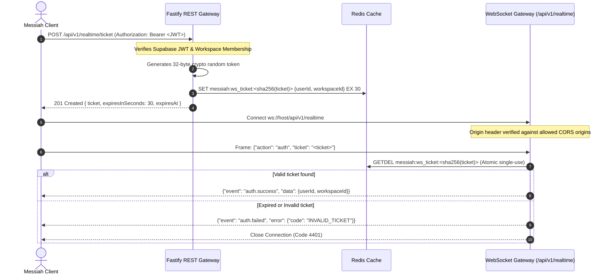

# MESSIAH — Realtime Streaming Protocol Specification

## 1. Overview

The **MESSIAH Realtime Streaming Protocol** is a lightweight, bidirectional WebSocket protocol designed for cross-platform client updates, real-time LLM token streaming, run cancellation, and thread synchronization.

All real-time communication between Messiah clients (Web, macOS, iOS, Android, Linux, Windows) and the Messiah Gateway (`apps/server`) adheres strictly to this protocol.

---

## 2. Authentication Flow: Single-Use Tickets

WebSockets cannot safely transmit long-lived JWTs in URL query parameters, as URLs are routinely recorded in browser histories, HTTP proxy logs, and gateway access logs.

Messiah enforces a **Two-Stage Ticket Authentication Architecture**:



### Ticket Security Guarantees:
1. **Single-Use**: Tickets are consumed atomically via Redis `GETDEL` (or atomic local map removal). A ticket cannot be replayed.
2. **Short-Lived**: Tickets expire after 30 seconds if unused.
3. **SHA-256 Hashed**: Only SHA-256 hashes of tickets are stored in cache, never plaintext.
4. **Auth Timeout Guard**: Clients must issue the `auth` frame within 10 seconds of establishing the WebSocket connection; otherwise, the connection is closed with code 4408 (`Auth Timeout`).

---

## 3. Client Frames

Clients send JSON frames conforming to `WebSocketClientFrameSchema`:

```typescript
export interface WebSocketClientFrame {
  action: "auth" | "thread.subscribe" | "thread.unsubscribe" | "ping";
  ticket?: string;
  threadId?: string;
}
```

### Action Types

#### `auth`
Authenticates the socket connection using a single-use ticket.
```json
{
  "action": "auth",
  "ticket": "c3e80ab269fc9648c668ad7300c..."
}
```

#### `thread.subscribe`
Subscribes the socket to streaming events and updates for a specific conversation thread. Requires workspace membership.
```json
{
  "action": "thread.subscribe",
  "threadId": "9b1deb4d-3b7d-4bad-9bdd-2b0d7b3dcb6d"
}
```

#### `thread.unsubscribe`
Unsubscribes from an active thread channel without disconnecting the socket.
```json
{
  "action": "thread.unsubscribe",
  "threadId": "9b1deb4d-3b7d-4bad-9bdd-2b0d7b3dcb6d"
}
```

#### `ping`
Client heartbeat frame to keep the socket alive. The server immediately replies with `pong`.
```json
{
  "action": "ping"
}
```

---

## 4. Server Frames

Server frames follow a standardized structure:

```json
{
  "event": "message.delta",
  "data": { "delta": "The universal " },
  "error": null,
  "threadId": "9b1deb4d-3b7d-4bad-9bdd-2b0d7b3dcb6d",
  "timestamp": "2026-11-21T14:00:00.000Z"
}
```

### Server Event Catalog

| Event Name | Description | Payload Data Structure |
| :--- | :--- | :--- |
| `auth.success` | Authentication successful | `{ "userId": "...", "workspaceId": "..." }` |
| `auth.failed` | Ticket invalid, expired, or timed out | Error object (`INVALID_TICKET`, `AUTH_TIMEOUT`) |
| `thread.snapshot` | Initial snapshot emitted upon subscription | `{ "thread": ThreadInfo, "messages": MessageInfo[], "activeRun": GenerationRunInfo \| null }` |
| `run.started` | AI generation run started on thread | `{ "status": "STREAMING" }` |
| `message.delta` | Live text token chunk delivered | `{ "delta": "word " }` |
| `message.snapshot` | Intermediate content sync checkpoint | `{ "content": "Full accumulated content..." }` |
| `usage.updated` | Real-time token consumption metrics | `{ "inputTokens": 120, "outputTokens": 45, "cachedTokens": 0 }` |
| `run.completed` | Run finalized successfully | `{ "status": "COMPLETED", "finishReason": "stop" }` |
| `run.failed` | Run terminated with provider error | `{ "status": "FAILED", "error": { "code": "...", "message": "..." } }` |
| `run.cancelled` | Run stopped by client cancellation | `{ "status": "CANCELLED", "reason": "User requested" }` |
| `pong` | Server heartbeat reply | Empty data |
| `error` | General socket protocol or validation error | Error object (`INVALID_FRAME`, `FORBIDDEN`, etc.) |

---

## 5. Reconnection & Snapshot Reconciliation

When a mobile or web client experiences network disruption:
1. The client detects socket closure and triggers exponential backoff reconnection.
2. Upon reconnecting, the client requests a new single-use ticket via REST API.
3. The client submits the `auth` frame and re-subscribes with `thread.subscribe`.
4. The server automatically transmits `thread.snapshot`, including any messages completed during the disconnect window and the current in-flight `activeRun`.
5. The client reconciles local UI state with the snapshot without full page reloads.

---

## 6. Origin Security & Cross-Worker Coordination (Phase 2B.1)

### 6.1 Origin Validation Policy
To protect against Cross-Site WebSocket Hijacking (CSWSH), WebSocket upgrades enforce environment-specific Origin checks:
- **Development/Test**: Accepts origins matching `CORS_ORIGIN`, `localhost`, and `127.0.0.1`.
- **Production (`NODE_ENV === "production"`)**: Strictly checks against the comma-separated `MESSIAH_ALLOWED_ORIGINS` environment variable. Localhost and loopback origins are never auto-trusted.
- Sockets with invalid or missing Origin headers are rejected with RFC-compliant closure code `4403` (`Forbidden Origin`).

### 6.2 Cross-Worker Cancellation Protocol
In a distributed deployment with multiple worker nodes:
- When a client issues `POST /api/v1/generation-runs/:runId/cancel`, the API updates PostgreSQL and publishes to Redis channel `messiah:cancel:<runId>`.
- The worker holding the active connection intercepts the channel notification and triggers `AbortController.abort()`, terminating LLM generation across process boundaries.

