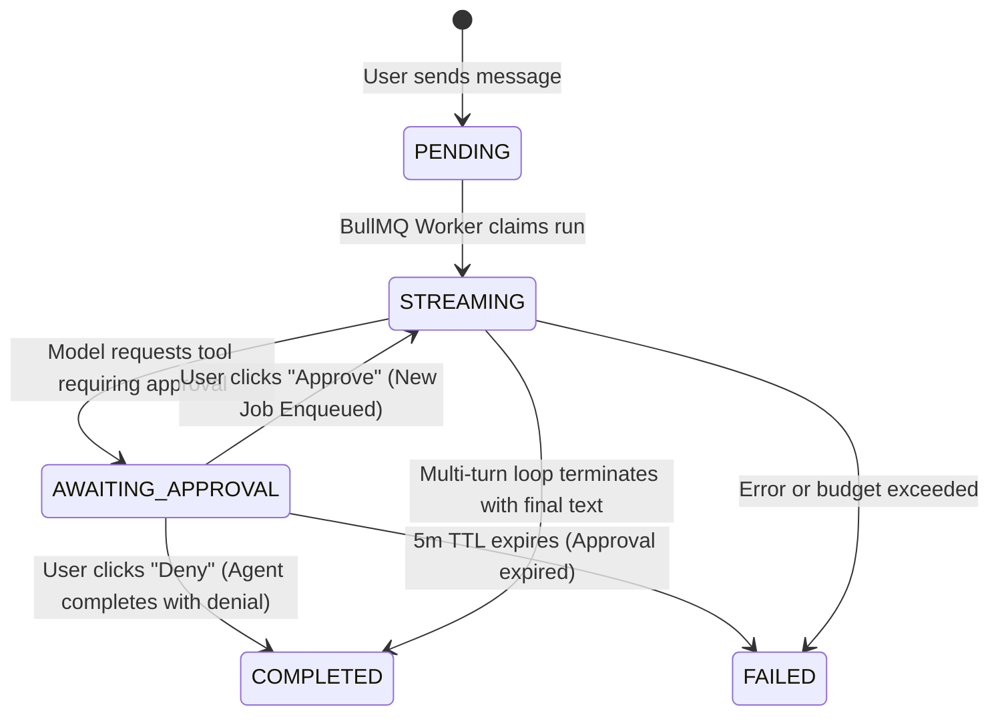

# MESSIAH — Tool Approval System & Human-in-the-Loop Governance

## 1. Overview

Autonomous agents operating on sensitive infrastructure present catastrophic risk if permitted unbounded execution. The **MESSIAH Tool Approval System** guarantees that sensitive, state-altering, or financial MCP tool calls undergo mandatory human review.

Key Principles:
1. **Zero Silent Execution**: Actions altering external state or deemed high-impact cannot execute without explicit confirmation.
2. **Cryptographic Binding**: Approvals are bound to SHA-256 hashes of the exact tool schema and canonicalized arguments. Arguments cannot be tampered with between authorization and execution.
3. **Single-Use Enforcement**: Every approval token can be redeemed exactly once.
4. **Time-To-Live (5m TTL)**: Approvals automatically expire after 5 minutes (300 seconds).
5. **Non-Blocking Architecture**: When awaiting approval, BullMQ workers transition the run to `AWAITING_APPROVAL` and exit immediately. Workers never sleep, block threads, or hold memory resources while waiting for humans.

---

## 2. Permission Modes & Role-Based Access Control

Messiah defines four distinct tool permission modes configured per tool definition:

| Permission Mode | Default Behavior | High-Impact Override | Human Confirmation |
|---|---|---|---|
| `DISABLED` | Execution rejected immediately with `403 Forbidden`. | Always rejected. | N/A |
| `REQUIRE_APPROVAL` | Prompts human for authorization. | Always prompts. | Required per invocation (5m TTL) |
| `READ_ONLY` | Auto-executed without prompt if verified read-only. | If high-impact regex matches, forces prompt. | None for safe reads |
| `EXPLICITLY_AUTHORIZED` | Auto-executed without prompt for standard actions. | **Always forces prompt** if classified high-impact. | Only for high-impact actions |

### Workspace Role Enforcement
Only authenticated workspace administrators may decide tool approvals:
- `OWNER`: Full approval and denial authority.
- `ADMIN`: Full approval and denial authority.
- `MEMBER`: **Forbidden** from approving or denying tool executions (`403 FORBIDDEN_ROLE`).
- `VIEWER`: **Strictly forbidden** from approving or denying tool executions (`403 FORBIDDEN_ROLE`).

### Automatic High-Impact Classification
Even under `EXPLICITLY_AUTHORIZED` mode, tools matching high-impact keywords are intercepted by `ToolAuthorizationService` and forced into `AWAITING_APPROVAL`:
- Mutative operations: `delete`, `drop`, `truncate`, `destroy`, `purge`, `remove`
- Financial/Billing: `pay`, `purchase`, `transfer`, `charge`, `billing`
- Privilege escalation: `grant`, `revoke`, `role`, `sudo`, `permission`, `credential`
- Sensitive deployment: `deploy`, `publish`, `release`, `restart`, `reboot`, `exec`, `shell`

---

## 3. Cryptographic Argument & Schema Hashing

To prevent Time-of-Check to Time-of-Use (TOCTOU) race conditions, approval records enforce dual SHA-256 cryptographic hashes:

1. **Schema Hash**:
   $$\text{schemaHash} = \text{SHA-256}(\text{CanonicalJSON}(\text{inputSchema}))$$
2. **Arguments Hash**:
   $$\text{argumentsHash} = \text{SHA-256}(\text{CanonicalJSON}(\text{arguments}))$$

`canonicalJson` ensures keys are sorted lexicographically at all nesting levels and numbers/strings are normalized, ensuring identical semantic payloads produce identical hashes regardless of formatting.

When the worker resumes execution following approval, it re-hashes the stored arguments and validates:
$$\text{RecomputedHash} \stackrel{?}{=} \text{ToolApproval.argumentsHash}$$
If a mismatch is detected, execution aborts with `ARGUMENTS_MODIFIED_AFTER_APPROVAL`.

---

## 4. Non-Blocking Worker Lifecycle & Resume Dispatch

Traditional agent engines block execution threads (e.g. `await getUserApproval()`) while waiting for human input, exhausting worker threadpools.

Messiah implements an asynchronous, event-driven state machine:

### Resume Protocol:
1. When approval is required, the worker writes:
   - `ToolCall` record with `status: "AWAITING_APPROVAL"`.
   - `ToolApproval` record with `status: "PENDING"`, `expiresAt: now() + 5m`.
   - Updates `GenerationRun` to `status: "AWAITING_APPROVAL"`.
   - Publishes WebSocket event `tool.approval_requested`.
   - **BullMQ worker job completes cleanly with return value `{ awaitingApproval: true }`**.
2. The user sees the `ToolApprovalCard` in the UI with a live countdown timer.
3. Upon clicking "Approve":
   - Server executes a single atomic database transaction:
     - Rechecks approver role (`OWNER` or `ADMIN`).
     - Validates context bindings (`toolCallId`, `generationRunId`, `threadId`, `connectionId`, `toolName`).
     - Verifies cryptographic `schemaHash` and `argumentsHash`.
     - Acquires an exclusive row lock via conditional `updateMany({ where: { id: approvalId, status: "PENDING" } })`; if 0 rows matched, aborts with 400 `ALREADY_DECIDED`.
     - Marks `ToolApproval` as `APPROVED`, `ToolCall` as `APPROVED`, and `GenerationRun` as `PENDING`.
     - Inserts a durable `OutboxEvent` with `eventType: "generation.resume"`, `aggregateType: "GenerationRun"`, `aggregateId: runId`.
   - The transaction commits atomically.
   - Dual-dispatch: fast-path BullMQ enqueue with deterministic `jobId: ${runId}-resume-${outboxEventId}`. If Redis drops connection, background `sweepOutbox()` cron picks it up and guarantees at-least-once resumption.
   - Realtime event `tool.approval_decided` is broadcast to workspace clients.
4. Worker picks up the resumed job, inspects the thread's approved tool call, executes the tool over SSRF-protected `safeFetch`, and continues the multi-turn agent loop.
